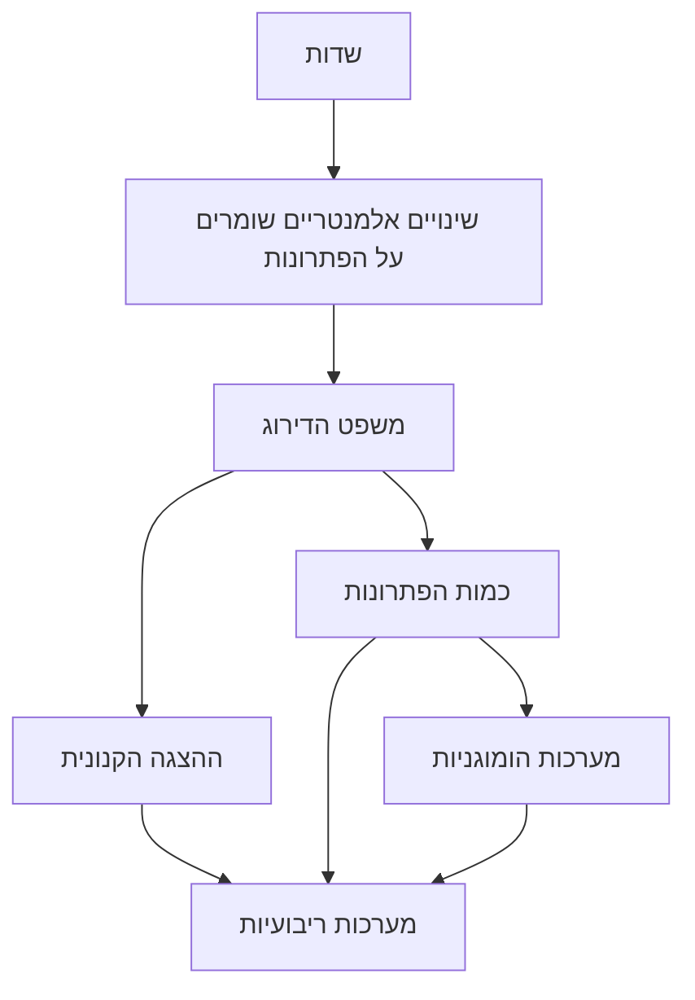

# אלגברה לינארית 1 - מפת הקורס

> הפתקים נכתבו במילים שלנו ומפנים לסעיפים בספרי הקורס 20109 של האוניברסיטה הפתוחה (מהדורה שנייה). מספרי ההגדרות והמשפטים תואמים לספר. כדאי ללמוד עם הספר ביד: הפתקים לא באים במקומו.

## כלי למידה

- [[משפטי מפתח - לינארית 1]]: המשפטים המרכזיים עם הוכחה מלאה. זו לא רשימה רשמית.
- [[כרטיסי חזרה - לינארית 1]]: שאלות קצרות לחזרה.

## חוט השדרה של פרק 1

## כרך א

### פרק 1: מערכות משוואות לינאריות

- [[שער פרק 1]]
- [[פעולות על קבוצה]]
- [[שדות]]
- [[ה-n-יות]]
- [[משוואות לינאריות]]
- [[מערכות לינאריות ומטריצת המקדמים]]
- [[שקילות ופעולות אלמנטריות]]
- [[שיטת החילוץ]]
- [[מטריצות מדרגות ומשפט הדירוג]]
- [[ההצגה הקנונית]]
- [[כמות הפתרונות]]
- [[מערכות הומוגניות]]
- [[מערכות מסדר n על n]]

### פרק 2: המרחב $F^n$

- [[שער-פרק-2|שער פרק 2]]
- [[2.1-המרחב-Fn-מבט-אלגברי]]
- [[2.2-R2-R3-מבט-גיאומטרי]]
- [[2.3-הצגות-פרמטריות]]
- [[2.4-המרחב-Fn]]
- [[2.5-צירופים-לינאריים]]
- [[2.6-תלות-לינארית]]
- [[2.7-בסיסים-ל-Fn]]
- [[מתכוני-עבודה-פרק-2]]

### פרק 3: מטריצות

- [[שער-פרק-3|שער פרק 3]]
- [[3.1-סימון-מטריצות]]
- [[3.2-שורות-ועמודות]]
- [[3.3-חיבור-וכפל-בסקלר]]
- [[3.4-כפל-מטריצות]]
- [[3.5-תכונות-הכפל]]
- [[3.6-מטריצות-ריבועיות]]
- [[3.7-כתיב-וקטורי]]
- [[3.8-מטריצות-הפיכות]]
- [[3.9-מטריצות-אלמנטריות]]
- [[3.10-אפיונים-של-הפיכות]]
- [[מתכוני-עבודה-פרק-3]]

פרק 4 יתווסף בהמשך.
