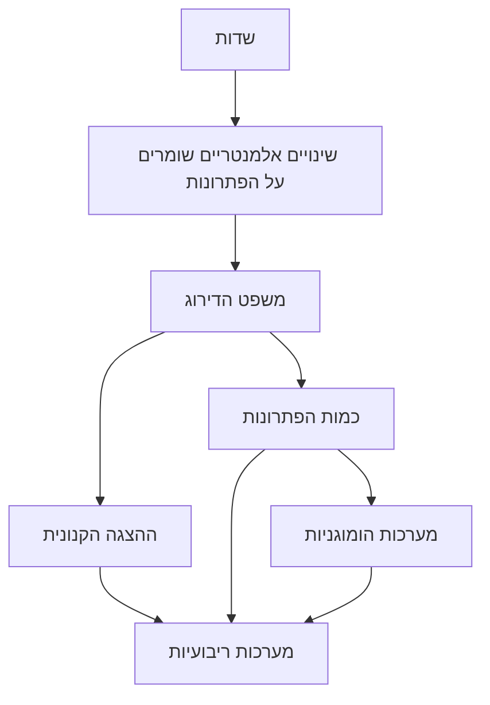

# אלגברה לינארית 1 - מפת הקורס

> הפתקים נכתבו במילים שלנו ומפנים לסעיפים בספרי הקורס 20109 של האוניברסיטה הפתוחה (מהדורה שנייה). מספרי ההגדרות והמשפטים תואמים לספר. כדאי ללמוד עם הספר ביד: הפתקים לא באים במקומו.

## כלי למידה

- [[משפטי מפתח - לינארית 1]]: המשפטים המרכזיים עם הוכחה מלאה. זו לא רשימה רשמית.
- [[כרטיסי חזרה - לינארית 1]]: שאלות קצרות לחזרה.

## חוט השדרה של פרק 1

## כרך א

### פרק 1: מערכות משוואות לינאריות

- [[שער פרק 1]]
- [[פעולות על קבוצה]]
- [[שדות]]
- [[ה-n-יות]]
- [[משוואות לינאריות]]
- [[מערכות לינאריות ומטריצת המקדמים]]
- [[שקילות ופעולות אלמנטריות]]
- [[שיטת החילוץ]]
- [[מטריצות מדרגות ומשפט הדירוג]]
- [[ההצגה הקנונית]]
- [[כמות הפתרונות]]
- [[מערכות הומוגניות]]
- [[מערכות מסדר n על n]]

פרקים 2–4 יתווספו אחרי פרק 1.
