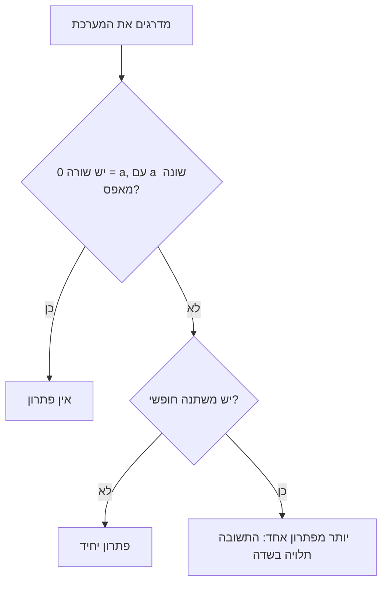

# כמות הפתרונות

> מקור: כרך א, סעיף 1.12 (משפטים 1.12.1, 1.12.2; מסקנה 1.12.3)

## למה צריך את זה

אחרי הדירוג אפשר לדעת כמה פתרונות יש למערכת, בלי לפתור אותה. מסתכלים על צורת המדרגות, ושואלים שתי שאלות: יש שורה שאומרת $0=a$? יש משתנה חופשי?

## משפט 1.12.1: בוחן לעקביות

תהי נתונה מערכת לינארית **מדורגת** מעל שדה $F$. המערכת עקבית אם ורק אם במטריצה שלה אין שורה מהצורה

$$[0,\dots,0,a],\qquad a\ne0$$

כלומר, אם ורק אם אין שורה שהאיבר הפותח שלה נמצא בעמודה האחרונה.

> [!simple]- במילים פשוטות: שורה אחת הורסת הכול
> **בשורה אחת**: שורה כזו אומרת $0=a$, וזה לא נכון אף פעם. אם אין שורה כזו, תמיד אפשר לבנות פתרון.
>
> **עם מספרים**: המערכת הראשונה בלתי עקבית, והשנייה עקבית:
>
> $$\left[\begin{array}{cc|c}1&2&3\\0&1&4\\0&0&5\end{array}\right]\qquad\left[\begin{array}{cc|c}1&2&3\\0&1&4\\0&0&0\end{array}\right]$$
>
> **מה נשבר אם המערכת לא מדורגת**: המערכת $x+y=1,\ x+y=2$ בלתי עקבית, אף שאין בה שורה כזו. הבוחן עובד רק אחרי הדירוג.

> [!plan]
> כיוון אחד מיידי: שורה כזו היא משוואה שאין לה פתרון. בכיוון השני בונים פתרון: מציבים ערכים במשתנים החופשיים, ומחשבים את הקשורים מלמטה למעלה. זה עובד כי בכל שורה יש איבר פותח של משתנה, ומותר לחלק בו.

### הוכחה

<!-- infi-proof: 1.12.1 -->

נניח שיש שורה כזו. היא מייצגת את המשוואה $0x_1+\dots+0x_n=a$ עם $a\ne0$. אף $n$-יה לא פותרת אותה, ולכן המערכת בלתי עקבית.

בכיוון השני, נניח שאין שורה כזו. אז לכל שורה שאינה שורת אפס יש איבר פותח בעמודה של משתנה.

נציב במשתנים החופשיים (הגדרה 1.10.4) ערכים כלשהם.

נעבור על השורות שאינן שורות אפס מלמטה למעלה. בכל שורה, כל המשתנים שמימין למשתנה הקשור שלה כבר קיבלו ערך, כי במטריצת מדרגות האיברים הפותחים של השורות שמתחתיה נמצאים מימינו.

לכן המשוואה נראית כך: $c\,x_j=d$, כאשר $c\ne0$ הוא האיבר הפותח ו-$d$ כבר ידוע. בשדה יש ל-$c$ הופכי, ומכאן $x_j=c^{-1}d$.

בסוף כל המשוואות מתקיימות, ושורות האפס מתקיימות תמיד. לכן מצאנו פתרון, והמערכת עקבית. ∎

<!-- /infi-proof -->

## משפט 1.12.2: כמות הפתרונות של מערכת מדורגת

תהי נתונה מערכת לינארית מדורגת מעל שדה $F$, ונניח שהיא **עקבית**.

- (א) אם כל המשתנים קשורים, למערכת יש פתרון יחיד.
- (ב) אם יש לפחות משתנה חופשי אחד, למערכת יש יותר מפתרון אחד. במקרה זה:
  - אם $F$ אינסופי, יש אינסוף פתרונות.
  - אם $F$ סופי, מספר הפתרונות שווה למספר האיברים של $F$ בחזקת מספר המשתנים החופשיים.

> [!simple]- במילים פשוטות: כל בחירה נותנת פתרון אחד בדיוק
> **בשורה אחת**: פתרון נקבע במלואו על ידי הערכים של המשתנים החופשיים. לכן סופרים בחירות.
>
> **עם מספרים**: מעל $\mathbb{Z}_2$, למערכת $x_1+x_2+x_3=1$ יש שני משתנים חופשיים, $x_2$ ו-$x_3$. יש $2^2=4$ בחירות, ולכן ארבעה פתרונות:
>
> | $x_2$ | $x_3$ | $x_1$ |
> |---|---|---|
> | $0$ | $0$ | $1$ |
> | $0$ | $1$ | $0$ |
> | $1$ | $0$ | $0$ |
> | $1$ | $1$ | $1$ |
>
> בשורה האחרונה $1+1+1=3$, והשארית בחלוקה ב-$2$ היא $1$ ✓

> [!plan]
> ההוכחה של משפט 1.12.1 כבר עשתה את העבודה: היא מראה שלכל בחירה של ערכים למשתנים החופשיים יש בדיוק דרך אחת להשלים אותה לפתרון. נשאר רק לספור.

### הוכחה

<!-- infi-proof: 1.12.2 -->

נסמן ב-$f$ את מספר המשתנים החופשיים (הגדרה 1.10.4).

המערכת עקבית, ולכן לפי משפט 1.12.1 אין בה שורה $[0,\dots,0,a]$ עם $a\ne0$.

נקבע ערכים למשתנים החופשיים. כפי שראינו בהוכחה של משפט 1.12.1, כל משתנה קשור מקבל מהשורה שלו ערך אחד בלבד, $x_j=c^{-1}d$, וכך מתקבל פתרון.

לכן כל בחירה של ערכים למשתנים החופשיים נותנת פתרון אחד בדיוק, ובחירות שונות נותנות פתרונות שונים.

להפך, כל פתרון מתקבל כך, מהערכים שיש לו במשתנים החופשיים. לכן מספר הפתרונות שווה למספר הבחירות, כלומר למספר ה-$f$-יות מעל $F$.

אם $f=0$ יש בחירה אחת, הבחירה הריקה, ולכן פתרון יחיד. זה סעיף (א).

אם $f\ge1$ ו-$F$ אינסופי, יש אינסוף בחירות. אם $F$ סופי, בכל משתנה חופשי יש $|F|$ אפשרויות, ולכן יש $|F|^f$ בחירות.

בשדה יש לפחות שני איברים, $0$ ו-$1$, ולכן במקרה $f\ge1$ יש יותר מפתרון אחד. זה סעיף (ב). ∎

<!-- /infi-proof -->

## מסקנה 1.12.3: שלוש האפשרויות מעל הממשיים

לכל מערכת לינארית מעל $\mathbb{R}$ מתקיימת אחת משלוש האפשרויות: אין לה פתרון, יש לה פתרון יחיד, או שיש לה אינסוף פתרונות.

המסקנה נכונה לכל מערכת, לא רק למערכת מדורגת: מדרגים אותה לפי משפט 1.10.5, והמערכת החדשה שקולה למקורית לפי משפט 1.7.3.

> [!simple]- במילים פשוטות: אי אפשר בדיוק שניים
> **בשורה אחת**: מעל $\mathbb{R}$ אין מערכת לינארית עם בדיוק שני פתרונות, או שלושה, או מאה.
>
> **תמונה בראש**: שני ישרים במישור נחתכים בנקודה אחת, מקבילים, או מתלכדים. אי אפשר שייפגשו בדיוק פעמיים.
>
> **מה נשבר בשדה סופי**: מעל $\mathbb{Z}_2$, למשוואה $x+y=1$ יש בדיוק שני פתרונות: $(1,0)$ ו-$(0,1)$.

בהמחשה עוברים לשלושה נעלמים. כל משוואה כזאת היא מישור במרחב, ושוב יש רק שלוש אפשרויות: נקודה אחת, ישר שלם, או שום נקודה משותפת. גררו את התרשים כדי לסובב אותו.

<!-- infi-demo: solution-count -->

## כרטיס דיוק

בדיקה עצמית:

- (א) כמה פתרונות יש מעל $\mathbb{R}$ למערכות שאלה המטריצות המדורגות שלהן? $\left[\begin{array}{cc|c}1&3&2\\0&1&5\end{array}\right]$; $\left[\begin{array}{ccc|c}1&3&0&2\\0&0&1&5\end{array}\right]$; $\left[\begin{array}{cc|c}1&3&2\\0&0&5\end{array}\right]$.
- (ב) עבור אילו $k\in\mathbb{R}$ למערכת $\left[\begin{array}{cc|c}1&1&1\\0&k(k-1)&k-1\end{array}\right]$ אין פתרון, יש פתרון יחיד, ויש אינסוף פתרונות?
- (ג) למערכת מדורגת ועקבית מעל $\mathbb{Z}_5$ יש $4$ משתנים, ובמטריצה שלה יש $2$ שורות שאינן שורות אפס. כמה פתרונות יש לה?
- (ד) הסבירו למה המערכת $x+y=1,\ 2x+2y=3$ מעל $\mathbb{R}$ לא סותרת את הבוחן, אף שאין בה שורה $[0,0,a]$.

> [!solution]- פתרון (א)
> בראשונה כל המשתנים קשורים, ולכן יש פתרון יחיד. בשנייה $x_2$ חופשי, ולכן יש אינסוף פתרונות. בשלישית יש שורה $[0,0,5]$, ולכן אין פתרון.

> [!solution]- פתרון (ב)
> אם $k=0$ השורה השנייה היא $[0,0,-1]$: אין פתרון. אם $k=1$ השורה השנייה היא שורת אפס, ו-$y$ חופשי: אינסוף פתרונות. בכל שאר המקרים אפשר לחלק ב-$k(k-1)$, ומקבלים $y=\frac1k$: פתרון יחיד.

> [!solution]- פתרון (ג)
> כל שורה שאינה שורת אפס מכילה איבר פותח של משתנה אחד, כי המערכת עקבית. לכן יש $2$ משתנים קשורים ו-$2$ חופשיים, ומספר הפתרונות הוא $5^2=25$.

> [!solution]- פתרון (ד)
> המערכת הזו אינה מדורגת, והבוחן חל רק על מערכת מדורגת. אחרי $R_2\to R_2-2R_1$ מתקבלת השורה $[0,0,1]$, וזה מראה שהיא בלתי עקבית.

## קשרים

- [[מטריצות מדרגות ומשפט הדירוג]]: משתנים קשורים וחופשיים
- [[מערכות הומוגניות]]: מקרה שבו הבוחן תמיד עובר
- [[מערכות מסדר n על n]]: מתי בדיוק יש פתרון יחיד
- [[שער פרק 1]]
