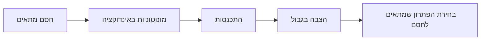

# תבניות הוכחה באינפי 1

## גבול סדרה לפי ההגדרה

1. יהי $\varepsilon>0$.
2. מנתחים את $|a_n-L|<\varepsilon$ עד שמקבלים תנאי מספיק על $n$.
3. בוחרים $N\in\mathbb N$ בעזרת [[תכונת ארכימדס והחלק השלם]].
4. מוכיחים שלכל $n>N$ מתקיים האי-שוויון (כמו בהגדרה 2.9).

## גבול פונקציה לפי $\varepsilon$-$\delta$

1. יהי $\varepsilon>0$.
2. מחפשים חסם מהצורה $|f(x)-L|\le C|x-x_0|$ או פירוק שמוביל אליו.
3. בוחרים $\delta$ כך ש-$0<|x-x_0|<\delta$ יספיק.
4. מסיימים בלי להשתמש בערך $f(x_0)$ אלא אם רציפות נבדקת.

## הוכחת sup

כדי להראות $s=\sup A$:

1. מוכיחים $a\le s$ לכל $a\in A$.
2. מוכיחים שלכל $\varepsilon>0$ קיים $a\in A$ כך ש-$s-\varepsilon<a$.

## סדרה רקורסיבית

## רציפות ומשפטי קיום

כאשר מבקשים קיום שורש או ערך ביניים, בוחרים שתי נקודות מתאימות בקטע שעליו הפונקציה רציפה ובודקים שהערך המבוקש נמצא ביניהן. אפשר להפעיל את המשפט על הקטע הסגור שבין שתי הנקודות גם כשהתחום המקורי פתוח. ל[[משפטי ויירשטראס]] ול[[רציפות במידה שווה ומשפט קנטור|משפט קנטור]] נדרשים רציפות על קטע **סגור וחסום**. יחידות דורשת נימוק נוסף.

## שרשרת הנגזרת

1. קיצון פנימי וגזירות נותנים נגזרת אפס לפי [[נקודות קיצון ומשפט פרמה|פרמה]].
2. ויירשטראס ופרמה מסייעים להוכיח את [[משפט רול]].
3. רול על פונקציות עזר שונות נותן את [[משפט לגראנז]] ואת [[משפט קושי]]. בפרט, הצבה $g(x)=x$ במשפט קושי נותנת גם היא את לגראנז'.
4. משפט קושי ותנאי גבול מתאימים משמשים בהוכחת [[כלל לופיטל]].

## בדיקת גזירות בתפר

בודקים תחילה שערך הפונקציה ושני הגבולות החד־צדדיים שווים. אחר כך מחשבים נגזרות חד־צדדיות, ומשווים אותן לאחר שהרציפות הובטחה. אם הן קיימות סופיות ושוות, הפונקציה גזירה בתפר. דוגמה מלאה נמצאת ב[[הגדרת הנגזרת]].

## חסם הפרשים ורציפות במידה שווה

אם $|f(x)-f(y)|\le M|x-y|$ לכל $x,y$ בתחום ו-$M>0$, אז לכל $\varepsilon>0$ בוחרים $\delta=\varepsilon/M$. אם $M=0$ הפונקציה קבועה וכל $\delta>0$ מתאים. להשגת החסם אפשר לעתים להשתמש בלגראנז', לאחר שבודקים שהקטע המחבר את $x,y$ נמצא בתחום והפונקציה רציפה וגזירה כנדרש.

## הוכחה בשלילה בעזרת תתי־סדרות

כדי להפריך קיום גבול, בונים שתי סדרות מותרות המתקרבות לאותה נקודה, עם גבולות תמונה שונים. כדי להוכיח שלסדרה חסומה יש גבול חלקי נוסף, מבודדים אינסוף איברים שנשארים במרחק קבוע ממועמד, ומפעילים עליהם בולצאנו–ויירשטראס. בכל מקרה בודקים שהאינדקסים עולים ושאיברי הסדרות בתחום.

## גבול $1^\infty$, $0^0$, $\infty^0$

1. כותבים $f^g=e^{g\ln f}$ (מותר כי $f>0$ בסביבה).
2. מחשבים את $\lim g\ln f$, שהיא לרוב צורה $\infty\cdot0$: הופכים למנה, או משתמשים ב-$\frac{\ln(1+u)}{u}\to1$.
3. מרציפות $e^x$ מעבירים את הגבול למעריך. ראו [[המספר e]].

## אי-שוויון בעזרת לגראנז' או מונוטוניות

- **יש הפרש $f(b)-f(a)$**: לגראנז' על הקטע, וחסימת $f'(c)$ מלמעלה ומלמטה.
- **משתנה אחד ונקודת שוויון**: $h=$ אגף שמאל פחות אגף ימין, $h(a)=0$, וסימן $h'$ קובע את הכיוון.
- שש דוגמאות מלאות: [[משפט לגראנז]], בסדנת אי-השוויונות.

## בדיוק $k$ פתרונות

1. **לפחות**: ערך הביניים על קטעים שבהם הסימן מתחלף (או גבולות ב-$\pm\infty$).
2. **לכל היותר**: אם $f^{(k)}$ לא מתאפסת בקטע, ל-$f$ יש שם לכל היותר $k$ שורשים (רול חוזר).
3. **בדיוק אחד בכל קטע**: מונוטוניות ממש. דוגמאות: [[משפט רול]].

## חקירת פונקציה

תחום וסימן, גבולות ואסימפטוטות, $f'$ וטבלת סימנים (עלייה וקיצון), $f''$ וטבלת סימנים (קמירות ופיתול), ואז שרטוט. שתי חקירות מלאות: [[אסימפטוטות וחקירת פונקציה]].

## גבול של סדרה בעזרת פונקציה

אם $\lim_{x\to\infty}f(x)=L$ אז $f(n)\to L$ (לפי היינה). כך מחשבים, למשל, $\sqrt[n]{n}=e^{\frac{\ln n}{n}}\to e^0=1$ דרך הפונקציה $\frac{\ln x}{x}$, כולל בלופיטל.

## בחירת כלי לגבול

| מצב | כלי ראשון |
|---|---|
| ביטוי אלגברי | פירוק/צמצום/רציונליזציה |
| ביטוי חסום כפול קטן | [[סדרות חסומות וסדרות אפסות]] או סנדוויץ' |
| $\sin x/x$ או זווית קטנה | [[הגבול של sin x חלקי x]] |
| צורת $0/0$ או $\infty/\infty$ | [[כלל לופיטל]] אחרי בדיקת תנאים |

## קשרים

- [[מפת תלות משפטים - אינפי 1]]
- [[אינדקס דוגמאות נגד - אינפי 1]]
- [[אינפי 1 - מפת הקורס]]
