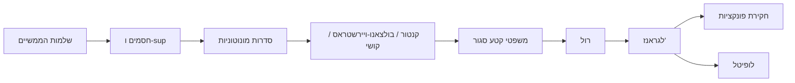

# 🗺️ חשבון אינפיניטסימלי 1 — מפת הקורס

> מבוסס על ספרי הקורס 20474 של האוניברסיטה הפתוחה (ד"ר גיל אלון): כרך א (יחידות 1–3), כרך ב (יחידות 4–6), כרך ג (יחידות 7–8), חוברת "הגדרות ומשפטים", וסיכום מצגות המרצה. מספרי המשפטים בפתקים תואמים את חוברת ההגדרות והמשפטים. שגיאות דפוס: [[תיקונים לספרי הקורס]].

## כלי למידה רוחביים

- [[מפת תלות משפטים - אינפי 1]] - לראות מי נשען על מי.
- [[תבניות הוכחה באינפי 1]] - פרוטוקולים להוכחות $\varepsilon$, sup, קטע סגור, ונגזרת.
- [[אינדקס דוגמאות נגד - אינפי 1]] - דוגמאות שמונעות הכללות שגויות.
- [[רשימת המשפטים לבחינה - אינפי 1]] - 33 המשפטים שמהם מבקשים הוכחה בבחינה, עם קישור לכל הוכחה.

## חוט השדרה של הקורס

**[[אקסיומת השלמות]]** ⟶ [[חסמים - חסם עליון ותחתון|תכונת החסם העליון]] ⟶ [[סדרות מונוטוניות|מונוטונית+חסומה מתכנסת]] ⟶ [[הלמה של קנטור]] ⟶ [[משפט בולצאנו-ויירשטראס]] ⟶ [[סדרות קושי|קריטריון קושי]] ⟶ משפטי הקטע הסגור: [[משפט ערך הביניים]], [[משפטי ויירשטראס]], [[רציפות במידה שווה ומשפט קנטור|קנטור]] ⟶ ובעזרת [[נקודות קיצון ומשפט פרמה|פרמה]]: [[משפט רול|רול]] ⟶ [[משפט לגראנז|לגראנז']] ⟶ כל תורת חקירת הפונקציות.

---

## כרך א

### יחידה 1 — המספרים הממשיים
- [[קבוצות, יחסים ופעולות]] · [[אינדוקציה מתמטית]]
- [[מערכות מספרים - מהטבעיים לממשיים]] · [[אקסיומות השדה והסדר]]
- [[ערך מוחלט ומרחק]] · [[קטעים וסביבות]]
- [[מקסימום ומינימום של קבוצה]] · **[[אקסיומת השלמות]]** · [[תכונת ארכימדס והחלק השלם]] · [[צפיפות הרציונליים]]
- [[אי-שוויון הממוצעים]]

### יחידה 2 — סדרות וגבולות
- [[סדרות - מושגי יסוד]] · **[[גבול של סדרה]]** · [[סדרות חסומות וסדרות אפסות]]
- כלי חישוב: [[אריתמטיקה של גבולות סדרות]] · [[כללי סדר ומשפט הסנדוויץ]]
- [[גבולות במובן הרחב]] · [[סדרי גודל ומבחן המנה]] · [[משפטי צזארו - סדרות ממוצעים]]

### יחידה 3 — קבוצות וסדרות חסומות
- **[[חסמים - חסם עליון ותחתון]]** · **[[סדרות מונוטוניות]]** · [[ייצוג עשרוני של מספרים ממשיים]]
- [[הלמה של קנטור]] · [[תת-סדרות וגבולות חלקיים]] · **[[משפט בולצאנו-ויירשטראס]]**
- [[סדרות קושי]] · [[גבול עליון וגבול תחתון]]

## כרך ב

### יחידה 4 — גבולות של פונקציות
- [[פונקציות ממשיות - מושגי יסוד]] · [[פונקציות אלמנטריות]]
- **[[גבול של פונקציה בנקודה]]** (סביבות / ε–δ / היינה)
- [[אריתמטיקה וכללים לגבולות פונקציות]] · [[הגבול של sin x חלקי x]]
- [[גבולות חד-צדדיים]] · [[גבולות אינסופיים וגבולות באינסוף]]

### יחידה 5 — פונקציות רציפות
- **[[רציפות בנקודה]]** · [[פונקציית דיריכלה]] · [[מיון נקודות אי-רציפות]]
- [[רציפות בקטע]] ⟶ שלושת הגדולים: **[[משפט ערך הביניים]]** · **[[משפטי ויירשטראס]]** · **[[רציפות במידה שווה ומשפט קנטור]]**
- [[פונקציות מונוטוניות ופונקציה הפוכה רציפה]] (כולל arcsin, arccos, arctan)

### יחידה 6 — פונקציות מעריכיות
- [[חזקות רציונליות וממשיות]] · [[פונקציות מעריכיות ולוגריתמיות]] · **[[המספר e]]**

## כרך ג

### יחידה 7 — הנגזרת
- **[[הגדרת הנגזרת]]** (מהירות, משיק; גזירות⟹רציפות) · [[נגזרות חד-צדדיות]]
- [[כללי הגזירה]] · **[[כלל השרשרת]]** · [[נגזרת הפונקציה ההפוכה]]
- [[נגזרות הפונקציות האלמנטריות]] · [[קירוב ליניארי והדיפרנציאל]]

### יחידה 8 — תכונות של פונקציות גזירות
- [[נקודות קיצון ומשפט פרמה]] מוביל אל **[[משפט רול]]**, שממנו מוכיחים את **[[משפט לגראנז]]** ואת [[משפט קושי]].
- [[משפט דארבו]] · **[[כלל לופיטל]]**
- חקירה: [[מונוטוניות ומיון נקודות קיצון]] · [[קמירות ונקודות פיתול]] · [[אסימפטוטות וחקירת פונקציה]]

---

## המשפטים שצריך לדעת להוכיח

הרשימה הרשמית של הקורס כוללת **33 משפטים** (סמסטר 2026ג), ובבחינה מבקשים להוכיח 2–3 מהם. הרשימה המלאה, עם קישור לכל הוכחה: **[[רשימת המשפטים לבחינה - אינפי 1]]**.

המשפטים ה"גדולים" ברשימה:

1. [[סדרות מונוטוניות|מונוטונית וחסומה מתכנסת]] (3.16)
2. [[הלמה של קנטור]] (3.22)
3. [[משפט בולצאנו-ויירשטראס]] (3.32)
4. [[משפט ערך הביניים]], גרסת השורש (5.29)
5. [[משפטי ויירשטראס]] (5.35, 5.37)
6. [[נקודות קיצון ומשפט פרמה|משפט פרמה]], [[משפט רול]], [[משפט לגראנז]] (8.4–8.6)
7. [[משפט קושי]], ההוכחה השנייה (8.9), ו[[רציפות במידה שווה ומשפט קנטור|משפט קנטור לרציפות במידה שווה]] (5.48)

קריטריון קושי (3.36) ו[[משפט דארבו]] (8.10) אינם ברשימה זו, אבל הם חלק מהחומר.

## אינדקס דוגמאות-נגד קלאסיות

הטבלה המרוכזת נמצאת ב[[אינדקס דוגמאות נגד - אינפי 1]]: לכל דוגמה מפורטת הטענה שהיא מפריכה והפניה לדף המתאים. כך אין צורך לתחזק שתי רשימות נפרדות.
