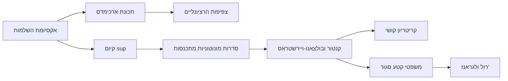

# אקסיומת השלמות

> מקור: כרך א, סעיפים 1.5.1–1.5.2 (אקסיומה 1.52, משפט 1.53, למה 1.54, מסקנה 1.55, הגדרה 1.56). למה 1.54 מופיעה בספר ואינה בחוברת ההגדרות.

**מה חשוב כאן**: מה האקסיומה אומרת ("אין חורים בציר"), [[#האינטואיציה|למה היא נכשלת ב-$\mathbb Q$]], ו[[#הגלגולים של השלמות לאורך הקורס|אילו משפטים נשענים עליה]]. ההוכחות המלאות של קיום שורשים ארוכות. בקריאה ראשונה מספיק לזכור את התבנית שלהן, ב"התבנית לזכירה".

## ניסוח (אקסיומה 1.52)

אם $A, B$ קבוצות לא ריקות של ממשיים כך שלכל $a\in A$ ולכל $b\in B$ מתקיים $a \le b$, אז קיים $x$ ממשי **מפריד**:
$$a \le x \le b \quad \text{לכל } a\in A,\ b\in B$$

> [!simple]- במילים פשוטות: מקום בין שתי קבוצות
> **בשורה אחת**: כשכל מספר בקבוצה אחת נמצא משמאל לכל מספר בשנייה, אפשר לשים מספר ממשי ביניהן.
>
> **תמונה בראש**: שתי קבוצות מתקרבות זו לזו משני הצדדים, ובציר הממשי לא חסרה נקודת התפר.
>
> **עם מספרים**: עבור $A=(0,1)$ ו-$B=(1,2)$ המפריד היחיד הוא $1$. עבור $A=\{0\},B=\{2\}$ כל מספר ב-$[0,2]$ מפריד.
>
> **מה נשבר בלי התנאים**: אם $A=\varnothing,B=\mathbb R$ אין מספר שמתחת לכל $B$. אם $B=\varnothing,A=\mathbb R$ אין מספר שמעל כל $A$. אם $A=\{2\},B=\{1\}$ הסדר מופר ולכן אין מפריד.
> השלמות מבטיחה קיום; יחידות היא שאלה נוספת.

### קריאה איטית של הניסוח

- הדרישה היא שכל $A$ "משמאל" לכל $B$ — כל איבר של $A$ קטן-או-שווה מכל איבר של $B$. לא מספיק שחלק מהאיברים מסודרים כך.
- המסקנה: קיימת נקודה בתפר. ייתכן ש-$x\in A$, ייתכן $x\in B$, ייתכן שאינו באף אחת — האקסיומה מבטיחה קיום בלבד.
- המפריד **אינו בהכרח יחיד**: ל-$A=\{0\},\ B=\{1\}$ כל $x\in[0,1]$ מפריד. יחידות מתקבלת רק כשהקבוצות "צמודות" (למשל בבניית שורש, להלן).

### האינטואיציה

אם כל $A$ משמאל לכל $B$, אין "חור" ביניהם — תמיד יש מספר ממשי בתפר. **זו התכונה שנכשלת ב-$\mathbb{Q}$**: הקבוצות
$$A=\{q\in\mathbb{Q},\ q>0 : q^2<2\}, \qquad B=\{q\in\mathbb{Q},\ q>0 : q^2>2\}$$
מקיימות את התנאי (כל איבר של $A$ קטן מכל איבר של $B$), אבל שום רציונלי אינו מפריד ביניהן: מפריד $x$ היה חייב לקיים $x^2=2$ (אם $x^2<2$ אפשר למצוא רציונלי מעט גדול ממנו שעדיין ב-$A$, בסתירה להפרדה; וסימטרית ל-$x^2>2$), ו-$\sqrt2\notin\mathbb{Q}$ לפי משפט 1.21 ב[[מערכות מספרים - מהטבעיים לממשיים]]. לכן השלמות היא אקסיומה אמיתית — היא לא נובעת מ[[אקסיומות השדה והסדר]], שהרי $\mathbb{Q}$ מקיים את כולן.

<!-- infi-demo: sup -->

## תוצאה ראשונה: קיום שורשים (משפט 1.53, למה 1.54, מסקנה 1.55)

**משפט 1.53**: לכל $c\ge0$ ולכל $n$ טבעי קיים $x\ge0$ עם $x^n=c$. **מסקנה 1.55** מוסיפה שהפתרון האי־שלילי **יחיד**; מסמנים $x=\sqrt[n]{c}$ (הגדרה 1.56). אם $c=0$ הפתרון הוא $0$, ואם $c>0$ הפתרון חיובי.

> [!simple]- במילים פשוטות: שורש הוא המספר שהחזקה שלו מתאימה
> **בשורה אחת**: לכל מספר אי־שלילי יש שורש אי־שלילי מכל סדר טבעי, והוא יחיד.
>
> **תמונה בראש**: מגדילים צלע עד שהשטח או הנפח מגיעים בדיוק ליעד.
>
> **עם מספרים**: $\sqrt9=3$, $\sqrt[3]{8}=2$, ו-$\sqrt[n]{0}=0$.
>
> **מה נשבר בלי התנאים**: למספר $-1$ אין שורש ריבועי ממשי; אם לא דורשים פתרון אי־שלילי, ל-$x^2=9$ יש שני פתרונות, $3$ ו-$-3$.
> אין צורך למצוא נוסחה עשרונית כדי להוכיח שקיים שורש.

### המהלך שבספר

**לקריאה שנייה.** הסעיף הזה והסעיף הבא הם הוכחות מלאות. בקריאה ראשונה אפשר לדלג ישר ל"התבנית לזכירה" שבסופם.

הספר מפצל את העבודה ללמה, ואת הוכחת הלמה הוא מביא ביחידה 2.

**למה 1.54.** יהי $x>0$.

1. אם $x^n<c$, קיים $y>x$ שעדיין מקיים $y^n<c$.
2. אם $x^n>c$, קיים $y$ עם $0<y<x$ שעדיין מקיים $y^n>c$.

הרעיון: שינוי קטן של $x$ משנה את $x^n$ רק מעט. בספר מוכיחים זאת אחרי [[כללי סדר ומשפט הסנדוויץ|משפט 2.30]]. אם $x^n<c$, הסדרה $\left(x+\frac1k\right)^n$ שואפת ל-$x^n$. משווים אותה לסדרה הקבועה $c$, ומשפט 2.30 מעביר את האי־שוויון החד אל הזנב: עבור $k$ גדול, $y=x+\frac1k$ מקיים $y^n<c$. הלמה ממוספרת בספר, והיא חסרה בחוברת ההגדרות שאפשר להביא לבחינה. מי שמשתמש בה כותב את ניסוחה במלואו, או מוכיח את המקרה הריבועי ישירות כמו בסעיף הבא.

**הוכחת משפט 1.53.** המקרה $c=0$ הוא $x=0$. עבור $c>0$ מגדירים

$$A=\{x>0:x^n\le c\}, \qquad B=\{x>0:x^n\ge c\}.$$

האי־שוויונות כאן חלשים: השורש עצמו, כשיתגלה, שייך לשתיהן. הקבוצות לא ריקות. אם $c\ge1$ אז $1\in A$ ו-$c\in B$, כי $1^n=1\le c$ ו-$c^n\ge c$. אם $0<c<1$ אז $c\in A$ ו-$1\in B$, כי $c^n\le c$ ו-$1\ge c$.

לכל $a\in A$ ולכל $b\in B$ מתקיים $a^n\le c\le b^n$. משאלה 33ד, על החיוביים החזקה שומרת סדר חזק: $a>b\ge0$ גורר $a^n>b^n$. לכן $a\le b$. לריבוע זה מיידי, כי $a^2-b^2=(a-b)(a+b)$. אקסיומת השלמות נותנת מפריד $x$, והוא גדול או שווה מכל איבר חיובי של $A$. לכן $x>0$.

אם $x^n<c$ אז $x\in A$, ומתנאי המפריד הוא המקסימום של $A$. הלמה נותנת $y>x$ עם $y^n<c$, ולכן $y\in A$, סתירה. אם $x^n>c$ אז $x$ הוא המינימום של $B$, והלמה נותנת איבר קטן ממנו שעדיין ב-$B$. נשאר $x^n=c$.

**יחידות (מסקנה 1.55).** משפט 1.53 נותן פתרון אי־שלילי אחד לפחות. אם $0\le y<x$ וגם $x^n=y^n$, שאלה 33ד נותנת $x^n>y^n$, סתירה. לכן הפתרון האי־שלילי יחיד.

### מסלול עצמאי לריבוע, בלי לחכות ליחידה 2

אפשר להוכיח את $x^2=c$ וגם את למה 1.54 עבור $n=2$ בעזרת דלתא מפורשת. כאן הקבוצות אחרות מאלה שבספר: אי־השוויון חד, והשורש אינו שייך לאף אחת מהן.

1. **הקבוצות**: $A=\{t>0:t^2<c\}$, $B=\{t>0:t^2>c\}$.
2. **לא ריקות**: אם $c=0$ השורש הוא $0$. אם $c>0$, אז $\min\{c,1\}/2\in A$ ו-$c+1\in B$, כי $(c+1)^2>c$.
3. **מופרדות**: $a^2<c<b^2$ עם $a,b>0$ גורר $a<b$.
4. **מפריד** $x$ מקיים $a\le x\le b$ לכל $a\in A$ ולכל $b\in B$, ובפרט $x>0$.
5. **שלילת שתי האפשרויות**. אם $x^2<c$, בוחרים
   $$\delta=\min\left\{1,\frac{c-x^2}{2x+1}\right\}>0.$$
   אז $(x+\delta)^2=x^2+\delta(2x+\delta)\le x^2+\delta(2x+1)<c$, ולכן $x+\delta\in A$ גדול מ-$x$, בסתירה להפרדה. אם $x^2>c$, בוחרים
   $$\delta=\min\left\{\frac x2,\frac{x^2-c}{2x}\right\}>0.$$
   אז $x-\delta>0$, ו-$(x-\delta)^2=x^2-2x\delta+\delta^2>x^2-2x\delta\ge c$, ולכן $x-\delta\in B$ וקטן מ-$x$. נשאר $x^2=c$.
6. **יחידות על החיוביים**: $0<x_1<x_2$ גורר $x_1^2<x_2^2$.

אם $x$ רציונלי, $c$ רציונלי ו-$x^2<c$, אותה נוסחה לדלתא נותנת רציונלי. לכן בתוך $\mathbb{Q}$ אין מפריד בין הרציונליים שריבועם קטן מ-$2$ לבין אלה שריבועם גדול מ-$2$. זו הסיבה שמשפט 1.21 חוסם כל הוכחת קיום שנשענת רק על השדה והסדר.

**התבנית לזכירה**: רוצים להוכיח שקיים מספר עם תכונה? בונים את "כל מי שקטן מדי" מול "כל מי שגדול מדי", מפרידים, ומוכיחים שהמפריד הוא בדיוק המבוקש. אותה תבנית חוזרת בהוכחת [[חסמים - חסם עליון ותחתון|תכונת החסם העליון]].

### נסו בעצמכם

לכל זוג קבוצות, מצאו את כל המפרידים. האם המפריד יחיד? ואם כן, האם הוא שייך ל-$A$, ל-$B$, או לאף אחת?

1. $A=\{1,2\}$, $B=\{4\}$.
2. $A=(-\infty,3)$, $B=[3,5]$.

> [!hint]- רמז
> מפריד $x$ צריך להיות גדול או שווה לכל איבר של $A$, וקטן או שווה לכל איבר של $B$. מה האיבר הגדול ב-$A$? מה הקטן ב-$B$?

> [!solution]- פתרון
> 1. $x$ צריך לקיים $x\ge2$ ו-$x\le4$. כל מספר ב-$[2,4]$ מפריד, ולכן המפריד אינו יחיד.
> 2. $x$ צריך להיות גדול או שווה לכל מספר קטן מ-$3$, ולכן $x\ge3$. הוא צריך גם להיות קטן או שווה ל-$3$, האיבר הקטן ב-$B$. לכן $x=3$ הוא המפריד היחיד, והוא שייך ל-$B$ ולא ל-$A$.

## הגלגולים של השלמות לאורך הקורס

אקסיומת השלמות מאפשרת להוכיח משפטי קיום מרכזיים בקורס. בין התוצאות הנגזרות ממנה:

1. [[תכונת ארכימדס והחלק השלם|תכונת ארכימדס]] (משפט 1.60)
2. [[צפיפות הרציונליים]] (הגדרה 1.65 ומשפט 1.66 בספר; שניהם חסרים בחוברת ההגדרות)
3. **תכונת החסם העליון** (משפט 3.6): לכל קבוצה לא-ריקה וחסומה מלעיל יש sup — [[חסמים - חסם עליון ותחתון]]. זהו הניסוח השקול והשימושי ביותר של השלמות.
4. **סדרה מונוטונית וחסומה מתכנסת** (משפט 3.16) — [[סדרות מונוטוניות]]
5. [[הלמה של קנטור]] (משפט 3.22) — קטעים מקוננים
6. [[משפט בולצאנו-ויירשטראס]] (משפט 3.32)
7. [[סדרות קושי|קריטריון קושי]] (משפט 3.36)
8. ובהמשך על פונקציות: [[משפט ערך הביניים]], [[משפטי ויירשטראס]], [[רציפות במידה שווה ומשפט קנטור|משפט קנטור]], ודרך [[משפט רול|רול]] — [[משפט לגראנז|לגראנז']] וכל חקירת הפונקציות.

אין להסיק שכל תוצאה ברשימה שקולה לשלמות: ארכימדס וצפיפות מתקיימות גם ברציונליים. לעומת זאת, משפטי קיום כמו תכונת החסם העליון והתכנסות סדרה מונוטונית חסומה אכן נכשלים מעל $\mathbb{Q}$ (למשל: הסדרה המונוטונית והחסומה $1, 1.4, 1.41, 1.414,\dots$ של קטיעות $\sqrt2$ אינה מתכנסת ב-$\mathbb{Q}$; הפונקציה $f(q)=q^2-2$ מחליפה סימן על $[0,2]\cap\mathbb{Q}$ בלי להתאפס).

## איך מזהים במבחן ששאלה "נוגעת בשלמות"

- מבקשים להוכיח **קיום** של מספר (שורש, גבול, נקודת חיתוך) בלי נוסחה מפורשת.
- מופיעות המילים sup/inf, מונוטונית וחסומה, קטעים מקוננים, תת-סדרה מתכנסת, קושי.
- שאלת "הפרכה מעל $\mathbb{Q}$": מתבקשת דוגמה נגדית — כמעט תמיד בונים אותה סביב $\sqrt2$.

## כרטיס דיוק

- **רעיון-על**: שלמות היא החומר שמונע "חורים" בציר: בין שתי קבוצות מופרדות תמיד יש נקודת תפר ממשית.
- **מתי מפעילים**: כשצריך לעבור מקירובים או חסמים לקיום מספר ממשי מוגדר.
- **בדיקה עצמית**: (א) שחזרו את בניית $\sqrt2$ כמפריד. (ב) הסבירו למה המפריד לא תמיד יחיד, ומתי כן. (ג) תנו שלוש דוגמאות נגדיות מעל $\mathbb{Q}$ למשפטים מהרשימה.
- **מלכודת**: לא כל חסם מלעיל הוא חסם עליון; החסם העליון הוא הקטן מבין החסמים מלעיל. וכן: האקסיומה נותנת קיום, לא יחידות ולא שיטת חישוב.
- **קישור רוחב**: ראו גם [[מפת תלות משפטים - אינפי 1]], [[תבניות הוכחה באינפי 1]], [[אינדקס דוגמאות נגד - אינפי 1]].

> [!solution]- פתרון (א)
> נגדיר $A=\{t>0:t^2<2\}$ ו-$B=\{t>0:t^2>2\}$. הן לא ריקות כי $1\in A,2\in B$, וכל $a\in A$ קטן מכל $b\in B$ כי הריבוע שומר סדר על החיוביים. השלמות נותנת מפריד $x$; בפרט $1\le x\le2$.
> אם $x^2<2$, נבחר $\delta=\min\{1/2,(2-x^2)/(2(2x+1))\}>0$. אז $(x+\delta)^2\le x^2+\delta(2x+1)<2$, ולכן $x+\delta\in A$, בסתירה להפרדה.
> אם $x^2>2$, נבחר $\delta=\min\{x/2,(x^2-2)/(4x)\}>0$. אז $x-\delta>0$ וגם $(x-\delta)^2\ge x^2-2x\delta\ge(x^2+2)/2>2$. לכן $x-\delta\in B$, שוב בסתירה להפרדה. נשאר $x^2=2$, ולכן $x=\sqrt2$.

> [!solution]- פתרון (ב)
> עבור $A=\{0\},B=\{1\}$ כל $x\in[0,1]$ מפריד, ולכן האקסיומה מבטיחה קיום ולא יחידות. אחרי משפט 3.6, כשיש כבר $\sup A$ ו-$\inf B$, המפרידים הם בדיוק הקטע $[\sup A,\inf B]$, והמפריד יחיד בדיוק כששני החסמים שווים. בבניית השורש כל מפריד חיובי מקיים $x^2=2$, ושני חיוביים שונים אינם בעלי אותו ריבוע.

> [!solution]- פתרון (ג)
> שלוש דוגמאות שבהן חסר גבול רציונלי:
> 1. תכונת החסם העליון: ל-$A=\{q\in\mathbb Q:q>0,q^2<2\}$ אין סופרמום ב-$\mathbb Q$. בממשיים חסמה העליון הוא $\sqrt2$; כל רציונלי קטן ממנו אינו חסם (מצפיפות), וכל רציונלי גדול ממנו ניתן להקטין לחסם רציונלי קטן יותר.
> 2. סדרה מונוטונית חסומה: $q_n=\lfloor10^n\sqrt2\rfloor/10^n$ רציונלית, עולה וחסומה. מתקיים $0\le\sqrt2-q_n<10^{-n}$, ולכן גבולה בממשיים הוא $\sqrt2$. מיחידות הגבול אין לה גבול רציונלי.
> 3. בולצאנו–ויירשטראס: אותה סדרה חסומה, אבל כל תת־סדרה שלה מתכנסת בממשיים ל-$\sqrt2$, לפי ירושת הגבול; לכן אין לה תת־סדרה שמתכנסת ב-$\mathbb Q$.
> ארכימדס וצפיפות אינן דוגמאות לכישלון מעל $\mathbb Q$.

## תרשים תלות

## קשרים

- [[אקסיומות השדה והסדר]] — שתי קבוצות האקסיומות האחרות
- [[חסמים - חסם עליון ותחתון]] — הניסוח השקול והשימושי ביותר
- [[מערכות מספרים - מהטבעיים לממשיים]] — הכשל של $\mathbb{Q}$ שהאקסיומה מתקנת
- [[אי-שוויון הממוצעים]] — משתמש בקיום שורשים
- [[הלמה של קנטור]], [[משפט בולצאנו-ויירשטראס]], [[סדרות קושי]] — צאצאיה הישירים ביחידה 3
