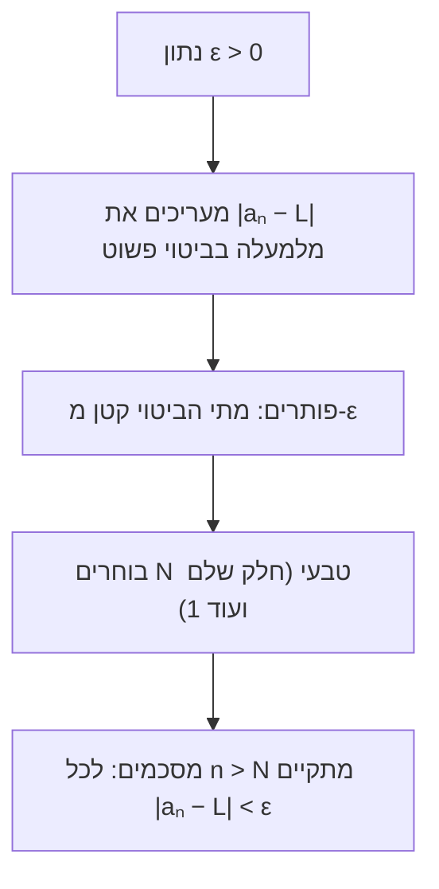

# גבול של סדרה

> מקור: כרך א, פרק 2.2 (הגדרות 2.8–2.15, טענות 2.10–2.14, משפטים 2.12, 2.16–2.18)

## ההגדרה (2.9)

$\{a_n\}$ **מתכנסת** ל-$L$ אם לכל $\varepsilon > 0$, כמעט כל איברי הסדרה נמצאים ב[[קטעים וסביבות|סביבת]]-$\varepsilon$ של $L$. במפורש:

$$\lim_{n\to\infty} a_n = L \iff \forall \varepsilon>0\ \exists N\in\mathbb{N}:\ \forall n> N,\ |a_n - L| < \varepsilon$$

(הניסוח במפורש משתמש ב-"$n>N$", כמו בהגדרת "כמעט לכל" בחוברת. כתיבה עם $n\ge N$ שקולה לגמרי.)

סדרה שאינה מתכנסת לשום $L$ נקראת **מתבדרת**.

> [!simple]- במילים פשוטות: מה ההגדרה הזו אומרת באמת
> **בשורה אחת**: הסדרה מתכנסת ל-$L$ אם מתישהו היא נכנסת לפס צר סביב $L$, ומשם היא כבר לא יוצאת ממנו. וזה צריך לעבוד לכל פס, צר ככל שיהיה.
>
> **איך קוראים את הסימנים**: $\forall$ קוראים "לכל", $\exists$ קוראים "קיים". אז השורה המפחידה היא בסך הכול המשפט: "לכל מרחק $\varepsilon$ שתבחרו, קיים מקום $N$ בסדרה, שאחריו כל האיברים קרובים ל-$L$ פחות מ-$\varepsilon$".
>
> **תמונה בראש**: מכונית שנוסעת לחניה. מי שעומד ליד החניה אומר: "תתקרבי לפחות עד מטר". אחרי כמה שניות היא בתוך המטר ולא יוצאת. "עכשיו עד עשרה סנטימטר". שוב, אחרי עוד קצת זמן היא שם. מכונית שתמיד מצליחה, לא משנה כמה קטן המרחק שמבקשים, היא מכונית ש"מתכנסת" לחניה.
>
> **עם מספרים**: הסדרה $a_n=\frac{3n+1}{n}=3+\frac1n$ מתקרבת ל-$3$, והמרחק שלה מ-$3$ הוא בדיוק $\frac1n$.
>
> | הדיוק שמבקשים $\varepsilon$ | צריך $\frac1n<\varepsilon$, כלומר | מאיזה $n$ זה מתקיים |
> |---|---|---|
> | $0.1$ | $n>10$ | מ-$n=11$ |
> | $0.01$ | $n>100$ | מ-$n=101$ |
> | $0.001$ | $n>1000$ | מ-$n=1001$ |
>
> ככל שהדיוק קשוח יותר, צריך ללכת רחוק יותר בסדרה. זה בדיוק "$N$ תלוי ב-$\varepsilon$".
>
> **אם זה עדיין נראה מפחיד**: ההגדרה רק מתרגמת את המילה "מתקרבת" לשפה שאפשר לבדוק. כל הוכחה מההגדרה היא אותו תרגיל: מקבלים $\varepsilon$, ומחשבים מאיפה הסדרה כבר מספיק קרובה.

### איך לקרוא את זה

- $\varepsilon$ — "דרישת הדיוק" של יריב: כמה קרוב צריך להיות ל-$L$. היריב רשאי לבחור כל דיוק, קטן ככל שירצה.
- $N$ — התשובה שלנו: מאיזה מקום בסדרה **כל** האיברים עומדים בדרישה.
- **הסדר קובע**: קודם נתון $\varepsilon$, ואז מוצאים $N$ — לכן $N$ רשאי (וכמעט תמיד חייב) להיות תלוי ב-$\varepsilon$. דיוק קשוח יותר, ולכן צריך ללכת רחוק יותר בסדרה.
- "כמעט כל" ([[סדרות - מושגי יסוד|הגדרה 2.5]]): רק מספר סופי של איברים מותר להם לחרוג. לכן שינוי/מחיקת רישא סופית לא משנה כלום.
- המשחק חייב להצליח **לכל** $\varepsilon$: הצלחה עבור $\varepsilon=0.1$ בלבד לא מוכיחה כלום.

### ההגדרה השלולה (חובה לדעת לנסח!)

$\{a_n\}$ **אינה** מתכנסת ל-$L$:
$$\exists\varepsilon>0\ \forall N\ \exists n> N:\ |a_n-L|\ge\varepsilon$$
כלומר: יש דיוק $\varepsilon$ שבו הסדרה נכשלת שוב ושוב — אינסוף איברים במרחק $\ge\varepsilon$ מ-$L$. שימו לב איך כל כמת התהפך. ניסוח שלילה נכון הוא שאלת מבחן קלאסית ותנאי לכל הוכחת התבדרות.

> [!simple]- במילים פשוטות: איך שוללים בלי להתבלבל
> שלילה של משפט עם כמתים נעשית בשלושה צעדים מכניים, משמאל לימין:
> 1. כל "לכל" ($\forall$) הופך ל"קיים" ($\exists$), וכל "קיים" הופך ל"לכל".
> 2. התנאי שבסוף מתהפך: $<$ הופך ל-$\ge$.
> 3. שום דבר אחר לא זז.
>
> בעברית: "יש מרחק $\varepsilon$ אחד, שאיתו הסדרה לא מצליחה: לא משנה כמה רחוק תלכו ($\forall N$), תמיד יהיה איבר מאוחר יותר ($\exists n>N$) שרחוק מ-$L$ לפחות $\varepsilon$". למשל, $(-1)^n$ עם $L=1$ ו-$\varepsilon=1$: כל איבר במקום אי-זוגי שווה ל-$-1$, והמרחק שלו מ-$1$ הוא $2\ge1$.

<!-- infi-demo: epsilon-n -->

## דוגמה עבודה מלאה — הוכחה מן ההגדרה

**טענה**: $\lim\dfrac{3n+1}{n}=3$.

**הוכחה**: יהי $\varepsilon>0$. נעריך:
$$\left|\frac{3n+1}{n}-3\right| = \left|\frac{1}{n}\right| = \frac1n.$$
נדרוש $\frac1n<\varepsilon$, כלומר $n>\frac1\varepsilon$. לפי [[תכונת ארכימדס והחלק השלם|ארכימדס]] נבחר $N=\left\lfloor\frac1\varepsilon\right\rfloor+1$, ואז $N>\frac1\varepsilon$. לכן לכל $n>N$ מתקיים $\frac1n<\frac1N<\varepsilon$. ∎

שימו לב לשלושת השלבים הקבועים: **(1) פישוט הביטוי, (2) פתירת אי-השוויון עבור $n$, (3) בחירת $N$ טבעי מפורש**. כשהביטוי לא מסתדר לפתרון מדויק — מעריכים מלמעלה ("הגדל מונה, הקטן מכנה", [[אקסיומות השדה והסדר|יחידה 1]]) עד שמתקבל חסם נוח כמו $\frac Cn$.

## דוגמאות ראשונות

- $\lim \frac1n = 0$ (טענה 2.10) — נובע מ[[תכונת ארכימדס והחלק השלם|ארכימדס]]: בהינתן $\varepsilon$ ניקח $N > 1/\varepsilon$. זה "הגבול האטומי" שממנו נבנים כל האחרים.
- סדרה קבועה $a_n=c$ מתכנסת ל-$c$ (טענה 2.11) — כל $N$ עובד.
- הסדרה $\{(-1)^n\}$ **מתבדרת** (טענה 2.14). הוכחה בתבנית השלילה: לכל מועמד $L$ ניקח $\varepsilon=\tfrac12$. המרחק בין $1$ ל-$-1$ הוא $2$, ולכן לא ייתכן ששני המספרים נמצאים בסביבת-$\tfrac12$ של $L$. שני הערכים מופיעים אינסוף פעמים, ולכן לכל $N$ יש $n>N$ עם $|a_n-L|\ge\tfrac12$. ∎

## יחידות הגבול (משפט 2.12)

אם $a_n \to L_1$ וגם $a_n \to L_2$ אז $L_1 = L_2$. לכן מותר לומר "**ה**גבול" ולכתוב $\lim a_n$.

> [!simple]- במילים פשוטות
> סדרה לא יכולה להתקרב לשני מקומות שונים באותו זמן. מכונית שמתקרבת יותר ויותר לחיפה לא יכולה באותו זמן להתקרב יותר ויותר לתל אביב: מתישהו היא צריכה להיות קרובה מאוד לשתיהן, וזה בלתי אפשרי.
>
> **עם מספרים**: נניח שהסדרה "מתקרבת" גם ל-$1$ וגם ל-$3$. המרחק ביניהם הוא $2$, אז ניקח $\varepsilon=1$ (חצי מהמרחק). הסביבות הן $(0,2)$ ו-$(2,4)$, והן לא נוגעות זו בזו. מתישהו כל האיברים צריכים להיות בשתיהן, אבל אין מספר שנמצא בשתיהן.

> [!plan]
> מניחים בשלילה שיש שני גבולות שונים. בוחרים $\varepsilon$ שהוא חצי מהמרחק ביניהם, כך ששתי הסביבות זרות. רחוק מספיק בסדרה האיבר חייב להיות בשתי הסביבות, וזו הסתירה.

<!-- infi-proof: 2.12 -->

**הוכחה**: נניח בשלילה ש-$L_1\ne L_2$, וניקח $\varepsilon=\frac{|L_1-L_2|}{2}>0$. עבור $\varepsilon$ הזה שתי הסביבות $N_\varepsilon(L_1)$ ו-$N_\varepsilon(L_2)$ **זרות** ([[קטעים וסביבות]]).

- מההתכנסות ל-$L_1$ קיים $N_1$ כך שלכל $n>N_1$ מתקיים $a_n\in N_\varepsilon(L_1)$.
- מההתכנסות ל-$L_2$ קיים $N_2$ כך שלכל $n>N_2$ מתקיים $a_n\in N_\varepsilon(L_2)$.

ניקח $n>\max(N_1,N_2)$. האיבר $a_n$ נמצא בשתי הסביבות, אבל הסביבות זרות. זו סתירה, ולכן $L_1=L_2$. ∎

<!-- /infi-proof -->

## סדרה מתכנסת חסומה (משפט 2.16)

**כל סדרה מתכנסת היא [[סדרות חסומות וסדרות אפסות|חסומה]].**

> [!simple]- במילים פשוטות
> "חסומה" פירושו שיש תקרה ורצפה שהסדרה לא חורגת מהן. סדרה מתכנסת היא כזו כי היא בנויה משני חלקים:
> - **הזנב** (מנקודה מסוימת והלאה): כל האיברים כבר בתוך פס צר סביב $L$, אז הם בטח חסומים.
> - **ההתחלה**: רק מספר סופי של איברים, ולמספר סופי של מספרים תמיד יש גדול ביותר.
>
> **עם מספרים**: נניח $a_1=5$, $a_2=-7$, $a_3=2$, ומשם והלאה כל האיברים במרחק פחות מ-$1$ מהגבול $L=1$. ההתחלה חסומה ב-$7$, והזנב בתוך $(0,2)$. לכן $M=\max\{5,7,2,1\}+1=8$ עובד: $|a_n|<8$ לכל $n$.
>
> **מה נשבר בכיוון ההפוך**: $(-1)^n$ חסומה (תמיד בין $-1$ ל-$1$), ובכל זאת לא מתכנסת. חסומה זה תנאי הכרחי, לא מספיק.

> [!plan]
> לוקחים $\varepsilon=1$, כך שהזנב חסום ב-$|L|+1$. להתחלה יש רק $N$ איברים, אז לוקחים את המקסימום שלהם. $M$ הוא הגדול מבין השניים, ועוד $1$.

<!-- infi-proof: 2.16 -->

**הוכחה**: נסמן $L=\lim a_n$ וניקח $\varepsilon=1$. קיים $N$ כך שלכל $n>N$ מתקיים $|a_n-L|<1$, ולכן לפי אי-שוויון המשולש $|a_n|\le|a_n-L|+|L|<|L|+1$. האיברים $a_1,\dots,a_N$ הם מספר סופי של מספרים. נגדיר

$$M=\max\{|a_1|,\dots,|a_N|,\ |L|\}+1.$$

לכל $n\le N$ מתקיים $|a_n|<M$, ולכל $n>N$ מתקיים $|a_n|<|L|+1\le M$. לכן $|a_n|<M$ לכל $n$, כמו בהגדרה 2.15. ∎

<!-- /infi-proof -->

(ההפך לא נכון: $\{(-1)^n\}$ חסומה ומתבדרת. ההשלמה החלקית: [[משפט בולצאנו-ויירשטראס]] — לחסומה יש תת-סדרה מתכנסת.) שימוש עיקרי: **הפרכה** — סדרה לא חסומה מתבדרת מיד, בלי שום חישוב.

## עמידות הגבול (משפטים 2.17, 2.29)

שינוי מספר סופי של איברים או הזזה ($b_n=a_{n+s}$) — לא משנים התכנסות ולא את ערך הגבול. התכנסות היא תכונת **זנב**: זנב של סדרה הוא כל האיברים ממקום מסוים והלאה, ומה שקורה בהתחלה לא משפיע על הגבול.

## דרכים להוכיח התבדרות — סיכום כלים

1. הסדרה לא חסומה (משפט 2.16).
2. שני [[תת-סדרות וגבולות חלקיים|גבולות חלקיים]] שונים (כמו $(-1)^n$) — הכלי הנוח ביותר בדרך כלל.
3. ישירות מהשלילה של ההגדרה.
4. הסדרה אינה [[סדרות קושי|קושי]].

## איך מוכיחים גבול מן ההגדרה — תבנית

1. נתון $\varepsilon>0$ שרירותי.
2. מפשטים/מעריכים את $|a_n-L|$ מלמעלה בביטוי פשוט ב-$n$ (בעזרת [[ערך מוחלט ומרחק|כללי ערך מוחלט]]).
3. פותרים את אי-השוויון עבור $n$ ובוחרים $N$ מתאים ([[תכונת ארכימדס והחלק השלם|ארכימדס/חלק שלם]]).
4. מסכמים: לכל $n>N$ מתקיים $|a_n-L|<\varepsilon$.

**הערות סגנון שחוסכות נקודות**: מותר להעריך ביד גסה — לא מחפשים את $N$ הקטן ביותר, רק אחד שעובד; מותר להניח $n\ge n_0$ קבוע כלשהו מראש (מוסיפים אותו ל-$N$ בסוף); ואסור להתחיל מ-$|a_n-L|<\varepsilon$ ולעבוד "אחורה" בלי לוודא שכל המעברים הפיכים.

## כרטיס דיוק

- **רעיון-על**: גבול הוא חוזה: לכל דיוק שנדרש, יש מקום שממנו והלאה כל הזנב עומד בו.
- **מתי מפעילים**: הוכחת התכנסות מהגדרה, הוכחת יחידות, תרגום "כמעט כל" ל-$N$, והוכחות התבדרות דרך השלילה.
- **בדיקה עצמית**: (א) הוכיחו מההגדרה $\frac{n}{n+1}\to1$ עם $N$ מפורש. (ב) כתבו את שלילת ההגדרה בלי להציץ. (ג) הוכיחו ש-$(-1)^n$ מתבדרת ישירות מהשלילה.

> [!solution]- פתרון (א)
> יהי $\varepsilon>0$. נחשב: $\left|\frac{n}{n+1}-1\right|=\frac{1}{n+1}<\frac1n$. מספיק לדרוש $\frac1n<\varepsilon$, כלומר $n>\frac1\varepsilon$. נבחר $N=\left\lfloor\frac1\varepsilon\right\rfloor+1$. אז לכל $n>N$ מתקיים $\left|\frac{n}{n+1}-1\right|<\frac1n<\frac1N<\varepsilon$. ∎

> [!solution]- פתרון (ב)
> $\{a_n\}$ אינה מתכנסת ל-$L$ אם $\exists\varepsilon>0\ \forall N\ \exists n>N:\ |a_n-L|\ge\varepsilon$. היא מתבדרת אם זה נכון **לכל** $L$ ממשי.

> [!solution]- פתרון (ג)
> יהי $L$ ממשי כלשהו, וניקח $\varepsilon=\frac12$. אם $|1-L|<\frac12$ וגם $|-1-L|<\frac12$, אז לפי אי-שוויון המשולש $2=|1-(-1)|\le|1-L|+|L-(-1)|<1$, סתירה. לכן לפחות אחד מהערכים $1$ או $-1$ רחוק מ-$L$ לפחות $\frac12$. כל אחד מהם מופיע באינסוף מקומות, ולכן לכל $N$ יש $n>N$ עם $|a_n-L|\ge\frac12$. זו בדיוק השלילה, לכל $L$, ולכן הסדרה מתבדרת. ∎
- **מלכודת**: הסדר הכמותי קריטי — $N$ תלוי ב-$\varepsilon$, לא להפך; ובדיקת $\varepsilon$ בודד אינה הוכחה.
- **קישור רוחב**: ראו גם [[מפת תלות משפטים - אינפי 1]], [[תבניות הוכחה באינפי 1]], [[אינדקס דוגמאות נגד - אינפי 1]].

## תרשים עבודה

## קשרים

- [[סדרות - מושגי יסוד]] — "כמעט כל", זנב, הזזות
- [[אריתמטיקה של גבולות סדרות]] — חישוב גבולות בלי אפסילונים
- [[כללי סדר ומשפט הסנדוויץ]] — השוואות בין גבולות
- [[גבולות במובן הרחב]] — שאיפה ל-$\pm\infty$
- [[סדרות מונוטוניות]] — קריטריון התכנסות בלי לדעת את הגבול
- [[סדרות קושי]] — קריטריון פנימי להתכנסות
- [[תת-סדרות וגבולות חלקיים]] — כלי ההתבדרות המרכזי
- [[גבול של פונקציה בנקודה]] — ההכללה לפונקציות; הגדרת היינה מחזירה אותנו לסדרות
