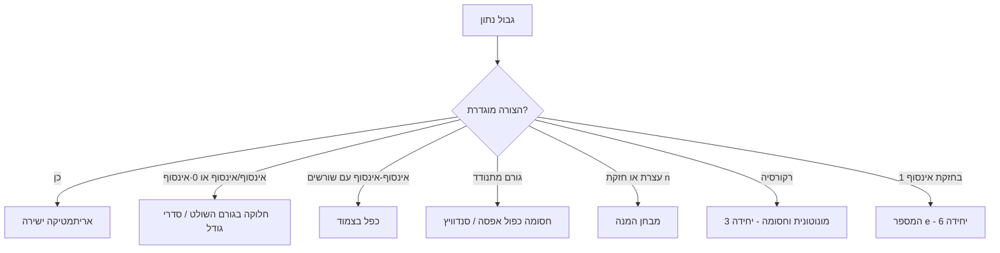

# שער יחידה 2 - סדרות וגבולות

## מה היחידה הזאת עושה

כאן מוגדר המושג המרכזי של כל הקורס: **גבול**. ההגדרה הכמותית ($\varepsilon$–$N$) היא הטכנולוגיה שמאפשרת לומר "מתקרב ל-" בלי ידיים מנופפות, וסביבה נבנה ארגז כלים שלם: אריתמטיקה, סנדוויץ', חסומה×אפסה, מבחן המנה, צזארו. מי ששולט ביחידה הזאת יודע שני דברים: **להוכיח** גבול מן ההגדרה, ו**לחשב** גבול עם הכלי הנכון בסדר הנכון.

## ציר לימוד

1. [[סדרות - מושגי יסוד]] — סדרה כפונקציה, זנב (כל האיברים ממקום מסוים והלאה), "כמעט לכל" (פרט למספר סופי של חריגים)
2. **[[גבול של סדרה]]** — ההגדרה, השלילה שלה, יחידות, כל סדרה מתכנסת חסומה
3. [[סדרות חסומות וסדרות אפסות]] — חסומה×אפסה ולמה 2.26
4. [[אריתמטיקה של גבולות סדרות]] — כללי החישוב והוכחותיהם
5. [[כללי סדר ומשפט הסנדוויץ]] — השוואות וכליאה
6. [[גבולות במובן הרחב]] — $\pm\infty$ וצורות בלתי-מוגדרות
7. [[סדרי גודל ומבחן המנה]] — הסולם: לוג < פולינום < מעריכי < עצרת
8. [[משפטי צזארו - סדרות ממוצעים]] — ממוצעים יורשים גבול

## עץ ההחלטה לחישוב גבול סדרה

## שלוש נקודות שנבחנים נופלים בהן

1. **שלילת ההגדרה**: להוכיח התבדרות צריך להראות לכל מועמד ממשי $L$ שקיים $\varepsilon>0$ כך שלכל $N$ יש $n>N$ עם $|a_n-L|\ge\varepsilon$ — לא "ההגדרה לא עובדת לי".
2. **אריתמטיקה רק כשהחלקים מתכנסים**: אסור לפרק $\lim(a_n+b_n)$ לפני שמוודאים ששני הגבולות קיימים.
3. **אי-שוויון חד נחלש בגבול**: מ-$a_n<b_n$ מסיקים $\lim a_n\le\lim b_n$ בלבד.

## דיאגרמת יחידה

<!-- infi-demo: epsilon-n -->

## כל הפתקים ביחידה

- [[אריתמטיקה של גבולות סדרות]]
- [[גבול של סדרה]]
- [[גבולות במובן הרחב]]
- [[כללי סדר ומשפט הסנדוויץ]]
- [[משפטי צזארו - סדרות ממוצעים]]
- [[סדרות - מושגי יסוד]]
- [[סדרות חסומות וסדרות אפסות]]
- [[סדרי גודל ומבחן המנה]]

## סוגי שאלות במבחן

- **הוכחה מההגדרה ושלילת הגדרה** — [2025א·86, שאלה 3](#/exams/34/q3), [2023ב·86, שאלה 3](#/exams/28/q3), [2025ב·96, שאלה 6](#/exams/38/q6). הדרך: מתחילים מהמרחק לגבול, מבודדים תנאי על $n$, ובשלילה שומרים על סדר הכמתים.
- **הוכחת משפט בסיסי** — [2026א·83, שאלה 2](#/exams/40/q2), [2026א·88, שאלה 2](#/exams/41/q2), [2026ג·83, שאלה 7](#/exams/45/q7). הדרך: מזהים את המבנה המתאים — התחלה סופית וזנב, חלוקת דיוק בחסם, או כליאה בין שני גבולות שווים.
- **הוכח או הפרך על סכומים, מכפלות ואפסות** — [2021ב·56, שאלה 4](#/exams/11/q4), [2024א·81, שאלה 4](#/exams/29/q4), [2024א·88, שאלה 4](#/exams/30/q4). הדרך: לפני הפעלת אריתמטיקה בודקים אילו גורמים באמת מתכנסים; להפרכה מנסים גורם אפס או סדרה מתחלפת.
- **שורש $n$־י וסנדוויץ׳** — [2019ב·82, שאלה 4](#/exams/1/q4), [2020ג·89, שאלה 4](#/exams/6/q4), [2026ב·84, שאלה 3](#/exams/42/q3). הדרך: בונים חסמים חיוביים, מוציאים את הגורם השולט מהשורש ומשתמשים בגבול השורש של קבוע.
- **שאיפה לאינסוף וקשרים למנת איברים** — [2022ג·91, שאלה 6](#/exams/23/q6), [2023א·86, שאלה 4](#/exams/25/q4), [2026ג·83, שאלה 8](#/exams/45/q8). הדרך: מבחינים בין אי־חסימות לבין מעבר של כל רף; אם יש מנה גדולה מאחד באופן אחיד, משווים לסדרה הנדסית.
- **ממוצעים הנדסיים** — [2020א·85, שאלה 1](#/exams/5/q1), [2025ב·85, שאלה 1](#/exams/37/q1), [2026ב·88, שאלה 6](#/exams/43/q6). הדרך: בודקים חיוביות ומפרידים בין גבול חיובי סופי, אפס ואינסוף; ההוכחה נשענת על אי־שוויון הממוצעים וצזארו החשבוני.

## בדיקת שליטה

- להוכיח מההגדרה $\frac{n}{n+1}\to1$ עם $N$ מפורש, ולנסח את שלילת ההגדרה.
- להוכיח שסדרה מתכנסת חסומה (רישא סופית, כלומר האיברים הראשונים עד מקום מסוים, יחד עם הזנב).
- לחשב: $\sqrt{n^2+n}-n$ (צמוד), $\frac{\sin n}{n}$ (חסומה×אפסה), $\sqrt[n]{2^n+3^n}$ (סנדוויץ'), $\frac{5^n}{n!}$ (מבחן המנה).
- לזהות מתי סנדוויץ' חזק יותר מאריתמטיקת גבולות ולמה.
- להבדיל בין גבול רגיל לגבול במובן הרחב, ובין "לא חסומה" ל"שואפת לאינסוף".
- למנות את הצורות הבלתי-מוגדרות ולתת שתי דוגמאות מנוגדות ל-$\infty-\infty$.

> [!solution]- פתרון 1
> יהי $\varepsilon>0$. מתקיים $|n/(n+1)-1|=1/(n+1)<1/n$. נבחר $N=\lfloor1/\varepsilon\rfloor+1$, ואז לכל $n>N$ מתקיים $1/n<1/N<\varepsilon$. לכן $n/(n+1)\to1$.
> שלילת ההתכנסות ל-$L$ נתון היא
> $$\exists\varepsilon>0\ \forall N\in\mathbb N\ \exists n>N:\ |a_n-L|\ge\varepsilon.$$
> כדי לשלול כל גבול ממשי צריך להראות זאת לכל $L\in\mathbb R$.

> [!solution]- פתרון 2
> נניח $a_n\to L$. עבור $\varepsilon=1$ יש $K$ כך שלכל $n>K$, $|a_n-L|<1$, ולכן $|a_n|<|L|+1$. נגדיר
> $$M=1+\max\{|a_1|,\ldots,|a_K|,|L|\}.$$
> המקסימום קיים כי מדובר בקבוצה סופית ולא ריקה. לכל $n\le K$ הערך המוחלט קטן מ-$M$ מבחירתו; לכל $n>K$ הוא קטן מ-$|L|+1\le M$. זה חסם יחיד לכל הסדרה. ∎

> [!solution]- פתרון 3א — צמוד
> נכפול בצמוד ונחלק ב-$n>0$:
> $$\sqrt{n^2+n}-n=\frac n{\sqrt{n^2+n}+n}=\frac1{\sqrt{1+1/n}+1}.$$
> מתקיים $1\le\sqrt{1+1/n}\le1+1/n$, ולכן השורש שואף ל-$1$ לפי הסנדוויץ׳. גבול המכנה הוא $2\ne0$, ומכאן גבול הביטוי $1/2$.

> [!solution]- פתרון 3ב — חסומה כפול אפסה
> הסדרה $1/n$ אפסה והסדרה $\sin n$ חסומה, כי $|\sin n|\le1$. לפי משפט 2.22, $\sin n/n\to0$. אין צורך לדעת אם $\sin n$ עצמה מתכנסת.

> [!solution]- פתרון 3ג — סנדוויץ׳
> מכיוון ש-$3^n\le2^n+3^n\le2\cdot3^n$, מתקיים $3\le\sqrt[n]{2^n+3^n}\le3\sqrt[n]2$. לפי טענה 2.34, $\sqrt[n]2\to1$, ולכן שני החסמים שואפים ל-$3$. הסנדוויץ׳ נותן גבול $3$.

> [!solution]- פתרון 3ד — מבחן המנה
> לסדרה החיובית $a_n=5^n/n!$ מתקיים
> $$\frac{a_{n+1}}{a_n}=\frac{5^{n+1}}{(n+1)!}\cdot\frac{n!}{5^n}=\frac5{n+1}\to0<1.$$
> לכן לפי משפט 2.48, $5^n/n!\to0$.

> [!solution]- פתרון 4
> אריתמטיקת גבולות דורשת שהגבולות של הרכיבים קיימים. הסנדוויץ׳ יכול להוכיח שקיים גבול גם כשגורם מסוים אינו מתכנס. למשל $(-1)^n/n$ כלואה בין $-1/n$ ל-$1/n$, ולכן שואפת לאפס. אי אפשר לפרק את גבולה למכפלת $\lim(-1)^n$ ו-$\lim1/n$, כי הגבול הראשון אינו קיים. לכן במצב הזה הכליאה נותנת מסקנה שהאריתמטיקה הישירה אינה נותנת.

> [!solution]- פתרון 5
> התכנסות רגילה היא התכנסות למספר ממשי, כמו $1/n\to0$. התכנסות במובן הרחב כוללת בנוסף גם $n\to\infty$ ו-$-n\to-\infty$. אי־חסימות רק אומרת שאין פס קבוע שמכיל את כל האיברים. למשל $(-1)^n n$ אינה חסומה, אך אינה שואפת לאינסוף אחד: היא מקבלת ערכים חיוביים ושליליים גדולים בערכם המוחלט אחרי כל מקום. לעומת זאת שאיפה לאינסוף דורשת שאחרי כל רף כל האיברים המאוחרים יישארו מעליו.

> [!solution]- פתרון 6
> הצורות הן $\infty-\infty$, $0\cdot\infty$, $\infty/\infty$, $0/0$, $1^\infty$, $0^0$ ו-$\infty^0$. פירושן שהצורה לבדה אינה מספיקה לקבוע גבול; זה אינו אומר בהכרח שאין גבול.
> למשל $(n+1)-n=1$ שואפת למספר סופי, ואילו $2n-n=n\to\infty$. בשני המקרים שני המחוסרים שואפים לאינסוף, אבל תוצאת ההפרש שונה.

## חזרה

- [[כרטיסי חזרה - אינפי 1]]
- [[כספת העל - אינפי 1]]
- [[אינפי 1 - מפת הקורס]]
