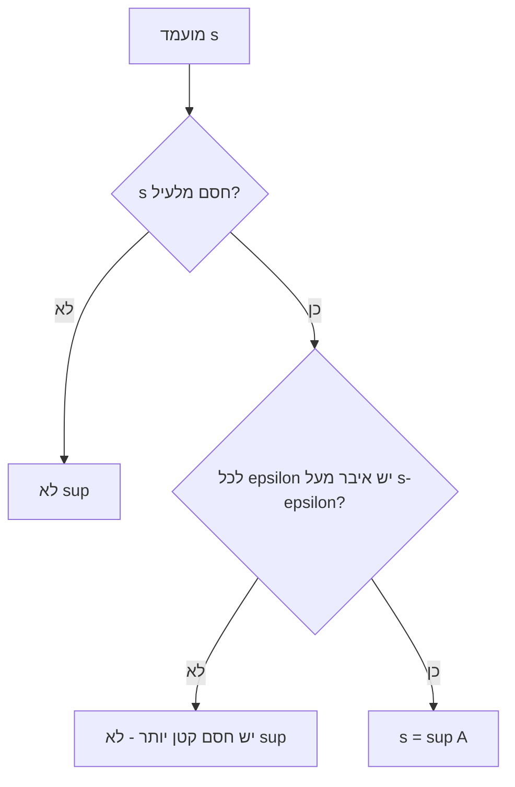

# חסמים: חסם עליון (sup) וחסם תחתון (inf)

> מקור: כרך א, פרק 3.1 (הגדרות 3.1, 3.2, 3.7, 3.12; טענות 3.3, 3.5, 3.8–3.10, 3.13, 3.14; משפטים 3.6, 3.11)

**מה חשוב כאן**: מה זה חסם עליון ($\sup$): החסם מלעיל הקטן ביותר. שני דברים לשלוט בהם: האפיון עם $\varepsilon$ (טענה 3.9), שהוא הדרך להוכיח ש-$y=\sup A$, וההבדל בין $\sup$ ל-$\max$. טענה 3.10 נמצאת ברשימת המשפטים לבחינה.

## חסם מלעיל ומלרע (הגדרה 3.1)

עבור $A \subseteq \mathbb{R}$:
- $c$ הוא **חסם מלעיל** של $A$ אם $a \le c$ לכל $a \in A$. אם קיים חסם כזה, אומרים ש-$A$ **חסומה מלעיל**.
- $c$ הוא **חסם מלרע** של $A$ אם $c \le a$ לכל $a\in A$. אם קיים חסם כזה, $A$ **חסומה מלרע**.
- **חסומה** (הגדרה 3.2): חסומה מלעיל וגם מלרע. לפי טענה 3.3 זה שקול לכך שקיים $M$ ממשי כך ש-$|x|< M$ לכל $x\in A$.

חסם מלעיל אינו יחיד: אם $c$ חסם מלעיל, גם כל מספר גדול ממנו הוא חסם מלעיל. לקטע $(0,1)$, למשל, קבוצת החסמים מלעיל היא כל $[1,\infty)$. השאלה המעניינת היא אם בין החסמים יש **קטן ביותר**.

> [!simple]- במילים פשוטות: תקרה ורצפה
> **בשורה אחת**: חסם הוא גבול שאף איבר בקבוצה לא עובר; הוא לא חייב להיות שייך לקבוצה.
>
> **תמונה בראש**: תקרה מעל כל הגבהים ורצפה מתחת לכולם. כדי שהקבוצה תהיה חסומה צריך את שתיהן.
>
> **עם מספרים**: לקבוצה $\{-2,1,4\}$ המספרים $4,5,100$ הם חסמים מלעיל, ו-$-2,-3$ חסמים מלרע. אפשר לבחור $M=5$, ואז $|x|<5$ לכל איבר.
>
> **מה לא מספיק**: $\mathbb N$ חסומה מלרע ב-$1$, אבל אין לה תקרה; חסימות מצד אחד אינה חסימות משני הצדדים.
>
> **תקרה נוחה ותקרה הכי נמוכה**: לקבוצה $(0,1)$ גם $2$ וגם $1$ הם חסמים מלעיל: אף איבר אינו מעליהם. אבל $2$ אינו החסם העליון, כי אפשר להנמיך את התקרה ל-$1$ ועדיין לכסות את כל הקבוצה.
>
> **מה מיוחד ב-$1$?** כל מספר קטן מ-$1$ כבר אינו חסם מלעיל: יש בקבוצה מספר גדול ממנו. לכן $\sup(0,1)=1$. המספר $1$ אינו שייך לקבוצה, ולכן אין לה מקסימום.
>
> **טיפ**: כדי להוכיח שמספר הוא סופרמום יש שתי משימות: להראות שהוא חסם מלעיל, ולהראות שאין חסם מלעיל קטן ממנו. בדיקת משימה אחת בלבד אינה מספיקה.

## תכונת החסם העליון (משפט 3.6) — לב היחידה

**לכל קבוצה לא ריקה וחסומה מלעיל יש חסם מלעיל מינימלי.**

הוא נקרא **החסם העליון** (סוּפְּרֶמוּם) ומסומן $\sup A$ (הגדרה 3.7). באופן סימטרי (משפט 3.11, הגדרה 3.12): לקבוצה לא-ריקה חסומה מלרע יש **חסם תחתון** (אינפימום) $\inf A$.

> [!simple]- במילים פשוטות: החסם הטוב ביותר
> **בשורה אחת**: הסופרמום הוא התקרה הנמוכה ביותר שעדיין נמצאת מעל כל הקבוצה. האינפימום הוא הרצפה הגבוהה ביותר שמתחת לכולה.
>
> **תמונה בראש**: מורידים תקרה עד שאי־אפשר להוריד אותה עוד, גם אם אין איבר שנוגע בה.
>
> **עם מספרים**: לקבוצה $(0,2)$ הסופרמום הוא $2$ והאינפימום $0$. המספר $2.1$ הוא חסם מלעיל, אך אינו הקטן ביותר.
>
> **מה נשבר כשמורידים תנאי**: ל-$\mathbb N$ אין חסם מלעיל ממשי. לקבוצה הריקה כל מספר הוא חסם, ולכן אין חסם מלעיל קטן ביותר. מעל הרציונליים בלבד גם קבוצה לא ריקה וחסומה יכולה להיעצר בחור כמו $\sqrt2$.

> [!plan]
> מסתכלים על הקבוצה הנתונה ועל קבוצת כל התקרות שלה. השלמות נותנת מספר ביניהן. הוא גם תקרה בעצמו וגם נמוך מכל התקרות, ולכן הוא הסופרמום.

**הוכחה (מ[[אקסיומת השלמות]])**: תהי $B$ קבוצת כל החסמים מלעיל של $A$. שתי הקבוצות לא ריקות ($A$ בהנחה; $B$ כי $A$ חסומה מלעיל), ולכל $a\in A,\ b\in B$: $a\le b$ (הגדרת חסם). לפי אקסיומת השלמות קיים מפריד $x$: $a\le x\le b$ לכל $a,b$. מהצד השמאלי — $x$ חסם מלעיל של $A$, כלומר $x\in B$; מהצד הימני — $x$ קטן-או-שווה מכל איבר של $B$, כלומר הוא **המינימלי** ב-$B$. ∎

שימו לב לשני תנאי הקיום — **לא ריקה** ו**חסומה מלעיל** — שניהם הכרחיים: ל-$\varnothing$ כל מספר הוא חסם מלעיל (באופן ריק: אין בקבוצה איבר שיכול להפר את הדרישה) ואין מינימלי; ל-$\mathbb{N}$ אין חסם מלעיל בכלל ([[תכונת ארכימדס והחלק השלם|ארכימדס]]). למעשה, תכונת החסם העליון **שקולה** לאקסיומת השלמות — ורוב ההוכחות בהמשך משתמשות דווקא בה. ב-$\mathbb{Q}$ היא נכשלת: ל-$\{q\in\mathbb{Q}: q^2<2\}$ אין sup רציונלי.

## האפיון העבודתי של sup (טענה 3.9)

$y = \sup A$ אם ורק אם:
1. $y$ חסם מלעיל של $A$: $\ \forall a\in A,\ a\le y$
2. לכל $\varepsilon>0$ קיים $x \in A$ כך ש-$x > y - \varepsilon$. במילים: שום מספר קטן מ-$y$ אינו חסם מלעיל.

> [!simple]- במילים פשוטות: איך מזהים סופרמום
> **בשורה אחת**: צריך להוכיח שני דברים: המועמד חוסם הכול, וכל הורדה קטנה שלו כבר מפספסת איבר.
>
> **תמונה בראש**: בודקים שהגג מעל כולם, ואז שאי־אפשר להנמיך אותו אפילו מעט.
>
> **עם מספרים**: בקבוצה $(0,1)$, אם מורידים את התקרה ל-$0.99$, האיבר $0.995$ כבר מעליה. בכלל, עבור $0<\varepsilon<1$ בוחרים $x=1-\varepsilon/2$.
>
> **מה נשבר בלי אחד התנאים**: $2$ חוסם את $(0,1)$ אך אינו חד מספיק; $0.5$ ניתן לקירוב מתוך הקבוצה אך אינו חוסם אותה.

התנאי השני = "יש איברי $A$ קרובים ל-sup כרצוננו". **מסקנה בונת-סדרות** (בשימוש בלתי פוסק): אם $y=\sup A$, אז לכל $n$ יש $x_n\in A$ עם $x_n>y-\frac1n$, ומסנדוויץ' $x_n\to y$ — כלומר **תמיד קיימת סדרה בתוך $A$ ששואפת ל-$\sup A$**. זה הגשר בין עולם הקבוצות לעולם הסדרות, והוא הצעד הראשון בהוכחות רבות (למשל [[משפטי ויירשטראס]]).

האפיון המקביל ל-inf: $y=\inf A$ $\iff$ $y$ חסם מלרע ולכל $\varepsilon>0$ יש $x\in A$ עם $x<y+\varepsilon$.

## sup לעומת max

- אם ל-$A$ יש מקסימום אז $\sup A = \max A$ (טענה 3.8); בדומה $\inf A=\min A$ (3.13).
- אבל sup קיים גם בלי מקסימום: $\sup(0,1)=1 \notin (0,1)$, $\ \inf\{\frac1n : n\in\mathbb{N}\}=0\notin$ הקבוצה.
- ההבחנה: ל-$A$ יש מקסימום אם ורק אם $\sup A\in A$. היתרון של $\sup$ הוא ש**קיומו מובטח** לכל קבוצה לא ריקה וחסומה מלעיל. למקסימום אין הבטחה כזו.

> [!simple]- במילים פשוטות: האם נוגעים בתקרה
> **בשורה אחת**: מקסימום הוא סופרמום ששייך לקבוצה; מינימום הוא אינפימום ששייך לה.
>
> **תמונה בראש**: יש הבדל בין גובה התקרה לבין גובה של אדם שבאמת עומד בחדר.
>
> **עם מספרים**: ל-$[0,1]$ יש מקסימום $1$; ל-$(0,1)$ אותו סופרמום $1$, אבל אין מקסימום. באותו אופן, ל-$\{1/n:n\ge1\}$ יש אינפימום $0$ ואין מינימום.
>
> **שימו לב**: קיום סופרמום אינו מבטיח שהוא איבר בקבוצה; לכן בדיקת שייכות היא צעד נפרד.

### דוגמאות מחושבות

| קבוצה | inf | min | sup | max |
|---|---|---|---|---|
| $[0,1]$ | 0 | 0 | 1 | 1 |
| $(0,1)$ | 0 | — | 1 | — |
| $\{\frac1n\}_{n\ge1}$ | 0 | — | 1 | 1 |
| $\{x: x^2<2\}$ | $-\sqrt2$ | — | $\sqrt2$ | — |
| $\mathbb{N}$ | 1 | 1 | — | — |

**דוגמת הוכחה** ($\sup(0,1)=1$; בחוברת זו טענה 3.5 בניסוח הכללי: $b$ הוא החסם מלעיל הקטן ביותר של $(a,b)$). (א) $1$ חסם מלעיל של $(0,1)$, ישירות מהגדרת הקטע. (ב) יהי $\varepsilon>0$, ואפשר להניח $\varepsilon<1$ (אם $\varepsilon\ge1$, כל איבר של הקטע גדול מ-$1-\varepsilon$). המספר $1-\frac\varepsilon2$ שייך ל-$(0,1)$ וגדול מ-$1-\varepsilon$. שני התנאים של טענה 3.9 מתקיימים, ולכן $\sup(0,1)=1$. ∎

## תכונות נוספות

- **טענה 3.10** — חיבור קבוצות (ברשימת המשפטים לבחינה): $\sup(A+B) = \sup A + \sup B$, כאשר $A+B=\{a+b : a\in A, b\in B\}$. ההוכחה המלאה בסעיף הבא.
- **שיקוף** (טענה 3.14): $\inf(-A) = -\sup A$. בזכות זה כל משפט על $\sup$ מתורגם מיד למשפט על $\inf$, ומספיק להוכיח הכול עבור $\sup$.
- **מונוטוניות** (לא בחוברת, הוכחה בשורה): אם $\varnothing\ne A\subseteq B$ ו-$B$ חסומה, אז $\sup A\le\sup B$ וגם $\inf A\ge\inf B$. הסיבה: $\sup B$ חסם מלעיל של $B$, ולכן גם של $A$, ו-$\sup A$ הוא החסם מלעיל הקטן ביותר של $A$.

> [!simple]- במילים פשוטות: חיבור ושיקוף של חסמים
> **בשורה אחת**: בחיבור שתי קבוצות אפשר לבחור איבר מכל אחת בנפרד, ולכן התקרות המדויקות מתחברות. שינוי סימן הופך תקרה לרצפה.
>
> **עם מספרים**: אם $A=(0,1)$ ו-$B=(0,2)$, אז $\sup(A+B)=3=1+2$. כדי לעבור את $2.9$ אפשר לבחור $0.98+1.98=2.96$.
>
> **שיקוף**: עבור $A=(0,2)$ מתקיים $-A=(-2,0)$, ולכן $\inf(-A)=-2=-\sup A$.
>
> **מה חייבים לבדוק**: בחיבור מדובר בקבוצות לא ריקות וחסומות מלעיל; בלי חסימות, למשל $A=\mathbb N$, אין סופרמום ממשי שאפשר לחבר. בשיקוף נדרשים אותם תנאים על $A$.

> [!exam] במבחן
> טענה 3.10 התבקשה להוכחה ב־**2 שאלות** במאגר, לפי תגית ההוכחה: [2022א·88, שאלה 2](#/exams/16/q2), [2023א·94, שאלה 2](#/exams/26/q2). השיטה: חסם לסכום, ואחריו בחירת שני איברים שכל אחד מפספס את הסופרמום שלו בפחות מחצי אפסילון.
>
> [שאלה 7 · 2019ב · מועד 85 — סריקה ללא פתרון](#/exams/2/q7). לפני בחירת תשובה, נסו להסביר אילו חסמים של הקבוצות רלוונטיים לקבוצת המנות. [עוד שאלות ביחידה](#/exams?unit=3).

## הוכחת טענה 3.10: $\sup(A+B)=\sup A+\sup B$

> [!plan]
> ראשית מחברים את שני החסמים ומקבלים חסם לסכום. אחר כך בוחרים מכל קבוצה איבר קרוב לסופרמום שלה בפחות מחצי אפסילון. הסכום שלהם קרוב לסכום הסופרמומים בפחות מאפסילון, ולכן אין חסם קטן יותר.

<!-- infi-proof: 3.10 -->

**הנתונים**: $A,B$ קבוצות לא ריקות וחסומות מלעיל של מספרים ממשיים. לפי משפט 3.6 קיימים $\alpha=\sup A$ ו-$\beta=\sup B$. נוכיח ש-$\alpha+\beta$ מקיים את שני התנאים של טענה 3.9 עבור הקבוצה $A+B$.

**תנאי 1: $\alpha+\beta$ חסם מלעיל של $A+B$.** כל איבר של $A+B$ הוא מהצורה $a+b$ עם $a\in A$ ו-$b\in B$. מכיוון ש-$\alpha$ חסם מלעיל של $A$, מתקיים $a\le\alpha$, ומכיוון ש-$\beta$ חסם מלעיל של $B$, מתקיים $b\le\beta$. לכן $a+b\le\alpha+\beta$ (חיבור אי-שוויונות).

**תנאי 2: אין חסם מלעיל קטן יותר.** יהי $\varepsilon>0$. לפי טענה 3.9 עבור $A$ עם $\frac\varepsilon2$, קיים $a\in A$ עם $a>\alpha-\frac\varepsilon2$. באותו אופן קיים $b\in B$ עם $b>\beta-\frac\varepsilon2$. האיבר $a+b$ שייך ל-$A+B$, ו-
$$a+b>\Big(\alpha-\frac\varepsilon2\Big)+\Big(\beta-\frac\varepsilon2\Big)=(\alpha+\beta)-\varepsilon.$$

שני התנאים של טענה 3.9 מתקיימים, ולכן $\sup(A+B)=\alpha+\beta=\sup A+\sup B$. ∎

<!-- /infi-proof -->

(בדרך: $A+B$ אינה ריקה, כי $A$ ו-$B$ אינן ריקות, ולכן ה-sup שלה מוגדר.)

## איך מוכיחים ש-$y=\sup A$ — תבנית

1. **חסם**: מראים $a\le y$ לכל $a\in A$ (אלגברה/אי-שוויונות).
2. **מינימליות**: נתון $\varepsilon>0$, בונים **איבר מפורש** של $A$ שגדול מ-$y-\varepsilon$. (או בשלילה: מניחים חסם $c<y$ ומגיעים לסתירה.)

טעות נפוצה: להסתפק ב"נראה שאי-אפשר פחות" בלי לבנות איבר. תנאי 2 דורש עד.

## תרגול מודרך: נסו לפני הפתרון

מצאו את הסופרמום ואת המקסימום, אם קיים, של $A=(0,2)$.

> [!hint]- רמז ראשון
> מצאו מספר שאף איבר בקבוצה אינו גדול ממנו. האם המספר הזה שייך לקבוצה?

> [!hint]- רמז שני
> כדי להראות שזה הסופרמום, הסבירו למה כל מספר קטן ממנו אינו חסם מלעיל.

> [!solution]- פתרון מלא
> המספר $2$ הוא חסם מלעיל. לכל $b<2$ יש איבר של $(0,2)$ שגדול מ-$b$: אם $b\le0$ נבחר $1$, ואם $0<b<2$ נבחר $(b+2)/2$. לכן $\sup A=2$. אין מקסימום: כל איבר $x\in A$ קטן מהאיבר $(x+2)/2$ השייך גם הוא לקבוצה.

## כרטיס דיוק

- **הרעיון המרכזי**: sup הוא תחליף ל-max כשהמקסימום לא מושג; הוא נקודת המגע בין סדר לשלמות, וקיומו הוא הצורה השימושית ביותר של אקסיומת השלמות.
- **מתי מפעילים**: קבוצה חסומה בלי מקסימום ברור; בניית איברים כמעט-מקסימליים; ובניית סדרה ששואפת ל-sup.
- **בדיקה עצמית**: (א) הוכיחו במלואו $\sup(0,1)=1$. (ב) הוכיחו את משפט 3.6 מהאקסיומה. (ג) בנו סדרה בתוך $\{x:x^2<2\}$ ששואפת ל-$\sqrt2$.
- **מלכודת**: חסם עליון חייב לחסום את **כל** הקבוצה; איבר גדול "כמעט מכולם" לא מספיק. ו-sup אינו בהכרח איבר של הקבוצה.

> [!solution]- פתרון (א)
> נסמן $A=(0,1)$. לכל $x\in A$ מתקיים $x<1$, ולכן $1$ חסם מלעיל. יהי $\varepsilon>0$, ונבחר $x=1-\min\{\varepsilon/2,1/2\}$. מתקיים $0<x<1$ וגם $1-x<\varepsilon$: אם $\varepsilon\le1$ המרחק הוא $\varepsilon/2$, ואם $\varepsilon>1$ המרחק הוא $1/2$. לכן $x>1-\varepsilon$. שני תנאי האפיון מתקיימים, ולכן $\sup A=1$.

> [!solution]- פתרון (ב)
> תהי $A\subseteq\mathbb R$ לא ריקה וחסומה מלעיל, ותהי $B$ קבוצת חסמיה מלעיל. $B$ אינה ריקה מחסימות $A$, ולכל $a\in A,b\in B$ מתקיים $a\le b$. מאקסיומת השלמות קיים $s$ כך ש-$a\le s\le b$ לכל זוג כזה. מן האי־שוויון הראשון $s$ חסם מלעיל, ולכן $s\in B$; מן השני $s$ קטן או שווה לכל חסם מלעיל. מכאן שהוא החסם מלעיל המינימלי, כנדרש.

> [!solution]- פתרון (ג)
> נבחר $x_n=\sqrt2\left(1-\frac1{n+1}\right)$. לכל $n\ge1$ מתקיים $0<x_n<\sqrt2$, ולכן $x_n^2<2$ ו-$x_n$ שייך לקבוצה. כמו כן $|x_n-\sqrt2|=\frac{\sqrt2}{n+1}\to0$, ולכן $x_n\to\sqrt2$. הגבול אינו חייב להשתייך לקבוצה.

## תרשים sup

## קשרים

- [[אקסיומת השלמות]] — המקור; תכונת החסם העליון שקולה לה
- [[תכונת ארכימדס והחלק השלם]] — מוכחת דרך sup
- [[סדרות מונוטוניות]] — עולה וחסומה מתכנסת ל-$\sup\{a_n\}$
- [[גבול עליון וגבול תחתון]] — limsup/liminf של סדרה
- [[משפטי ויירשטראס]] — פונקציה רציפה בקטע סגור מקבלת sup כמקסימום
