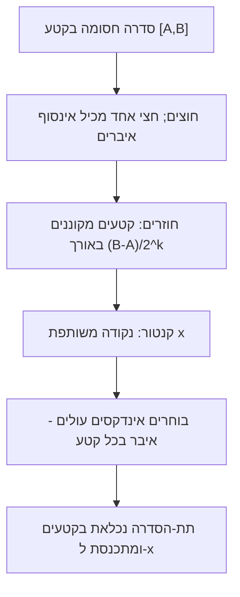

# משפט בולצאנו–ויירשטראס

> מקור: כרך א, סעיף 3.3.5 (משפט 3.32, מסקנה 3.33, משפט 3.34)

## המשפט (3.32)

**לכל סדרה חסומה יש תת-סדרה מתכנסת.**

ובניסוח גבולות חלקיים: לכל סדרה חסומה יש לפחות [[תת-סדרות וגבולות חלקיים|גבול חלקי]] אחד (סופי).

> [!simple]- במילים פשוטות: מוצאים מסלול שמתכנס
> **בשורה אחת**: בסדרה שנשארת בתחום חסום אפשר לבחור אינסוף איברים, לפי סדר הופעתם, שמתקרבים לאותו מספר.
>
> **תמונה בראש**: אינסוף ביקורים בתוך חדר סגור וחסום; אפשר למצוא אזור קטן יותר ויותר שיש בו עדיין אינסוף ביקורים.
>
> **עם מספרים**: $(-1)^n$ אינה מתכנסת, אבל האיברים במקומות $2,4,6,\dots$ שווים כולם ל-$1$, ולכן הם תת־סדרה מתכנסת.
>
> **מה נשבר בלי חסימות**: בסדרה $a_n=n$ כל תת־סדרה מקיימת $a_{n_k}=n_k\ge k\to\infty$, ולכן אין לה גבול סופי.
>
> **שימו לב**: המסקנה מבטיחה מסלול אחד מתכנס; היא אינה מבטיחה שכל הסדרה מתכנסת.

> [!exam] במבחן
> משפט 3.32 התבקש להוכחה ב־**7 שאלות** במאגר: למשל [2022א·88, שאלה 1](#/exams/16/q1), [2025ב·81, שאלה 1](#/exams/36/q1), [2026ב·97, שאלה 6](#/exams/44/q6). בהוכחה יש להסביר מדוע אפשר לבחור אינדקס גדול מהקודם בכל שלב.

> [!plan]
> חוצים שוב ושוב קטע חסום שמכיל את הסדרה, ובכל פעם שומרים חצי שמכיל אינסוף איברים. קנטור נותן נקודה משותפת לכל הקטעים. בוחרים בכל קטע איבר עם אינדקס חדש וגדול יותר; אורכי הקטעים שולטים במרחק שלו מהנקודה.

## הוכחה מלאה — חצייה + קנטור (ברשימת המשפטים לבחינה)

<!-- infi-proof: 3.32 -->

הסדרה חסומה: כל איבריה בקטע $I_0=[A,B]$.

**שלב 1 — בניית קטעים מקוננים.** נחצה את $I_0$ לשני חצאים שווים. לפחות אחד מהם מכיל $a_n$ עבור **אינסוף** אינדקסים $n$ (אילו בשניהם היו רק סופיים — גם באיחוד, סתירה). נבחר חצי כזה ונקרא לו $I_1$. נמשיך באינדוקציה: $I_{k+1}$ הוא חצי של $I_k$ המכיל אינסוף איברי סדרה. מתקבלת סדרת קטעים סגורים מקוננים עם $|I_k| = \frac{B-A}{2^k}\to0$.

**שלב 2 — קנטור.** לפי [[הלמה של קנטור]] קיימת נקודה יחידה $x\in\bigcap I_k$.

**שלב 3 — בניית תת-הסדרה.** נבחר $n_1$ עם $a_{n_1}\in I_1$. בהינתן $n_k$, נבחר $n_{k+1}>n_k$ עם $a_{n_{k+1}}\in I_{k+1}$ — אפשרי כי ב-$I_{k+1}$ יש איברים עם **אינסוף** אינדקסים, ובפרט גדולים מ-$n_k$. (זו בדיוק הנקודה שבה "אינסוף איברים" הכרחי — "לפחות איבר אחד" לא היה מספיק לבחירה אינסופית עולה!)

**שלב 4 — התכנסות.** $a_{n_k}$ ו-$x$ שניהם ב-$I_k$, לכן $|a_{n_k}-x|\le|I_k|=\frac{B-A}{2^k}\to0$, כלומר $a_{n_k}\to x$. ∎

<!-- /infi-proof -->

*(דרך חלופית שקיימת בספרות: לכל סדרה יש תת-סדרה מונוטונית — דרך "נקודות פסגה" — ואז [[סדרות מונוטוניות|משפט 3.16]]. הקורס הולך בדרך החצייה.)*

## הרחבות

- **מסקנה 3.33**: לכל סדרה (גם לא חסומה) יש תת-סדרה מתכנסת **במובן הרחב**: אם לא חסומה מלעיל — יש תת-סדרה $\to\infty$ (בוחרים $a_{n_k}>k$ באינדוקציה); בדומה מלרע.

> [!simple]- במילים פשוטות: גם בריחה לאינסוף היא אפשרות
> **בשורה אחת**: אם מרשים גם גבול אינסופי, מכל סדרה אפשר לחלץ תת־סדרה עם יעד.
>
> **עם מספרים**: עבור $(-1)^n n$, האיברים הזוגיים $2,4,6,\dots$ שואפים לאינסוף, והאי־זוגיים שואפים למינוס אינסוף.
>
> **איך בוחרים**: בסדרה שאינה חסומה מלעיל אפשר למצוא אחרי כל מקום עוד איבר שגדול מכל רף נתון; התחלה סופית לא יכולה להיות הסיבה לאי־חסימות.
>
> **מה לא מובטח**: ללא חסימות היעד לא חייב להיות מספר ממשי, כפי שרואים בסדרה $a_n=n$.

**משפט 3.34 — אפיון ההתכנסות** (הופיע במבחנים קודמים, לא ברשימה של 2026ג): סדרה **חסומה** מתכנסת $\iff$ יש לה גבול חלקי **יחיד**.

> [!simple]- במילים פשוטות: יעד יחיד בתוך תחום חסום
> **בשורה אחת**: אם הסדרה חסומה וכל מסלול מתכנס מתקרב לאותו מספר, גם הסדרה כולה מתקרבת אליו.
>
> **תמונה בראש**: אילו היו אינסוף ביקורים רחוק מהיעד, החסימות הייתה מאפשרת למצוא בהם מסלול מתכנס ליעד אחר.
>
> **עם מספרים**: $(-1)^n/n$ חסומה וכל הגבולות החלקיים שלה הם $0$, ולכן היא מתכנסת ל-$0$.
>
> **מה נשבר בלי חסימות**: $0,2,0,4,0,6,\dots$ בעלת גבול חלקי סופי יחיד $0$, אך אינה מתכנסת. בלי יחידות, $(-1)^n$ היא דוגמה חסומה ומתבדרת.

> [!plan]
> בכיוון הראשון משתמשים בכך שתת־סדרה יורשת את הגבול. בכיוון השני מניחים שיש אינסוף איברים שנשארים רחוק מהגבול החלקי היחיד. בולצאנו–ויירשטראס מחלץ מהם תת־סדרה מתכנסת, והמרחק הקבוע מבטיח שגבולה אחר — סתירה.

<!-- infi-proof: 3.34 -->

**כיוון ראשון: מהתכנסות נובע גבול חלקי יחיד.** אם $a_n\to L$, אז לפי משפט 3.25 כל תת-סדרה מתכנסת ל-$L$. לכן $L$ גבול חלקי, ואין גבול חלקי אחר.

**כיוון שני: חסומה עם גבול חלקי יחיד מתכנסת.** תהי $\{a_n\}$ חסומה, ויהי $L$ הגבול החלקי היחיד שלה (קיים לפי בולצאנו–ויירשטראס). נניח בשלילה ש-$a_n\not\to L$. לפי שלילת הגדרת הגבול קיים $\varepsilon_0>0$ כך שיש אינסוף ערכי $n$ עם $|a_n-L|\ge\varepsilon_0$. נסדר אותם בסדר עולה, $m_1<m_2<\cdots$, ונקבל תת-סדרה $\{a_{m_k}\}$. תת-הסדרה חסומה, כי $\{a_n\}$ חסומה, ולכן לפי בולצאנו–ויירשטראס יש לה תת-סדרה מתכנסת, $a_{m_{k_j}}\to L'$. זו גם תת-סדרה של $\{a_n\}$, ולכן $L'$ גבול חלקי של $\{a_n\}$. מצד שני $|a_{m_{k_j}}-L|\ge\varepsilon_0$ לכל $j$, ובגבול (משפט 2.31) $|L'-L|\ge\varepsilon_0>0$, כלומר $L'\ne L$. זה סותר את יחידות הגבול החלקי. ∎

<!-- /infi-proof -->

**החסימות חיונית**: נגדיר $a_n=0$ עבור $n$ אי-זוגי ו-$a_n=n$ עבור $n$ זוגי, כלומר $0,2,0,4,0,6,\dots$. לסדרה יש גבול חלקי סופי **יחיד**, $0$: תת-סדרה שמכילה אינסוף איברים ממקומות זוגיים אינה חסומה ולכן אינה מתכנסת, ותת-סדרה מתכנסת מכילה אפוא רק מספר סופי של איברים כאלה, וכל השאר אפסים. ובכל זאת הסדרה מתבדרת, כי היא אינה חסומה. לכן בלי חסימות, גבול חלקי יחיד אינו מספיק.

## מה המשפט באמת אומר

חסימות היא "דחיסת אינסוף איברים בקופסה סופית" — הם **חייבים להצטופף** סביב נקודה כלשהי. אין לאן לברוח: או שמתפזרים לאינסוף (אסור, חסומה) או שנערמים. זהו ביטוי ה**קומפקטיות** של קטע סגור — התכונה שהופכת את $[a,b]$ לזירה הנוחה של האנליזה — ועוד שקילות של [[אקסיומת השלמות]] (ב-$\mathbb{Q}$: קטיעות $\sqrt2$ חסומות ובלי גבול חלקי רציונלי).

## צרכני המשפט בהמשך הקורס

- [[סדרות קושי|קריטריון קושי]] (3.36) — סדרת קושי חסומה; ב"ו נותן גבול חלקי; תכונת קושי גוררת שכל הסדרה נגררת אליו.
- [[משפטי ויירשטראס]] (5.35, 5.37) — פעמיים: חסימות פונקציה רציפה (בשלילה, דרך סדרה) ולכידת נקודת מקסימום.
- [[רציפות במידה שווה ומשפט קנטור|משפט קנטור]] (5.48) — בשלילה, בונים שתי סדרות מתקרבות ומפעילים ב"ו.
- [[גבול עליון וגבול תחתון]] — קיום limsup/liminf לחסומה (משפט 3.38).

**תבנית השימוש האופיינית**: "יש לי סדרה שנבנתה בשלילה / מבחירת נקודות; היא חסומה (כי התחום חסום); אז יש תת-סדרה מתכנסת $x_{n_k}\to c$; עכשיו מפעילים רציפות/היינה על $c$ ומגיעים לסתירה או למבוקש." — כך נראות ההוכחות ביחידה 5.

## כרטיס דיוק

- **רעיון-על**: אינסוף איברים בקופסה חסומה חייבים להצטופף — לפחות מסלול מתכנס אחד מובטח.
- **מתי מפעילים**: סדרה חסומה בלי מונוטוניות; הוכחות-בשלילה על קטע סגור; וכל מקום שצריך "לחלץ" תת-סדרה מתכנסת.
- **בדיקה עצמית**: (א) שחזרו את ההוכחה, והסבירו איפה בדיוק נדרש "אינסוף איברים" (ולא "לפחות אחד"). (ב) הוכיחו את מסקנה 3.33 לסדרה לא חסומה. (ג) תנו דוגמה שמפריכה את 3.34 בלי חסימות.
- **מלכודת**: המשפט לא אומר שהסדרה מתכנסת — רק שיש לה תת-סדרה מתכנסת; ואפיון 3.34 דורש חסימות.
- **קישור רוחב**: ראו גם [[מפת תלות משפטים - אינפי 1]], [[תבניות הוכחה באינפי 1]], [[אינדקס דוגמאות נגד - אינפי 1]].

> [!solution]- פתרון (א)
> נבחר קטע סגור $I_0=[A,B]$ המכיל את כל האיברים. אם $A=B$ הסדרה קבועה, וסיימנו. אחרת בכל שלב נחצה את הקטע לשני חצאים סגורים. לפחות בחצי אחד יש איברים באינסוף אינדקסים, כי איחוד שתי קבוצות סופיות של אינדקסים הוא סופי. נבחר חצי כזה. כך מתקבלים קטעים מקוננים $I_k$ באורך $(B-A)/2^k\to0$. מקנטור יש נקודה $x$ בחיתוכם. נבחר $n_1$ עם $a_{n_1}\in I_1$; אחרי בחירת $n_k$ נבחר $n_{k+1}>n_k$ עם $a_{n_{k+1}}\in I_{k+1}$. אפשר לעשות זאת כי יש בקטע אינסוף אינדקסים ורק סופיים שאינם גדולים מ-$n_k$. כעת $|a_{n_k}-x|\le(B-A)/2^k\to0$, ולכן תת־הסדרה מתכנסת ל-$x$.

> [!solution]- פתרון (ב)
> אם הסדרה אינה חסומה מלעיל, גם כל זנב שלה (האיברים ממקום מסוים והלאה) אינו חסום מלעיל: אחרת צירוף חסם הזנב ומקסימום ההתחלה הסופית היה חוסם את כל הסדרה. לכן אפשר לבחור באינדוקציה $n_k>n_{k-1}$ עם $a_{n_k}>k$. לכל רף $M$, כאשר $k>M$ מתקיים $a_{n_k}>M$, ולכן $a_{n_k}\to\infty$. אם הסדרה חסומה מלעיל אך אינה חסומה, היא אינה חסומה מלרע; מפעילים את אותו טיעון על $-a_n$ ומקבלים תת־סדרה השואפת ל-$-\infty$. יחד עם המקרה החסום, שבו מפעילים בולצאנו–ויירשטראס, מתקבלת המסקנה לכל סדרה.

> [!solution]- פתרון (ג)
> נגדיר $a_{2k-1}=0$, $a_{2k}=2k$. האי־זוגיים נותנים גבול חלקי $0$. כל תת־סדרה עם אינסוף איברים זוגיים אינה חסומה ולכן אינה מתכנסת למספר ממשי. מכאן שכל תת־סדרה המתכנסת למספר ממשי מכילה רק סופיים מהזוגיים, ולכן ממקום מסוים היא אפס וגבולה $0$. זה הגבול החלקי הסופי היחיד, אך הסדרה אינה חסומה ולפיכך אינה מתכנסת.

## תרשים הוכחה

## קשרים

- [[הלמה של קנטור]] — מנוע ההוכחה
- [[תת-סדרות וגבולות חלקיים]] — השפה; משפט 3.34
- [[סדרות קושי]] — הצרכן המיידי הבא
- [[משפטי ויירשטראס]], [[רציפות במידה שווה ומשפט קנטור]] — הצרכנים ביחידה 5
- [[אקסיומת השלמות]] — השורש
