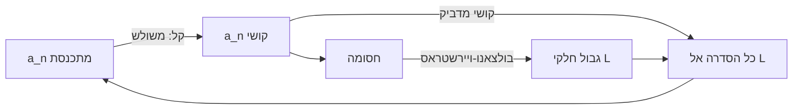

# סדרות קושי וקריטריון קושי

> מקור: כרך א, סעיף 3.3.6 (הגדרה 3.35, משפט 3.36)

**מה חשוב כאן**: תנאי קושי: לכל $\varepsilon$, ממקום מסוים והלאה כל שני איברים קרובים זה לזה עד כדי $\varepsilon$. המשפט המרכזי (3.36): סדרה מתכנסת אם ורק אם היא סדרת קושי. היתרון: אפשר להוכיח התכנסות בלי לדעת מהו הגבול. המלכודת: לא מספיק שאיברים **סמוכים** מתקרבים זה לזה.

## תנאי קושי (הגדרה 3.35)

$\{a_n\}$ מקיימת את **תנאי קושי** אם:
$$\forall\varepsilon>0\ \exists N\in\mathbb{N}:\ \forall m,n> N,\quad |a_m - a_n| < \varepsilon$$

כלומר: מאיזשהו שלב, **כל שני איברים** (לא רק עוקבים!) קרובים זה לזה עד כדי $\varepsilon$. סדרה כזו נקראת **סדרת קושי**. ניסוח שקול ונוח: לכל $\varepsilon>0$ קיים $N$ כך שלכל $n> N$ ולכל $p\ge1$: $|a_{n+p}-a_n|<\varepsilon$ — "המרחק מכל איבר עתידי, רחוק ככל שיהיה, קטן מ-$\varepsilon$".

> [!simple]- במילים פשוטות: כל זוג מאוחר קרוב
> **בשורה אחת**: בסדרת קושי, אחרי שמתקדמים מספיק, כל האיברים מצטופפים קרוב זה לזה.
>
> **תמונה בראש**: מטיילים שמתכנסים לקבוצה קטנה, גם בלי לדעת מראש את כתובת המפגש.
>
> **עם מספרים**: עבור $a_n=1/n$ וכל $m,n>10$, מתקיים $|a_m-a_n|<0.1$. לכל דיוק קטן יותר אפשר להתקדם עוד.
>
> **מה לא מספיק**: שכנים קרובים אינם מבטיחים שכל הקבוצה קטנה. בסדרה $\sqrt n$ הפרשי השכנים שואפים לאפס, אבל בין האיברים במקום $n$ ובמקום $4n$ המרחק הוא $\sqrt n$.

### המלכודת המפורסמת של הקורס

לא מספיק ש-$|a_{n+1}-a_n|\to0$! **דוגמת הדגל**: $a_n=\sqrt n$. מתקיים
$$a_{n+1}-a_n=\sqrt{n+1}-\sqrt n=\frac{1}{\sqrt{n+1}+\sqrt n}\to0,$$
אבל הסדרה אינה סדרת קושי: עבור $m=4n$ מתקיים $a_m-a_n=2\sqrt n-\sqrt n=\sqrt n\to\infty$. ההפרשים הקטנים בין איברים סמוכים **מצטברים** להפרש גדול. תנאי קושי דורש שליטה על $|a_m-a_n|$ לכל **זוג** אינדקסים גדולים, ולא רק לאינדקסים סמוכים.

## קריטריון קושי (משפט 3.36)

**סדרה מתכנסת $\iff$ היא סדרת קושי.**

> [!simple]- במילים פשוטות: קרבה הדדית הופכת לגבול
> **בשורה אחת**: בסדרות ממשיות, להצטופף יחד יותר ויותר ולשאוף לגבול הם שני תיאורים של אותה תופעה.
>
> **תמונה בראש**: בולצאנו–ויירשטראס מוצא יעד לחלק מהמטיילים; תנאי קושי מחייב את כל האחרים להגיע איתם.
>
> **עם מספרים**: אם איבר מאוחר נמצא פחות מ-$0.05$ מאיבר תת־סדרה, ואותו איבר פחות מ-$0.05$ מהגבול, המרחק הכולל קטן מ-$0.1$.
>
> **למה חשוב לעבוד בממשיים**: הקטיעות העשרוניות של $\sqrt2$ הן סדרת קושי של רציונליים, אך אין להן גבול רציונלי. השלמות מבטיחה שהיעד אינו חסר.

> [!plan]
> בכיוון הראשון מקרבים כל אחד משני איברים לאותו גבול בחצי הדיוק. בכיוון השני מראים שקושי נותן חסימות, ומחלצים תת־סדרה מתכנסת. שוב מחלקים את הדיוק לשניים: מרחק לאיבר מתאים של תת־הסדרה, וממנו לגבול.

### הוכחה מלאה

**כיוון ראשון: מתכנסת ולכן קושי.** נניח $a_n\to L$. יהי $\varepsilon>0$; קיים $N$ כך שלכל $n> N$: $|a_n-L|<\frac\varepsilon2$. אז לכל $m,n> N$:
$$|a_m-a_n| \le |a_m-L|+|L-a_n| < \tfrac\varepsilon2+\tfrac\varepsilon2 = \varepsilon. \ ∎$$
גם כאן השתמשנו באי-שוויון המשולש ובפיצול של $\varepsilon$ לשני חצאים. ראו [[ערך מוחלט ומרחק]].

**כיוון שני: קושי ולכן מתכנסת — הכיוון העמוק.**

*שלב 1: סדרת קושי חסומה.* עבור $\varepsilon=1$ יש $N$ כך שלכל $m,n> N$ מתקיים $|a_m-a_n|<1$. נקבע $m=N+1$: לכל $n>N$ מתקיים $|a_n-a_{N+1}|<1$, ולכן $|a_n|<|a_{N+1}|+1$. יחד עם הרישא הסופית (מספר סופי של האיברים הראשונים) $a_1,\dots,a_N$ הסדרה חסומה (כמו בהוכחת [[גבול של סדרה|משפט 2.16]]).

*שלב 2: יש גבול חלקי.* לפי [[משפט בולצאנו-ויירשטראס]] יש תת-סדרה $a_{n_k}\to L$.

*שלב 3: כל הסדרה נגררת אל $L$.* יהי $\varepsilon>0$. מתנאי קושי קיים $N_1$ כך שלכל $m,n> N_1$ מתקיים $|a_m-a_n|<\frac\varepsilon2$. מהתכנסות התת-סדרה קיים $k$ עם $n_k> N_1$ ו-$|a_{n_k}-L|<\frac\varepsilon2$. לכן לכל $n> N_1$:
$$|a_n-L| \le |a_n-a_{n_k}|+|a_{n_k}-L| < \tfrac\varepsilon2+\tfrac\varepsilon2=\varepsilon. \ ∎$$

**סיכום הרעיון**: קושי ולכן חסומה ולכן (ב"ו) גבול חלקי ולכן (קושי שוב) כולם צמודים לתת-הסדרה ולכן גבול מלא. שימו לב שקושי משמש **פעמיים**.

## המשמעות העקרונית

זהו קריטריון התכנסות **פנימי לחלוטין**: לא צריך לנחש את הגבול ולא צריך מונוטוניות ([[סדרות מונוטוניות|השוו למשפט 3.16]]) — רק להשוות איברי הסדרה לעצמם. שלושת קריטריוני ההתכנסות של הקורס, בסדר כלליות עולה:

| קריטריון | דורש | נותן |
|---|---|---|
| הגדרת הגבול | מועמד $L$ | הכול |
| מונוטונית+חסומה | מונוטוניות | קיום גבול = sup |
| **קושי** | כלום (פנימי) | קיום גבול |

הכיוון הקשה נשען על [[אקסיומת השלמות]] (ויחד עם תכונת ארכימדס הוא אפילו שקול לה): ב-$\mathbb{Q}$ יש סדרות קושי בלי גבול (קטיעות עשרוניות של $\sqrt2$: קושי כי ההפרשים $<10^{-n}$, בלי גבול רציונלי) — הגבול "חסר". שלמות = "כל סדרת קושי מתכנסת". (זו גם הדרך האלטרנטיבית **לבנות** את $\mathbb{R}$ בקורסים מתקדמים.)

## שימוש טיפוסי — הפרשים דועכים הנדסית

אם $|a_{n+1}-a_n| \le c\, q^n$ עם $c>0$ ו-$0<q<1$, אז לכל $m>n$ (טלסקופ + סכום הנדסי):
$$|a_m-a_n| \le \sum_{k=n}^{m-1}|a_{k+1}-a_k| \le c\sum_{k=n}^{m-1}q^k = c\,q^n\,\frac{1-q^{m-n}}{1-q} < \frac{c\,q^n}{1-q} \xrightarrow[n\to\infty]{} 0$$
— קושי, ולכן מתכנסת, בלי שום מושג מה הגבול. כך מטפלים בסדרות "מתכווצות" (כמו $a_{n+1}=\cos(a_n)$ ודומותיה; את ההפרשים שם חוסמים בעזרת [[משפט לגראנז|לגראנז']] מיחידה 8) ובסדרות של סכומים סופיים עם דעיכה הנדסית. **התבנית**: הפרש-שכנים קטן גאומטרית ולכן טלסקופ ולכן קושי.

ולהפרכה: כדי להראות שסדרה אינה מתכנסת, מספיק למצוא $\varepsilon$ וזוגות $m,n$ גדולים כרצוננו עם $|a_m-a_n|\ge\varepsilon$ (כמו $|a_{4n}-a_n|=\sqrt n$ עבור $a_n=\sqrt n$).

## נסו בעצמכם: השלימו את החסר

**טענה**: $a_n=\dfrac1n$ היא סדרת קושי. (נוכיח ישירות מההגדרה, בלי להשתמש בגבול.)

יהי $\varepsilon>0$. לכל $m,n>N$:

$$\left|\frac1m-\frac1n\right|\le\frac1m+\frac1n<\underline{\quad?\quad}+\underline{\quad?\quad}=\frac{2}{N}.$$

כדי שזה יהיה קטן מ-$\varepsilon$ מספיק לבחור $N$ כך ש-$N>\underline{\quad?\quad}$.

> [!hint]- רמז
> אם $m>N$ אז $\frac1m<\frac1N$. את הדרישה $\frac2N<\varepsilon$ פותרים עבור $N$.

> [!solution]- פתרון
> לכל $m,n>N$ מתקיים $\frac1m<\frac1N$ ו-$\frac1n<\frac1N$, ולכן
> $$\left|\frac1m-\frac1n\right|\le\frac1m+\frac1n<\frac1N+\frac1N=\frac2N.$$
> נבחר $N$ טבעי כך ש-$N>\frac{2}{\varepsilon}$ (יש כזה לפי תכונת ארכימדס). אז $\frac2N<\varepsilon$, ותנאי קושי מתקיים. ∎
>
> עם מספרים: עבור $\varepsilon=0.01$ מספיק $N=201$. שימו לב שהגבול $0$ לא הופיע בהוכחה.

## כרטיס דיוק

- **הרעיון המרכזי**: תנאי קושי בודק התכנסות "מבפנים": האיברים בזנב (כל האיברים ממקום מסוים והלאה) קרובים זה לזה, בלי להזכיר גבול.
- **מתי מפעילים**: גבול לא ניתן לניחוש; הפרשים דועכים גאומטרית; הוכחת אי־התכנסות באמצעות זוגות איברים רחוקים; ודיוני שלמות.
- **בדיקה עצמית**: (א) הוכיחו ששני הכיוונים של 3.36. (ב) הראו ש-$\sqrt n$ אינה קושי אף ש-$a_{n+1}-a_n\to0$. (ג) הוכיחו התכנסות כש-$|a_{n+1}-a_n|\le2^{-n}$.
- **מלכודת**: $|a_{n+1}-a_n|\to0$ אינו תנאי קושי. התנאי דורש קרבה בין כל שני איברים בזנב, ולא רק בין איברים סמוכים.

> [!solution]- פתרון (א)
> אם $a_n\to L$, אז לכל $\varepsilon>0$ קיים $N$ כך שלכל $n>N$ מתקיים $|a_n-L|<\varepsilon/2$. לכל $m,n>N$ נקבל $|a_m-a_n|\le|a_m-L|+|a_n-L|<\varepsilon$, ולכן הסדרה קושי.
> להפך, נניח קושי. עבור $\varepsilon=1$ יש $N_0$ כך שלכל $n>N_0$ מתקיים $|a_n-a_{N_0+1}|<1$, ולכן $|a_n|<|a_{N_0+1}|+1$. יחד עם מספר סופי של איברים ראשונים נקבל חסימות. לפי בולצאנו–ויירשטראס קיימת תת־סדרה $a_{n_k}\to L$.
> יהי $\varepsilon>0$. מתנאי קושי יש $N$ כך שלכל $m,n>N$ מתקיים $|a_m-a_n|<\varepsilon/2$. נבחר $k$ גדול מספיק כך שגם $n_k>N$ וגם $|a_{n_k}-L|<\varepsilon/2$. לכל $n>N$ מתקיים $|a_n-L|\le|a_n-a_{n_k}|+|a_{n_k}-L|<\varepsilon$. לכן $a_n\to L$.

> [!solution]- פתרון (ב)
> לכל $n\ge1$ מתקיים $a_{n+1}-a_n=1/(\sqrt{n+1}+\sqrt n)\to0$. עם זאת, נבחר $\varepsilon=1$. לכל $N$ נבחר טבעי $n>\max\{N,1\}$ ונגדיר $m=4n>N$. אז $|a_m-a_n|=\sqrt n>1$. מצאנו לכל $N$ זוג מאוחר שמרחקו לפחות $\varepsilon$, ולכן תנאי קושי נכשל.

> [!solution]- פתרון (ג)
> לכל $m>n$ נכתוב הפרש כסכום סופי ונשתמש במשולש:
> $$|a_m-a_n|\le\sum_{k=n}^{m-1}|a_{k+1}-a_k|\le\sum_{k=n}^{m-1}2^{-k}=2^{1-n}(1-2^{-(m-n)})<2^{1-n}.$$
> יהי $\varepsilon>0$. מאחר ש-$2^{1-n}\to0$, קיים $N$ כך שלכל $n>N$ החסם קטן מ-$\varepsilon$. לכל שני אינדקסים גדולים מ-$N$ משתמשים בקטן מהם כחסם התחלתי; אם הם שווים ההפרש אפס. לכן הסדרה קושי, וממשפט 3.36 היא מתכנסת.

## תרשים לוגי

## קשרים

- [[משפט בולצאנו-ויירשטראס]] — לב הכיוון הקשה
- [[אקסיומת השלמות]] — השקילות העמוקה
- [[גבול של סדרה]] — ההגדרה שהקריטריון מייתר
- [[ערך מוחלט ומרחק]] — אי-שוויון המשולש בשני הכיוונים
- [[סדרות מונוטוניות]] — הקריטריון המקביל בעולם המונוטוני
- [[גבולות אינסופיים וגבולות באינסוף|תנאי קושי לפונקציות]] — גרסה לגבול פונקציה

## תרגול ממבחנים

שאלות ממבחני עבר בנושא הזה, עם רמזים ופתרונות מקופלים: [[שאלות ממבחנים - סדרות|סדרות]]. כל הנושאים נמצאים ב[[שער תרגול לפי נושאים]].
