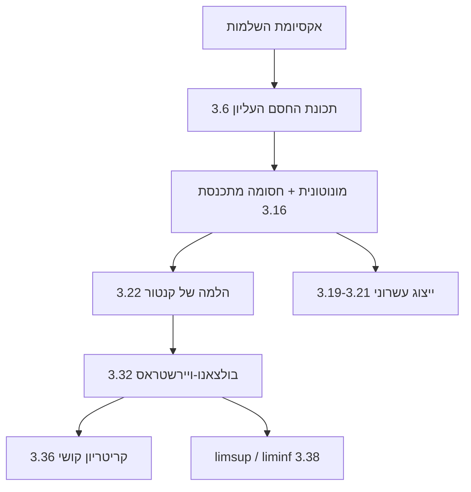

# שער יחידה 3 - קבוצות וסדרות חסומות

> שם היחידה בכרך א: "קבוצות וסדרות חסומות". הפרקים: 3.1 חסם עליון ותחתון, 3.2 סדרות מונוטוניות, 3.3 גבולות חלקיים.

## מה היחידה הזאת עושה

זו היחידה שבה [[אקסיומת השלמות]] מתפרקת לכלים מעשיים. השרשרת: **שלמות ומכאן sup ומכאן מונוטונית+חסומה מתכנסת ומכאן קנטור ומכאן בולצאנו-ויירשטראס ומכאן קושי** — כל חוליה מוכחת מהקודמת, וכולן יחד הן ארגז משפטי הקיום שכל יחידות ההמשך (5, 8) יישענו עליו. שבעה מתוך 33 הפריטים ב[[רשימת המשפטים לבחינה - אינפי 1|רשימה הרשמית לבחינה]] נמצאים ביחידה הזו, ובהם 3.16, 3.22 ו-3.32.

## ציר לימוד

1. **[[חסמים - חסם עליון ותחתון]]** — sup/inf: קיום, אפיון, ובניית סדרות אל ה-sup
2. **[[סדרות מונוטוניות]]** — משפט 3.16 ותבנית הסדרות הרקורסיביות
3. [[ייצוג עשרוני של מספרים ממשיים]] — יישום ראשון: משמעות לשבר אינסופי
4. [[הלמה של קנטור]] — קטעים מקוננים ושיטת החצייה
5. [[תת-סדרות וגבולות חלקיים]] — השפה: מסלולים ויעדים
6. **[[משפט בולצאנו-ויירשטראס]]** — חסומה ולכן תת-סדרה מתכנסת
7. **[[סדרות קושי]]** — הקריטריון הפנימי
8. [[גבול עליון וגבול תחתון]] — limsup/liminf: מעטפת ההתנהגות

## שרשרת התלות

## שלוש נקודות שנבחנים נופלים בהן

1. **הצבת גבול ברקורסיה לפני הוכחת קיום** — קודם חסימות+מונוטוניות, רק אחר-כך $L=f(L)$.
2. **$|a_{n+1}-a_n|\to0$ אינו קושי** — $\sqrt n$ היא דוגמה נגדית; קושי דורש כל זוג $m,n$.
3. **גבול חלקי ≠ גבול** — "אינסוף איברים בסביבה" מול "כמעט כולם"; תת-סדרה מתכנסת אחת אינה מוכיחה התכנסות.

## דיאגרמת יחידה

<!-- infi-demo: nested-intervals -->

## כל הפתקים ביחידה

- [[גבול עליון וגבול תחתון]]
- [[הלמה של קנטור]]
- [[חסמים - חסם עליון ותחתון]]
- [[ייצוג עשרוני של מספרים ממשיים]]
- [[משפט בולצאנו-ויירשטראס]]
- [[סדרות מונוטוניות]]
- [[סדרות קושי]]
- [[תת-סדרות וגבולות חלקיים]]

## סוגי שאלות במבחן

- **הוכחת בולצאנו–ויירשטראס או קנטור**: [2022א·88, שאלה 1](#/exams/16/q1), [2022ג·82, שאלה 1](#/exams/22/q1), [2026ב·97, שאלה 6](#/exams/44/q6). בקנטור עוקבים אחר שתי סדרות הקצוות; בבולצאנו–ויירשטראס שומרים בכל חצייה אינסוף אינדקסים ובוחרים אותם בסדר עולה.
- **חסמים ופעולות על קבוצות**: [2022א·88, שאלה 2](#/exams/16/q2), [2023ב·84, שאלה 6](#/exams/27/q6), [2026א·83, שאלה 3](#/exams/40/q3). מתחילים מחסם לכל האיברים, ואז מוכיחים שאי־אפשר לשפר אותו בעזרת אפסילון או דוגמה נגדית.
- **סדרות רקורסיביות ושילוב זוגיים ואי־זוגיים**: [2022א·91, שאלה 3](#/exams/17/q3), [2023א·81, שאלה 3](#/exams/24/q3). מוכיחים הגדרה היטב, חסימות ומונוטוניות; אם הסדרה מתנדנדת, בוחנים כל זוגיות בנפרד לפני משוואות הגבול.
- **גבולות חלקיים, גבול עליון ותחתון**: [2022א·97, שאלה 7](#/exams/18/q7), [2024א·81, שאלה 6](#/exams/29/q6). מוצאים תתי־סדרות שמגיעות לערכים, וגם מנמקים מדוע אין גבולות חלקיים נוספים; מבדילים בין sup לבין limsup.
- **הוכח או הפרך באמצעות תתי־סדרות**: [2022א·91, שאלה 5](#/exams/17/q5), [2023א·94, שאלה 5](#/exams/26/q5). בודקים אם נדרשת חסימות ואם אותם אינדקסים מתאימים לשתי הסדרות; סכום גבולות חלקיים אינו בהכרח גבול חלקי של הסכום.
- **קושי תחת הפעלת פונקציה**: [2022ב·81, שאלה 4](#/exams/19/q4), [2022ב·84, שאלה 4](#/exams/20/q4). ברציפות במידה שווה מעבירים את דרישת הדיוק לתנאי קושי; ברציפות רגילה בלבד בודקים האם הגבול נמצא בתחום.

## בדיקת שליטה

- להוכיח במלואם את משפטי היחידה שברשימה לבחינה: 3.10, 3.16, 3.17, 3.22, 3.27, 3.32 ולמה 3.37 ([[רשימת המשפטים לבחינה - אינפי 1]]). קריטריון קושי (3.36) אינו ברשימה, אבל ההוכחה שלו היא חזרה טובה על ב"ו.
- להריץ את תבנית הסדרה הרקורסיבית על $a_1=\sqrt2,\ a_{n+1}=\sqrt{2+a_n}$ מא' עד ת'.
- להדגים סביב $\sqrt2$ כיצד משפט הסדרה המונוטונית החסומה, הלמה של קנטור ומשפט בולצאנו–ויירשטראס נכשלים כשדורשים גבול או נקודת חיתוך רציונליים.
- לחשב limsup/liminf של $(-1)^n(1+\frac1n)$ ולנמק מהאפיון.
- להסביר למה $0.999\dots=1$ דרך הגדרת הערך כגבול.

> [!solution]- פתרון (א) — הוכחת 3.10
> **הנתונים**: $A,B$ קבוצות לא ריקות וחסומות מלעיל של מספרים ממשיים. לפי משפט 3.6 קיימים $\alpha=\sup A$ ו-$\beta=\sup B$. נוכיח ש-$\alpha+\beta$ מקיים את שני התנאים של טענה 3.9 עבור הקבוצה $A+B$.
>
> **תנאי 1: $\alpha+\beta$ חסם מלעיל של $A+B$.** כל איבר של $A+B$ הוא מהצורה $a+b$ עם $a\in A$ ו-$b\in B$. מכיוון ש-$\alpha$ חסם מלעיל של $A$, מתקיים $a\le\alpha$, ומכיוון ש-$\beta$ חסם מלעיל של $B$, מתקיים $b\le\beta$. לכן $a+b\le\alpha+\beta$ (חיבור אי-שוויונות).
>
> **תנאי 2: אין חסם מלעיל קטן יותר.** יהי $\varepsilon>0$. לפי טענה 3.9 עבור $A$ עם $\frac\varepsilon2$, קיים $a\in A$ עם $a>\alpha-\frac\varepsilon2$. באותו אופן קיים $b\in B$ עם $b>\beta-\frac\varepsilon2$. האיבר $a+b$ שייך ל-$A+B$, ו-
> $$a+b>\Big(\alpha-\frac\varepsilon2\Big)+\Big(\beta-\frac\varepsilon2\Big)=(\alpha+\beta)-\varepsilon.$$
>
> שני התנאים של טענה 3.9 מתקיימים, ולכן $\sup(A+B)=\alpha+\beta=\sup A+\sup B$. ∎

> [!solution]- פתרון (א) — הוכחת 3.16
> תהי $\{a_n\}$ עולה וחסומה מלעיל. קבוצת האיברים $\{a_n\}$ לא ריקה וחסומה מלעיל, ולכן לפי [[חסמים - חסם עליון ותחתון|תכונת החסם העליון]] קיים
> $$s=\sup\{a_n \mid n\in\mathbb{N}\}.$$
> נוכיח $a_n\to s$. יהי $\varepsilon>0$. לפי אפיון ה-sup (טענה 3.9), $s-\varepsilon$ אינו חסם מלעיל — קיים $N$ עם $a_N > s-\varepsilon$. מהמונוטוניות, לכל $n\ge N$:
> $$s-\varepsilon < a_N \le a_n \le s < s+\varepsilon,$$
> (האי-שוויון $a_n\le s$ — כי $s$ חסם מלעיל). לכן $|a_n-s|<\varepsilon$ לכל $n\ge N$. ∎

> [!solution]- פתרון (א) — הוכחת 3.17
> **הוכחה (המקרה העולה).** תהי $\{a_n\}$ עולה ולא חסומה. סדרה עולה חסומה מלרע על-ידי $a_1$, כי $a_1\le a_n$ לכל $n$. לכן אם הסדרה הייתה חסומה מלעיל, היא הייתה חסומה. מכאן ש-$\{a_n\}$ **אינה חסומה מלעיל**. יהי $M$ ממשי. $M$ אינו חסם מלעיל של הסדרה, ולכן קיים $N$ עם $a_N>M$. מכיוון שהסדרה עולה, לכל $n>N$ מתקיים $a_n\ge a_N>M$. זו בדיוק הגדרה 2.36, ולכן $a_n\to\infty$. המקרה היורד מתקבל מהמקרה העולה עבור $\{-a_n\}$ ומטענה 2.39. ∎

> [!solution]- פתרון (א) — הוכחת 3.22
> **שלב 1 — הקצוות מונוטוניים וחסומים.** מהקינון: $a_1\le a_2\le\dots$ (הקצה השמאלי רק זז ימינה) ו-$b_1\ge b_2\ge\dots$; וכן לכל $m,n$: $a_n\le b_m$ (כל קצה שמאלי משמאל לכל קצה ימני — קחו את הקטע העמוק מבין השניים). בפרט $\{a_n\}$ עולה וחסומה מלעיל על-ידי $b_1$, ו-$\{b_n\}$ יורדת וחסומה מלרע על-ידי $a_1$.
>
> **שלב 2 — התכנסות.** לפי [[סדרות מונוטוניות|משפט 3.16]]: $a_n\to \alpha=\sup a_n$ ו-$b_n\to \beta=\inf b_n$, ומ-$a_n\le b_n$ בגבול $\alpha\le\beta$.
>
> **שלב 3 — ההתכווצות מזהה.** $\beta-\alpha = \lim(b_n-a_n) = 0$, לכן $\alpha=\beta=:x$.
>
> **שלב 4 — $x$ בכל הקטעים.** לכל $n$: $a_n\le\alpha=x=\beta\le b_n$ (sup מעל כל $a_n$, inf מתחת לכל $b_n$), כלומר $x\in I_n$.
>
> **שלב 5 — יחידות.** אם $x,y$ שתיהן בחיתוך אז לכל $n$: $|x-y|\le b_n-a_n\to0$, ולכן $x=y$. ∎

> [!solution]- פתרון (א) — הוכחת 3.27
> **כיוון ראשון: מגבול חלקי נובעים אינסוף איברים בכל סביבה.** תהי $a_{n_k}\to L$, ויהי $\varepsilon>0$. קיים $K$ כך שלכל $k>K$ מתקיים $|a_{n_k}-L|<\varepsilon$. האינדקסים $n_{K+1}<n_{K+2}<\cdots$ שונים זה מזה, ולכן יש אינסוף ערכי $n$ עם $|a_n-L|<\varepsilon$.
>
> **כיוון שני: מאינסוף איברים בכל סביבה בונים גבול חלקי.** נבנה באינדוקציה אינדקסים $n_1<n_2<\cdots$ כך ש-$|a_{n_k}-L|<\frac1k$.
> - עבור $\varepsilon=1$ יש אינסוף $n$-ים עם $|a_n-L|<1$; נבחר אחד מהם ונסמן $n_1$.
> - נניח שבחרנו $n_1<\dots<n_k$. עבור $\varepsilon=\frac1{k+1}$ יש **אינסוף** $n$-ים עם $|a_n-L|<\frac1{k+1}$, ולכן יש ביניהם $n>n_k$. נבחר אחד כזה ונסמן $n_{k+1}$.
>
> הסדרה $\{n_k\}$ עולה ממש, ולכן $\{a_{n_k}\}$ תת-סדרה. מתקיים $L-\frac1k<a_{n_k}<L+\frac1k$, ולפי הסנדוויץ' $a_{n_k}\to L$. לכן $L$ גבול חלקי. ∎

> [!solution]- פתרון (א) — הוכחת 3.32
> הסדרה חסומה: כל איבריה בקטע $I_0=[A,B]$.
>
> **שלב 1 — בניית קטעים מקוננים.** נחצה את $I_0$ לשני חצאים שווים. לפחות אחד מהם מכיל $a_n$ עבור **אינסוף** אינדקסים $n$ (אילו בשניהם היו רק סופיים — גם באיחוד, סתירה). נבחר חצי כזה ונקרא לו $I_1$. נמשיך באינדוקציה: $I_{k+1}$ הוא חצי של $I_k$ המכיל אינסוף איברי סדרה. מתקבלת סדרת קטעים סגורים מקוננים עם $|I_k| = \frac{B-A}{2^k}\to0$.
>
> **שלב 2 — קנטור.** לפי [[הלמה של קנטור]] קיימת נקודה יחידה $x\in\bigcap I_k$.
>
> **שלב 3 — בניית תת-הסדרה.** נבחר $n_1$ עם $a_{n_1}\in I_1$. בהינתן $n_k$, נבחר $n_{k+1}>n_k$ עם $a_{n_{k+1}}\in I_{k+1}$ — אפשרי כי ב-$I_{k+1}$ יש איברים עם **אינסוף** אינדקסים, ובפרט גדולים מ-$n_k$. (זו בדיוק הנקודה שבה "אינסוף איברים" הכרחי — "לפחות איבר אחד" לא היה מספיק לבחירה אינסופית עולה!)
>
> **שלב 4 — התכנסות.** $a_{n_k}$ ו-$x$ שניהם ב-$I_k$, לכן $|a_{n_k}-x|\le|I_k|=\frac{B-A}{2^k}\to0$, כלומר $a_{n_k}\to x$. ∎

> [!solution]- פתרון (א) — הוכחת 3.37
> **הוכחה.** לפי משפט 3.27 מספיק להראות שלכל $\varepsilon>0$ יש אינסוף ערכי $n$ עם $|a_n-x|<\varepsilon$.
>
> 1. יהי $\varepsilon>0$. מכיוון ש-$x_k\to x$, קיים $k$ עם $|x_k-x|<\frac\varepsilon2$.
> 2. $x_k$ הוא גבול חלקי, ולכן לפי משפט 3.27 (עם $\frac\varepsilon2$) יש אינסוף ערכי $n$ עם $|a_n-x_k|<\frac\varepsilon2$.
> 3. לכל $n$ כזה, לפי אי-שוויון המשולש,
> $$|a_n-x|\le|a_n-x_k|+|x_k-x|<\frac\varepsilon2+\frac\varepsilon2=\varepsilon.$$
>
> לכן יש אינסוף ערכי $n$ עם $|a_n-x|<\varepsilon$, ו-$x$ גבול חלקי. ∎

> [!solution]- פתרון (ב)
> בסיס: $0<a_1=\sqrt2<2$. אם $0<a_n<2$, אז $0<a_{n+1}=\sqrt{2+a_n}<2$, ולכן הסדרה מוגדרת וחסומה מלמעלה ב-$2$. נוסף על כך, לכל $0<a_n<2$ מתקיים
> $$a_{n+1}^2-a_n^2=2+a_n-a_n^2=(2-a_n)(a_n+1)>0.$$
> שני האיברים חיוביים, לכן $a_{n+1}>a_n$. הסדרה עולה וחסומה, ולכן מתכנסת ל-$L\in[\sqrt2,2]$. נעביר גבול בזהות $a_{n+1}^2=2+a_n$ ונקבל $L^2=2+L$, כלומר $(L-2)(L+1)=0$. החסם החיובי פוסל את $-1$, ולכן $L=2$.

> [!solution]- פתרון (ג)
> נסמן $q_n=\lfloor10^n\sqrt2\rfloor/10^n$. אלו רציונליים, והסדרה עולה, חסומה ומתכנסת בממשיים ל-$\sqrt2$, כי $0\le\sqrt2-q_n<10^{-n}$. לכן אין לה גבול רציונלי, וזה כישלון הגרסה הרציונלית של משפט המונוטונית החסומה.
> כל תת־סדרה שלה שואפת לאותו גבול בממשיים. מיחידות הגבול אין תת־סדרה שמתכנסת לרציונלי, ולכן גם הגרסה הרציונלית של בולצאנו–ויירשטראס נכשלת.
> לקנטור נבחר $I_n=[q_n,q_n+10^{-n}]\cap\mathbb Q$. אלה קטעים רציונליים סגורים, לא ריקים, מקוננים, ואורכם $10^{-n}\to0$: כל קטיעה נוספת מחלקת את הקטע הקודם לעשר תת־יחידות ובוחרת אחת מהן. בממשיים החיתוך הוא רק $\sqrt2$, ולכן בתוך $\mathbb Q$ החיתוך ריק. אין בכך כישלון של כל משפט על תתי־סדרות מעל הרציונליים; כשלנו בדרישות הקיום האלה.

> [!solution]- פתרון (ד)
> הזוגיים הם $a_{2k}=1+1/(2k)\to1$, והאי־זוגיים $a_{2k-1}=-1-1/(2k-1)\to-1$. כדי לבדוק את האפיון, יהי $\varepsilon>0$ ונבחר $N>1/\varepsilon$. לכל $n>N$ מתקיים $-1-\varepsilon<a_n<1+\varepsilon$. אינסוף הזוגיים גדולים מ-$1-\varepsilon$, ואינסוף האי־זוגיים קטנים מ-$-1+\varepsilon$. מכאן שהגבול העליון $1$ והתחתון $-1$.

> [!solution]- פתרון (ה)
> הקטיעה בעלת $n$ ספרות היא $s_n=\sum_{k=1}^n9/10^k=1-10^{-n}$. לכן $s_n\to1$. הגדרת ערכו של פיתוח עשרוני אינסופי היא גבול הקטיעות, ומכאן $0.999\dots=1$. האי־שוויון החד $s_n<1$ לכל $n$ אינו מחייב אי־שוויון חד בגבול.

## חזרה

- [[כרטיסי חזרה - אינפי 1]]
- [[כספת העל - אינפי 1]]
- [[אינפי 1 - מפת הקורס]]
