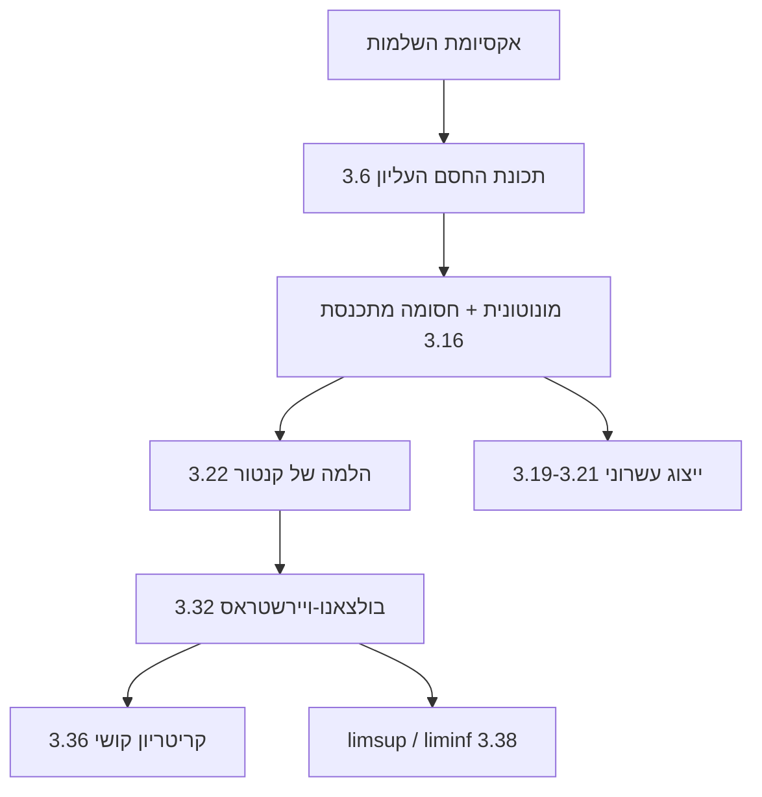

# שער יחידה 3 - קבוצות וסדרות חסומות

> שם היחידה בכרך א: "קבוצות וסדרות חסומות". הפרקים: 3.1 חסם עליון ותחתון, 3.2 סדרות מונוטוניות, 3.3 גבולות חלקיים.

## מה היחידה הזאת עושה

זו היחידה שבה [[אקסיומת השלמות]] מתפרקת לכלים מעשיים. השרשרת: **שלמות ומכאן sup ומכאן מונוטונית+חסומה מתכנסת ומכאן קנטור ומכאן בולצאנו-ויירשטראס ומכאן קושי** — כל חוליה מוכחת מהקודמת, וכולן יחד הן ארגז משפטי הקיום שכל יחידות ההמשך (5, 8) יישענו עליו. שבעה מתוך 33 הפריטים ב[[רשימת המשפטים לבחינה - אינפי 1|רשימה הרשמית לבחינה]] נמצאים ביחידה הזו, ובהם 3.16, 3.22 ו-3.32.

## ציר לימוד

1. **[[חסמים - חסם עליון ותחתון]]** — sup/inf: קיום, אפיון, ובניית סדרות אל ה-sup
2. **[[סדרות מונוטוניות]]** — משפט 3.16 ותבנית הסדרות הרקורסיביות
3. [[ייצוג עשרוני של מספרים ממשיים]] — יישום ראשון: משמעות לשבר אינסופי
4. [[הלמה של קנטור]] — קטעים מקוננים ושיטת החצייה
5. [[תת-סדרות וגבולות חלקיים]] — השפה: מסלולים ויעדים
6. **[[משפט בולצאנו-ויירשטראס]]** — חסומה ולכן תת-סדרה מתכנסת
7. **[[סדרות קושי]]** — הקריטריון הפנימי
8. [[גבול עליון וגבול תחתון]] — limsup/liminf: מעטפת ההתנהגות

## שרשרת התלות

## שלוש נקודות שנבחנים נופלים בהן

1. **הצבת גבול ברקורסיה לפני הוכחת קיום** — קודם חסימות+מונוטוניות, רק אחר-כך $L=f(L)$.
2. **$|a_{n+1}-a_n|\to0$ אינו קושי** — $\sqrt n$ היא דוגמה נגדית; קושי דורש כל זוג $m,n$.
3. **גבול חלקי ≠ גבול** — "אינסוף איברים בסביבה" מול "כמעט כולם"; תת-סדרה מתכנסת אחת אינה מוכיחה התכנסות.

## דיאגרמת יחידה

<!-- infi-demo: nested-intervals -->

## כל הפתקים ביחידה

- [[גבול עליון וגבול תחתון]]
- [[הלמה של קנטור]]
- [[חסמים - חסם עליון ותחתון]]
- [[ייצוג עשרוני של מספרים ממשיים]]
- [[משפט בולצאנו-ויירשטראס]]
- [[סדרות מונוטוניות]]
- [[סדרות קושי]]
- [[תת-סדרות וגבולות חלקיים]]

## סוגי שאלות במבחן

- **הוכחת בולצאנו–ויירשטראס או קנטור**: [2022א·88, שאלה 1](#/exams/16/q1), [2022ג·82, שאלה 1](#/exams/22/q1), [2026ב·97, שאלה 6](#/exams/44/q6). בקנטור עוקבים אחר שתי סדרות הקצוות; בבולצאנו–ויירשטראס שומרים בכל חצייה אינסוף אינדקסים ובוחרים אותם בסדר עולה.
- **חסמים ופעולות על קבוצות**: [2022א·88, שאלה 2](#/exams/16/q2), [2023ב·84, שאלה 6](#/exams/27/q6), [2026א·83, שאלה 3](#/exams/40/q3). מתחילים מחסם לכל האיברים, ואז מוכיחים שאי־אפשר לשפר אותו בעזרת אפסילון או דוגמה נגדית.
- **סדרות רקורסיביות ושילוב זוגיים ואי־זוגיים**: [2022א·91, שאלה 3](#/exams/17/q3), [2023א·81, שאלה 3](#/exams/24/q3). מוכיחים הגדרה היטב, חסימות ומונוטוניות; אם הסדרה מתנדנדת, בוחנים כל זוגיות בנפרד לפני משוואות הגבול.
- **גבולות חלקיים, גבול עליון ותחתון**: [2022א·97, שאלה 7](#/exams/18/q7), [2024א·81, שאלה 6](#/exams/29/q6). מוצאים תתי־סדרות שמגיעות לערכים, וגם מנמקים מדוע אין גבולות חלקיים נוספים; מבדילים בין sup לבין limsup.
- **הוכח או הפרך באמצעות תתי־סדרות**: [2022א·91, שאלה 5](#/exams/17/q5), [2023א·94, שאלה 5](#/exams/26/q5). בודקים אם נדרשת חסימות ואם אותם אינדקסים מתאימים לשתי הסדרות; סכום גבולות חלקיים אינו בהכרח גבול חלקי של הסכום.
- **קושי תחת הפעלת פונקציה**: [2022ב·81, שאלה 4](#/exams/19/q4), [2022ב·84, שאלה 4](#/exams/20/q4). ברציפות במידה שווה מעבירים את דרישת הדיוק לתנאי קושי; ברציפות רגילה בלבד בודקים האם הגבול נמצא בתחום.

## בדיקת שליטה

- להוכיח במלואם את משפטי היחידה שברשימה לבחינה: 3.10, 3.16, 3.17, 3.22, 3.27, 3.32 ולמה 3.37 ([[רשימת המשפטים לבחינה - אינפי 1]]). קריטריון קושי (3.36) אינו ברשימה, אבל ההוכחה שלו היא חזרה טובה על ב"ו.
- להריץ את תבנית הסדרה הרקורסיבית על $a_1=\sqrt2,\ a_{n+1}=\sqrt{2+a_n}$ מא' עד ת'.
- להדגים סביב $\sqrt2$ כיצד משפט הסדרה המונוטונית החסומה, הלמה של קנטור ומשפט בולצאנו–ויירשטראס נכשלים כשדורשים גבול או נקודת חיתוך רציונליים.
- לחשב limsup/liminf של $(-1)^n(1+\frac1n)$ ולנמק מהאפיון.
- להסביר למה $0.999\dots=1$ דרך הגדרת הערך כגבול.

> [!solution]- פתרון (א): איפה כל הוכחה
> כל הוכחה כתובה במלואה פעם אחת, בפתק שלה, עם תוכנית בשלוש שורות ומצב "שלב אחר שלב":
>
> - 3.10, $\sup(A+B)$: [[חסמים - חסם עליון ותחתון]]
> - 3.16 ו-3.17, סדרות מונוטוניות: [[סדרות מונוטוניות]]
> - 3.22, הלמה של קנטור: [[הלמה של קנטור]]
> - 3.27 ו-3.37, גבולות חלקיים: [[תת-סדרות וגבולות חלקיים]]
> - 3.32, בולצאנו-ויירשטראס: [[משפט בולצאנו-ויירשטראס]]
>
> **איך מתרגלים**: כותבים כל הוכחה מדף ריק, ורק אז פותחים את הפתק ומשווים. אפשר גם לסדר את השלבים בפאזל ההוכחות שבעמוד [התרגול](#/practice).

> [!solution]- פתרון (ב)
> בסיס: $0<a_1=\sqrt2<2$. אם $0<a_n<2$, אז $0<a_{n+1}=\sqrt{2+a_n}<2$, ולכן הסדרה מוגדרת וחסומה מלמעלה ב-$2$. נוסף על כך, לכל $0<a_n<2$ מתקיים
> $$a_{n+1}^2-a_n^2=2+a_n-a_n^2=(2-a_n)(a_n+1)>0.$$
> שני האיברים חיוביים, לכן $a_{n+1}>a_n$. הסדרה עולה וחסומה, ולכן מתכנסת ל-$L\in[\sqrt2,2]$. נעביר גבול בזהות $a_{n+1}^2=2+a_n$ ונקבל $L^2=2+L$, כלומר $(L-2)(L+1)=0$. החסם החיובי פוסל את $-1$, ולכן $L=2$.

> [!solution]- פתרון (ג)
> נסמן $q_n=\lfloor10^n\sqrt2\rfloor/10^n$. אלו רציונליים, והסדרה עולה, חסומה ומתכנסת בממשיים ל-$\sqrt2$, כי $0\le\sqrt2-q_n<10^{-n}$. לכן אין לה גבול רציונלי, וזה כישלון הגרסה הרציונלית של משפט המונוטונית החסומה.
> כל תת־סדרה שלה שואפת לאותו גבול בממשיים. מיחידות הגבול אין תת־סדרה שמתכנסת לרציונלי, ולכן גם הגרסה הרציונלית של בולצאנו–ויירשטראס נכשלת.
> לקנטור נבחר $I_n=[q_n,q_n+10^{-n}]\cap\mathbb Q$. אלה קטעים רציונליים סגורים, לא ריקים, מקוננים, ואורכם $10^{-n}\to0$: כל קטיעה נוספת מחלקת את הקטע הקודם לעשר תת־יחידות ובוחרת אחת מהן. בממשיים החיתוך הוא רק $\sqrt2$, ולכן בתוך $\mathbb Q$ החיתוך ריק. כלומר, מעל $\mathbb Q$ שלושת משפטי הקיום נכשלים. השלמות של $\mathbb R$ היא בדיוק מה שמציל אותם.

> [!solution]- פתרון (ד)
> הזוגיים הם $a_{2k}=1+1/(2k)\to1$, והאי־זוגיים $a_{2k-1}=-1-1/(2k-1)\to-1$. כדי לבדוק את האפיון, יהי $\varepsilon>0$ ונבחר $N>1/\varepsilon$. לכל $n>N$ מתקיים $-1-\varepsilon<a_n<1+\varepsilon$. אינסוף הזוגיים גדולים מ-$1-\varepsilon$, ואינסוף האי־זוגיים קטנים מ-$-1+\varepsilon$. מכאן שהגבול העליון $1$ והתחתון $-1$.

> [!solution]- פתרון (ה)
> הקטיעה בעלת $n$ ספרות היא $s_n=\sum_{k=1}^n9/10^k=1-10^{-n}$. לכן $s_n\to1$. הגדרת ערכו של פיתוח עשרוני אינסופי היא גבול הקטיעות, ומכאן $0.999\dots=1$. האי־שוויון החד $s_n<1$ לכל $n$ אינו מחייב אי־שוויון חד בגבול.

## חזרה

- [[כרטיסי חזרה - אינפי 1]]
- [[כספת העל - אינפי 1]]
- [[אינפי 1 - מפת הקורס]]
