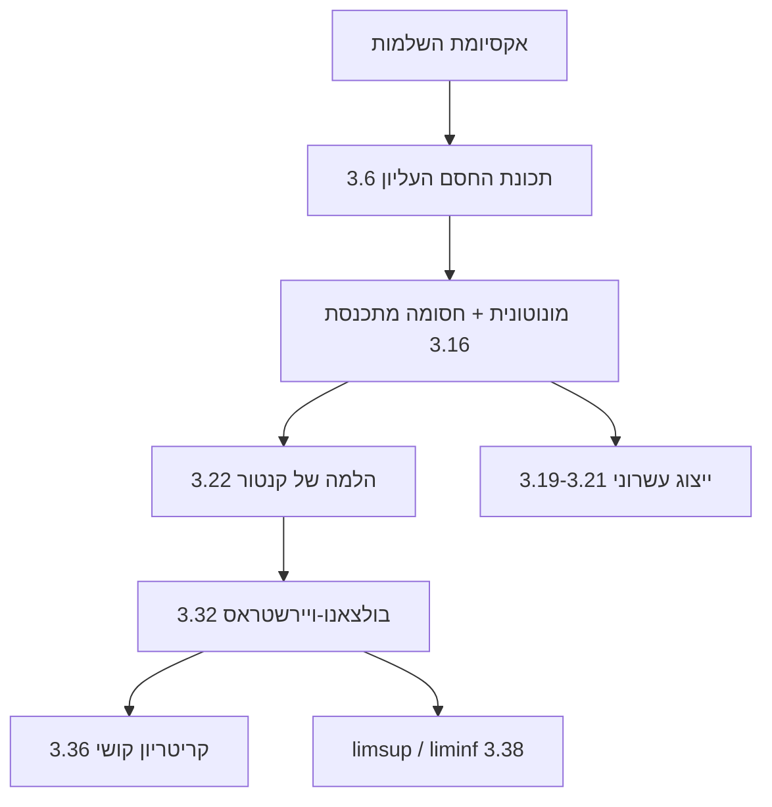

# שער יחידה 3 - קבוצות וסדרות חסומות

> שם היחידה בכרך א: "קבוצות וסדרות חסומות". הפרקים: 3.1 חסם עליון ותחתון, 3.2 סדרות מונוטוניות, 3.3 גבולות חלקיים.

## מה היחידה הזאת עושה

זו היחידה שבה [[אקסיומת השלמות]] מתפרקת לכלים מעשיים. השרשרת: **שלמות ⟵ sup ⟵ מונוטונית+חסומה מתכנסת ⟵ קנטור ⟵ בולצאנו-ויירשטראס ⟵ קושי** — כל חוליה מוכחת מהקודמת, וכולן יחד הן ארגז משפטי הקיום שכל יחידות ההמשך (5, 8) יישענו עליו. שמונה מתוך 35 המשפטים ב[[רשימת המשפטים לבחינה - אינפי 1|רשימה הרשמית לבחינה]] נמצאים ביחידה הזו, ובהם 3.16, 3.22 ו-3.32.

## ציר לימוד

1. **[[חסמים - חסם עליון ותחתון]]** — sup/inf: קיום, אפיון, ובניית סדרות אל ה-sup
2. **[[סדרות מונוטוניות]]** — משפט 3.16 ותבנית הסדרות הרקורסיביות
3. [[ייצוג עשרוני של מספרים ממשיים]] — יישום ראשון: משמעות לשבר אינסופי
4. [[הלמה של קנטור]] — קטעים מקוננים ושיטת החצייה
5. [[תת-סדרות וגבולות חלקיים]] — השפה: מסלולים ויעדים
6. **[[משפט בולצאנו-ויירשטראס]]** — חסומה ⟹ תת-סדרה מתכנסת
7. **[[סדרות קושי]]** — הקריטריון הפנימי
8. [[גבול עליון וגבול תחתון]] — limsup/liminf: מעטפת ההתנהגות

## שרשרת התלות



## שלוש נקודות שנבחנים נופלים בהן

1. **הצבת גבול ברקורסיה לפני הוכחת קיום** — קודם חסימות+מונוטוניות, רק אחר-כך $L=f(L)$.
2. **$|a_{n+1}-a_n|\to0$ אינו קושי** — $\sqrt n$ והטור ההרמוני הם דוגמאות הנגד; קושי דורש כל זוג $m,n$.
3. **גבול חלקי ≠ גבול** — "אינסוף איברים בסביבה" מול "כמעט כולם"; תת-סדרה מתכנסת אחת אינה מוכיחה התכנסות.

## דיאגרמת יחידה

<!-- infi-demo: nested-intervals -->

## כל הפתקים ביחידה

```dataview
TABLE WITHOUT ID file.link AS "פתק", join(file.tags, ", ") AS "תגים"
FROM "יחידה 3 - חסמים וגבולות חלקיים"
WHERE file.name != this.file.name
SORT file.name ASC
```

## בדיקת שליטה

- להוכיח במלואם את משפטי היחידה שברשימה לבחינה: 3.10, 3.16, 3.17, 3.22, 3.27, 3.32, 3.34 ולמה 3.37 ([[רשימת המשפטים לבחינה - אינפי 1]]). קריטריון קושי (3.36) אינו ברשימה, אבל ההוכחה שלו היא חזרה טובה על ב"ו.
- להריץ את תבנית הסדרה הרקורסיבית על $a_1=\sqrt2,\ a_{n+1}=\sqrt{2+a_n}$ מא' עד ת'.
- להסביר למה כל אחד מהמשפטים נכשל מעל $\mathbb{Q}$, עם דוגמה מפורשת סביב $\sqrt2$.
- לחשב limsup/liminf של $(-1)^n(1+\frac1n)$ ולנמק מהאפיון.
- להסביר למה $0.999\dots=1$ דרך הגדרת הערך כגבול.

## חזרה

- [[כרטיסי חזרה - אינפי 1]]
- [[כספת העל - אינפי 1]]
- [[אינפי 1 - מפת הקורס]]
