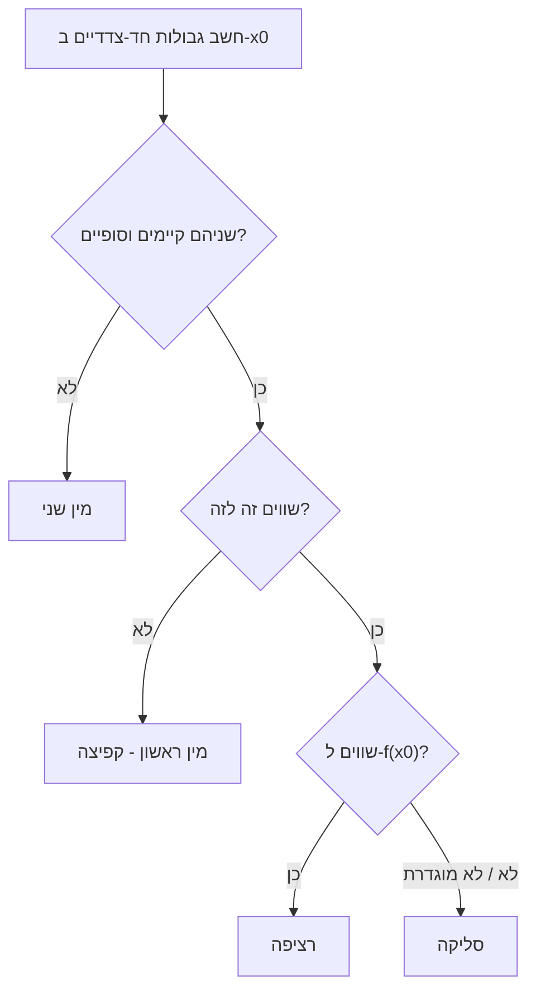

# מיון נקודות אי-רציפות

> מקור: כרך ב, סעיף 5.1.5 (הגדרות 5.21–5.23) + משפט 5.41

**מה חשוב כאן**: שלושת הסוגים, וסדר העבודה שממיין כל נקודה: מחשבים את שני הגבולות החד-צדדיים, ושואלים אם הם קיימים, אם הם סופיים ואם הם שווים. מספיק לזכור דוגמה אחת לכל סוג: $\frac{\sin x}{x}$ (סליקה), $\operatorname{sgn}(x)$ (קפיצה) ו-$\frac1x$ (מין שני).

## שלושת הסוגים

### 1. אי-רציפות סליקה (הגדרה 5.21)

הגבול $\lim_{x\to x_0} f(x) = L$ **קיים וסופי**, אבל $f(x_0)$ לא מוגדר, או $f(x_0) \ne L$.

זו תקלה בנקודה אחת בלבד. אם מגדירים מחדש את הערך בנקודה, $f(x_0)=L$, הפונקציה נעשית רציפה שם. מכאן השם "סליקה": אפשר לסלק את אי-הרציפות. דוגמאות: $\frac{\sin x}{x}$ ב-$0$ (הגבול הוא $1$, והפונקציה אינה מוגדרת שם); $\frac{x^2-1}{x-1}$ ב-$1$ (הגבול הוא $2$); $f(x)=x^2$ לכל $x\ne0$ עם $f(0)=7$ (הגבול הוא $0$, והערך שונה ממנו).

> [!simple]- במילים פשוטות: חור שאפשר לסתום
> **בשורה אחת**: שני הצדדים מצביעים על אותו גובה סופי, ורק הערך בנקודה חסר או לא מתאים.
>
> **תמונה בראש**: חתיכה אחת חסרה במסילה ישרה; משלימים אותה בגובה הנכון.
>
> **עם מספרים**: עבור $\frac{x^2-1}{x-1}$, כש-$x\ne1$ הערך הוא $x+1$. ב-$0.99$ מקבלים $1.99$ וב-$1.01$ מקבלים $2.01$, ולכן ההשלמה ב-$1$ היא $2$.
>
> **מה חייבים לבדוק**: אם אין גבול סופי משותף, שום בחירה של ערך אחד לא תתקן את הרציפות.

> [!simple]- נבנה את הרעיון צעד אחר צעד
> **שלוש שאלות לאבחון החיבור**: מהו הגבול משמאל? מהו הגבול מימין? מהו ערך הפונקציה בנקודה? רושמים כל תשובה בנפרד ומשווים.
>
> **חור שאפשר למלא**: אם $f(x)=x+1$ לכל $x\ne1$ ו-$f(1)=7$, שני הצדדים שואפים ל-$2$. הבעיה היא רק בערך שבנקודה; הגדרת הערך מחדש ל-$2$ תיצור רציפות.
>
> **קפיצה**: ל-$|x|/x$ הגבול משמאל ל-$0$ הוא $-1$ ומימין הוא $1$. אין ערך יחיד שאפשר לשים ב-$0$ כדי ששני הצדדים יתאימו לו.

### 2. אי-רציפות ממין ראשון — "קפיצה" (הגדרה 5.22)

שני [[גבולות חד-צדדיים|הגבולות החד-צדדיים]] קיימים וסופיים אבל **שונים**:
$$\lim_{x\to x_0^-} f(x) = L_1 \neq L_2 = \lim_{x\to x_0^+} f(x)$$

**גובה הקפיצה** הוא $L_2-L_1$. דוגמאות: $\lfloor x\rfloor$ בכל מספר שלם (קפיצה בגובה $1$), ו-$\operatorname{sgn}(x)$ ב-$0$ (קפיצה בגובה $2$). כאן שינוי של הערך בנקודה אינו עוזר: אפשר להתאים אותו לכל היותר לאחד הצדדים, והגרף קופץ בכל מקרה.

> [!simple]- במילים פשוטות: שתי מדרגות שלא נפגשות
> **בשורה אחת**: כל צד מתקרב לגובה סופי משלו, אבל הגבהים שונים.
>
> **תמונה בראש**: מגיעים למדרגה משני כיוונים; שינוי הצבע של נקודה אחת לא מבטל את הפרש הגבהים.
>
> **עם מספרים**: ב-$|x|/x$ ליד $0$, כל ערך משמאל הוא $-1$ וכל ערך מימין הוא $1$. הקפיצה בגובה $2$.
>
> **מה לא משנה**: גם אם נקבע את הערך ב-$0$ להיות $-1$, $0$ או $1$, שני הגבולות החד־צדדיים יישארו שונים.

### 3. אי-רציפות ממין שני (הגדרה 5.23)

כל השאר: **לפחות אחד** הגבולות החד-צדדיים לא קיים או אינסופי. דוגמאות לפי תת-סוג:
- **התנדנדות**: $\sin\frac1x$ ב-$0$. הגבולות החד-צדדיים אינם קיימים, כי הפונקציה מתנדנדת אינסוף פעמים בכל סביבה של $0$.
- **שאיפה לאינסוף**: $\frac1x$ ב-$0$. הגבולות החד-צדדיים אינסופיים.
- **בלי גבול באף נקודה**: [[פונקציית דיריכלה]]. אין לה גבול חד-צדדי באף נקודה.
- **מקרה מעורב**: $e^{1/x}$ ב-$0$. משמאל הגבול הוא $0$ והוא קיים, ומימין הגבול הוא $\infty$. מספיק שאחד הצדדים אינו סופי.

> [!simple]- במילים פשוטות: לפחות צד אחד לא נרגע
> **בשורה אחת**: כשצד אחד אינו מתקרב למספר סופי, אי־הרציפות היא ממין שני.
>
> **תמונה בראש**: המחוג ממשיך להתנדנד או יוצא מכל טווח; אין גובה סופי שאפשר לחבר אליו את המסילה.
>
> **עם מספרים**: עבור $1/x^2$, הערכים ב-$0.1,0.01,0.001$ הם $100,10000,1000000$. בשני הצדדים הם גדלים בלי גבול.
>
> **שימו לב**: לא חייבים ששני הצדדים ייכשלו. ב-$e^{1/x}$ הגבול משמאל הוא $0$ ומימין $+\infty$, ולכן מספיק הכישלון מימין.

## סדר עבודה למיון (אלגוריתם)

1. חשבו $\lim_{x\to x_0^-}f$ ו-$\lim_{x\to x_0^+}f$.
2. אם שניהם קיימים, סופיים **ושווים**, הגבול קיים. אם הוא שווה גם ל-$f(x_0)$, הפונקציה רציפה בנקודה. אם $f(x_0)$ שונה ממנו או אינו מוגדר, זו אי-רציפות **סליקה**.
3. קיימים, סופיים **ושונים** ולכן **מין ראשון**.
4. בכל מקרה אחר זו אי-רציפות **ממין שני**.

### דוגמה עבודה

$f(x)=\dfrac{|x^2-x|}{x^2-x}$ (מוגדרת כש-$x^2-x\ne0$, כלומר $x\ne0,1$). זו פונקציית סימן של $x(x-1)$: שווה $1$ כש-$x<0$ או $x>1$, ושווה $-1$ ב-$(0,1)$. ב-$x=0$: משמאל $1$, מימין $-1$ — מין ראשון. ב-$x=1$: משמאל $-1$, מימין $1$ — מין ראשון. (לא סליקה, אף שהפונקציה "רק לא מוגדרת" שם — ההגדרה דורשת גבול קיים!)

> [!exam] במבחן
> מיון נקודת אי-רציפות של פונקציה מפוצלת עם פרמטר הוא שאלה אמריקאית קבועה, לרוב יחד עם גבול מסוג $1^\infty$ או $0\cdot\infty$ באחד הצדדים. לדוגמה: [2019ב·82, שאלה 5](#/exams/1/q5), [2021א·83, שאלה 4](#/exams/9/q4), [2022ב·81, שאלה 7](#/exams/19/q7), [2024ב·85, שאלה 7](#/exams/32/q7).
>
> **סדר עבודה**: מחשבים כל גבול חד-צדדי לחוד, ורק אז משווים לערך בנקודה, לפי האלגוריתם שלמטה.

## משפטים מבניים — אילו אי-רציפויות "מותרות" למי

- **מונוטונית — רק קפיצות** (משפט 5.41): לפונקציה מונוטונית בקטע יש גבולות חד-צדדיים סופיים בכל נקודה פנימית (משפט 5.39 ומסקנה 5.40: במקרה העולה הגבול משמאל הוא $\sup$ הערכים משמאל — קיים בזכות [[חסמים - חסם עליון ותחתון|תכונת החסם]]), ולכן כל אי-רציפות שלה בנקודה פנימית היא ממין ראשון. (העשרה, מחוץ לחומר: לפונקציה מונוטונית יש לכל היותר מספר בן-מנייה של אי-רציפויות, כי לכל קפיצה אפשר להתאים רציונלי משלה.)
- **נגזרת — בלי קפיצות** (משפט 8.12, מ[[משפט דארבו]]): פונקציה שהיא נגזרת של פונקציה אחרת אינה יכולה לקפוץ — אי-הרציפויות שלה הן ממין שני בלבד. לכן $\lfloor x \rfloor$ ו-$\operatorname{sgn}(x)$ **אינן נגזרות על כל הישר** של אף פונקציה; ולעומתן הנגזרת של $f(x)=x^2\sin\frac1x$ ל-$x\ne0$, עם $f(0)=0$, אינה רציפה ב-$0$ אבל ממין שני. השילוב של שני המשפטים: **נגזרת מונוטונית היא רציפה.** אי-רציפות של פונקציה מונוטונית חייבת להיות קפיצה (5.41), ולנגזרת אסור לקפוץ (8.12).

> [!simple]- במילים פשוטות: למונוטונית ולנגזרת מגבלות שונות
> **בשורה אחת**: פונקציה מונוטונית יכולה לקפוץ, אבל בנקודה פנימית היא אינה יכולה להתנדנד או לברוח לאינסוף; נגזרת אינה יכולה לקפוץ.
>
> **עם מספרים**: $f(x)=x$ ל-$x<0$ ו-$f(x)=x+1$ ל-$x\ge0$ עולה ממש וקופצת ב-$0$. לכן מונוטוניות אינה רציפות.
>
> **תמונה בראש**: המונוטוניות מסדרת את כל הגבהים בכיוון אחד. תכונת דארבו מחייבת נגזרת לעבור בכל גובה ביניים.
>
> **גבול השימוש**: הטענה על מונוטונית היא בנקודה פנימית. בקצה חסר, כמו $0$ עבור $1/x$ על $(0,1)$, ייתכן גבול אינסופי.

## למה המיון הזה שימושי

- **אינטגרביליות (בקורסי המשך)**: מין ראשון וסליקות "לא מזיקות"; ריבוי מין-שני מסבך.
- **השלמה ברציפות**: רק סליקה ניתנת לתיקון — שאלת "האם ניתן להגדיר את $f$ ב-$x_0$ כך שתהיה רציפה?" היא בדיוק "האם האי-רציפות סליקה?".
- **זיהוי מהיר בחקירת פונקציה**: כל נקודה חשודה (איפוס מכנה, תפר הגדרה, ערך מוחלט מתאפס) מקבלת תווית לפי האלגוריתם.

## נסו בעצמכם: מיינו שלוש נקודות

מיינו את נקודת אי-הרציפות בכל אחד מהמקרים. בכל מקרה חשבו קודם את שני הגבולות החד-צדדיים.

| הפונקציה | הנקודה | גבול משמאל | גבול מימין | הסוג |
|---|---|---|---|---|
| $\dfrac{x^2-4}{x-2}$ | $2$ | ? | ? | ? |
| $\dfrac{\lvert x-3\rvert}{x-3}$ | $3$ | ? | ? | ? |
| $\dfrac{1}{(x-1)^2}$ | $1$ | ? | ? | ? |

> [!hint]- רמז
> בראשונה אפשר לצמצם: $x^2-4=(x-2)(x+2)$. בשנייה, $|x-3|$ שווה $x-3$ מימין ל-$3$ ו-$-(x-3)$ משמאל לו. בשלישית המכנה חיובי משני הצדדים ושואף ל-$0$.

> [!solution]- פתרון
> | הפונקציה | הנקודה | גבול משמאל | גבול מימין | הסוג |
> |---|---|---|---|---|
> | $\dfrac{x^2-4}{x-2}$ | $2$ | $4$ | $4$ | סליקה |
> | $\dfrac{\lvert x-3\rvert}{x-3}$ | $3$ | $-1$ | $1$ | מין ראשון (קפיצה בגובה $2$) |
> | $\dfrac{1}{(x-1)^2}$ | $1$ | $\infty$ | $\infty$ | מין שני |
>
> **הראשונה**: לכל $x\ne2$ הפונקציה שווה $x+2$, ולכן שני הגבולות הם $4$. הגבול קיים והפונקציה אינה מוגדרת ב-$2$: סליקה.
>
> **השנייה**: מימין ל-$3$ הפונקציה שווה $1$, ומשמאל $-1$. שני הגבולות סופיים ושונים: מין ראשון.
>
> **השלישית**: שני הגבולות הם $\infty$. הם "שווים", אבל אינם סופיים, ולכן זו אי-רציפות ממין שני ולא סליקה. הסדר של השאלות חשוב: קודם שואלים אם הגבולות סופיים, ורק אחר כך אם הם שווים.

## כרטיס דיוק

- **רעיון-על**: סוג אי-הרציפות נקבע רק לפי שני הגבולות החד-צדדיים. שואלים שלוש שאלות: האם הם קיימים, האם הם סופיים, והאם הם שווים.
- **מתי מפעילים**: פונקציות לפי מקרים, רציונליות עם חורים, ערך מוחלט, חלק שלם; ושאלות "האם ניתן להשלים ברציפות".
- **בדיקה עצמית**: (א) מיינו: $\sin\frac1x$, $\ \frac{|x|}{x}$, $\ \frac{x^2-1}{x-1}$, $\ \frac{1}{x^2}$, $\ e^{1/x}$ — כולן ב-0 או בנקודה הבעייתית. (ב) הוכיחו שבנקודה פנימית מונוטונית לא יכולה לסבול מין שני. (ג) למה $\lfloor x\rfloor$ אינה נגזרת של אף פונקציה?
- **מלכודת**: סליקה דורשת **גבול קיים וסופי** — "הפונקציה לא מוגדרת שם" לבדו לא הופך אי-רציפות לסליקה.
- **קישור רוחב**: ראו גם [[מפת תלות משפטים - אינפי 1]], [[תבניות הוכחה באינפי 1]], [[אינדקס דוגמאות נגד - אינפי 1]].

> [!solution]- פתרון (א)
> ב-$0$: ל-$\sin(1/x)$ אין גבול חד־צדדי, כי לאורך $x_n=1/(\pi/2+2\pi n)$ ערכיה $1$ ולאורך $y_n=1/(3\pi/2+2\pi n)$ ערכיה $-1$; זהו מין שני. ל-$|x|/x$ גבולות $-1$ משמאל ו-$1$ מימין, ולכן מין ראשון. ב-$1$: $\frac{x^2-1}{x-1}=x+1$ מחוץ לנקודה, ולכן הגבול $2$ ואי־הרציפות סליקה. ב-$0$, ל-$1/x^2$ שני גבולות $+\infty$, ולכן מין שני. ל-$e^{1/x}$ הגבול משמאל $0$ ומימין $+\infty$, ולכן גם היא ממין שני.

> [!solution]- פתרון (ב)
> תהי $x_0$ נקודה פנימית בקטע שבו $f$ עולה. נבחר $u<x_0<v$ בקטע. ב-$(u,x_0)$ הפונקציה מונוטונית וחסומה בין $f(u)$ ל-$f(x_0)$, ולכן משפט 5.39 נותן גבול סופי משמאל. ב-$(x_0,v)$ אותו משפט נותן גבול סופי מימין. מתקיים $L_-\le f(x_0)\le L_+$. אם הגבולות שווים, גם הערך שווה להם ויש רציפות; אחרת זו קפיצה. ליורדת משתמשים ב-$-f$.

> [!solution]- פתרון (ג)
> נניח שהייתה פונקציה גזירה על $\mathbb R$ שנגזרתה $\lfloor x\rfloor$. הנגזרת הייתה מקבלת ב-$1/2$ את הערך $0$ וב-$3/2$ את הערך $1$. לפי דארבו היא חייבת לקבל בין הנקודות גם $1/2$, אבל פונקציית החלק השלם מקבלת רק ערכים שלמים. זו סתירה. היא יכולה להיות נגזרת על קטע שאינו חוצה נקודת קפיצה; האיסור כאן הוא על כל $\mathbb R$.

## תרשים מיון

## קשרים

- [[גבולות חד-צדדיים]] — כלי המיון
- [[רציפות בנקודה]] — ההגדרה שנכשלת
- [[פונקציות מונוטוניות ופונקציה הפוכה רציפה]] — מונוטונית: רק קפיצות
- [[משפט דארבו]] — למה נגזרות לא קופצות
- [[פונקציית דיריכלה]] — מין שני בכל נקודה
- [[תכונת ארכימדס והחלק השלם]] — $\lfloor x\rfloor$ כדוגמת קפיצה
