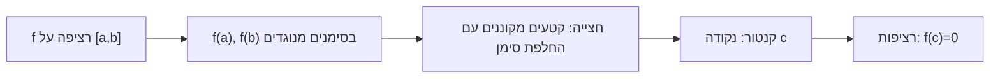

# משפט ערך הביניים

> מקור: כרך ב, סעיפים 5.2.2–5.2.3 (משפטים 5.29–5.32, 5.34; טענה 5.33). משפט 5.29 ברשימת המשפטים לבחינה; משפט 5.30 היה ברשימות קודמות.

**מה חשוב כאן**: שתי הגרסאות של המשפט (שורש בין שני סימנים הפוכים, וכל ערך ביניים), וההוכחה בשיטת החצייה, שנמצאת ברשימת המשפטים לבחינה. בתרגילים זה הכלי להוכחת קיום של פתרון. התבנית: מעבירים הכול לאגף אחד, ומוצאים שתי נקודות שבהן הסימן שונה.

## גרסת השורש (משפט 5.29)

אם $f$ רציפה ב-$[a,b]$ ו-$f(a)\cdot f(b) < 0$ (סימנים מנוגדים בקצוות), אז קיימת נקודה $c\in(a,b)$ עם:
$$f(c) = 0$$

> [!simple]- במילים פשוטות: לעבור מצד לצד בלי לדלג על האפס
> **בשורה אחת**: אם מתחילים מתחת לאפס ומסיימים מעליו לאורך גרף רציף, עוברים באפס בדרך.
>
> **תמונה בראש**: מטייל שעולה ממקום מתחת לפני הים למקום מעליהם חייב לעבור בגובה פני הים.
>
> **עם מספרים**: $f(x)=x^3+x-1$ נותנת $f(0)=-1$ ו-$f(1)=1$. לכן יש שורש בין $0$ ל-$1$, גם בלי נוסחה עבורו.
>
> **מה נשבר כשמורידים תנאי**: בלי רציפות אפשר לקפוץ ישר מ-$-1$ ל-$1$. בלי החלפת סימן, $x^2+1$ על $[-1,1]$ רציפה ואין לה שורש. אלה תנאים שמבטיחים קיום, ולא תנאים שכל פונקציה עם שורש חייבת לקיים.

> [!exam] במבחן
> משפט 5.29 התבקש להוכחה ב־**3 שאלות**: [2021ב·86, שאלה 1](#/exams/13/q1), [2022ב·81, שאלה 1](#/exams/19/q1), [2022ב·94, שאלה 1](#/exams/21/q1). בשיטת החצייה צריך להסביר אילו סימנים נשמרים בקצוות, ואיך הרציפות מזהה את ערך הפונקציה בנקודה המשותפת.
>
> [שאלה 2 · 2020ג · מועד 89 — סריקה ללא פתרון](#/exams/6/q2). בסעיף ב׳ חפשו קטע שעליו הפונקציה רציפה ומשנה סימן. [עוד שאלות ביחידה](#/exams?unit=5).

> [!plan]
> בכל חצייה משאירים חצי שבו הקצוות עדיין משני צדי האפס. אם לא פוגשים שורש באמצע, הקטעים מתכווצים לנקודה אחת לפי קנטור. הרציפות אומרת שערך הפונקציה בה גם לא חיובי וגם לא שלילי, ולכן הוא אפס.

### הוכחה מלאה — חצייה (ברשימת המשפטים לבחינה)

<!-- infi-proof: 5.29 -->

נניח בה"כ $f(a)<0<f(b)$. נבנה קטעים מקוננים באינדוקציה: $[a_0,b_0]=[a,b]$. בהינתן $[a_n,b_n]$ עם $f(a_n)\le0\le f(b_n)$, נסמן $m=\frac{a_n+b_n}{2}$:
- אם $f(m)=0$ — סיימנו (מצאנו $c=m$).
- אם $f(m)>0$: ניקח $[a_{n+1},b_{n+1}]=[a_n,m]$ (הסימנים בקצוות עדיין $\le0\le$).
- אם $f(m)<0$: ניקח $[m,b_n]$.

**האינווריאנטה (התכונה שנשמרת בכל שלב) נשמרת**: $f(a_n)\le 0\le f(b_n)$ לכל $n$, והאורכים $\frac{b-a}{2^n}\to0$. לפי [[הלמה של קנטור]] קיימת נקודה יחידה $c$ עם $a_n\to c$ ו-$b_n\to c$. מ[[רציפות בנקודה|רציפות (היינה)]]:
$$f(c)=\lim f(a_n)\le 0 \quad\text{וגם}\quad f(c)=\lim f(b_n)\ge 0$$
(מעבר גבול שומר אי-שוויון חלש — [[כללי סדר ומשפט הסנדוויץ|משפט 2.31]]). לכן $f(c)=0$; ומכיוון ש-$f(a),f(b)\ne0$, בהכרח $c\in(a,b)$. ∎

<!-- /infi-proof -->

**ההוכחה גם מראה איך למצוא את השורש.** זו שיטת החצייה: בכל צעד אורך הקטע קטן פי שניים, ואחרי $n$ צעדים השורש ידוע בדיוק של $\frac{b-a}{2^n}$.

> [!simple]- עם מספרים: מחפשים את $\sqrt2$
> **בשורה אחת**: חוצים את הקטע שוב ושוב, ובכל פעם שומרים את החצי שבו הסימן מתחלף.
>
> ניקח $f(x)=x^2-2$ בקטע $[1,2]$. $f(1)=-1<0$ ו-$f(2)=2>0$, ולכן יש שורש בפנים.
>
> | הקטע | נקודת האמצע | ערך $f$ באמצע | החצי שנשאר |
> |---|---|---|---|
> | $[1,2]$ | $1.5$ | $0.25>0$ | $[1,1.5]$ |
> | $[1,1.5]$ | $1.25$ | $-0.4375<0$ | $[1.25,1.5]$ |
> | $[1.25,1.5]$ | $1.375$ | $-0.109<0$ | $[1.375,1.5]$ |
>
> אחרי שלושה צעדים יודעים שהשורש נמצא בקטע שאורכו $\frac18$. ואכן $\sqrt2\approx1.414$ נמצא בין $1.375$ ל-$1.5$.

<!-- infi-demo: bisection -->

## הגרסה הכללית (משפט 5.31, "משפט ערך הביניים של קושי")

אם $f$ רציפה ב-$[a,b]$ ו-$t$ מספר בין $f(a)$ ל-$f(b)$, אז קיים $c\in[a,b]$ עם $f(c)=t$.
(אם $t$ שווה לאחד מערכי הקצוות, בוחרים את אותו קצה. אחרת מיישמים את 5.29 על $g(x)=f(x)-t$, שהיא רציפה ומחליפה סימן.)

**סיסמה**: פונקציה רציפה לא מדלגת על ערכים. לכן תמונת קטע היא קטע (משפט 5.34).

> [!simple]- במילים פשוטות: לא רק אפס
> **בשורה אחת**: כל גובה שבין שני ערכי פונקציה רציפה מתקבל בדרך ביניהם.
>
> **עם מספרים**: ב-$f(x)=x^2$ על $[1,3]$ מתקבלים כל הערכים שבין $1$ ל-$9$; למשל $4$ מתקבל ב-$x=2$.
>
> **תמונה בראש**: מזיזים את קו גובה המטרה אל האפס על ידי חיסור אותו מספר מכל הערכים.
>
> **שימו לב**: אם גובה המטרה שווה לערך בקצה, הפתרון יכול להיות בקצה עצמו. אם הוא ממש בין ערכי הקצוות, מתקבל פתרון פנימי. אין כאן הבטחת יחידות.

## מסקנות ושימושים

- **שורש לפולינום ממעלה אי-זוגית** (משפט 5.30, היה ברשימות קודמות): לכל פולינום שמעלתו אי-זוגית יש לפחות שורש ממשי אחד. (למעלה זוגית אין ערובה: $x^2+1$.) ההוכחה המלאה בסעיף הבא.
- **נקודת שבת** (משפט 5.32): $f:[a,b]\to[a,b]$ רציפה ולכן יש $x$ עם $f(x)=x$. הוכחה: $g(x)=f(x)-x$ מקיימת $g(a)=f(a)-a\ge0$ (כי $f(a)\in[a,b]$) ו-$g(b)\le0$; ערך ביניים. ∎ (גרסה חד-ממדית של משפטי נקודת שבת מפורסמים.)
- **קיום שורשים $\sqrt[n]{c}$ — שוב** (טענה 5.33): דרך רציפות $x^n$ על $[0,\max(1,c)]$ — בלי [[אקסיומת השלמות|העבודה הידנית של יחידה 1]]. השוואת שתי ההוכחות מדגימה כמה חזק הכלי שנבנה.
- **תבנית "הוכיחו שקיים פתרון"**: מציגים את המשוואה כ-$f(x)=0$ עם $f$ רציפה, מאתרים שתי נקודות עם סימנים מנוגדים (בהצבה!), מצטטים את המשפט. דוגמה: ל-$x=\cos x$ יש פתרון ב-$(0,\frac\pi2)$ — $g(x)=x-\cos x$, $g(0)=-1<0$, $g(\frac\pi2)=\frac\pi2>0$. ∎
- **משוואות "מוזרות"**: קיום $c$ שבו שתי פונקציות רציפות נפגשות ($f=g$) — עובדים עם ההפרש.

> [!simple]- במילים פשוטות: שימושים של אותו רעיון
> **בשורה אחת**: כדי להראות ששני גדלים נפגשים, מסתכלים על ההפרש ביניהם ומחפשים החלפת סימן.
>
> **נקודת שבת עם מספרים**: $f(x)=(x+1)/2$ שולחת את $[0,2]$ לתוכו. עבור $g(x)=f(x)-x$ מקבלים $g(0)=1/2$ ו-$g(2)=-1/2$, ונקודת השבת היא $1$.
>
> **שורשים ותמונה**: הפונקציה $x^3$ עולה ברציפות מ-$0$ ל-$8$ על $[0,2]$, ולכן מקבלת גם $2$; זו דרך להבטיח קיום של $\sqrt[3]2$. תמונת קטע היא קטע משום שכל גובה בין שני ערכים מתקבל.
>
> **מה נשבר**: $f(x)=x+1$ על $[0,1]$ רציפה אבל אינה שולחת את הקטע לעצמו, ואין לה נקודת שבת. לפולינום ממעלה זוגית כגון $x^2+1$ לא מובטח שורש ממשי.

> [!plan]
> במרחק גדול מהאפס האיבר המוביל קובע את סימן הפולינום. בחזקה אי־זוגית הסימן שלו הפוך בשני צדי הישר. בוחרים שתי נקודות רחוקות מספיק ומפעילים את משפט ערך הביניים על הקטע שביניהן.

## הוכחת משפט 5.30 — שורש לפולינום ממעלה אי-זוגית

<!-- infi-proof: 5.30 -->

יהי $p(x)=a_nx^n+\dots+a_1x+a_0$ עם $n$ אי-זוגי ו-$a_n\ne0$. מספיק לטפל במקרה $a_n>0$, כי ל-$p$ ול-$-p$ אותם שורשים.

1. **פירוק.** לכל $x\ne0$:
$$p(x)=x^n\,q(x),\qquad q(x)=a_n+\frac{a_{n-1}}{x}+\dots+\frac{a_0}{x^n}.$$
כל מחובר מהצורה $\frac{a_k}{x^{n-k}}$ עם $k<n$ שואף ל-$0$ כאשר $x\to\pm\infty$, ולכן $q(x)\to a_n>0$.
2. **סימן גדול מספיק.** נפעיל את הגדרת הגבול באינסוף (הגדרה 4.54) עם $\varepsilon=\frac{a_n}{2}$: קיים $M_1$ כך שלכל $x>M_1$ מתקיים $|q(x)-a_n|<\frac{a_n}2$, ובפרט $q(x)>\frac{a_n}2>0$. באותו אופן, עבור $x\to-\infty$, קיים $M_2$ כך ש-$q(x)>0$ לכל $x<-M_2$. ניקח $R>\max(M_1,M_2,0)$. אז $q(R)>0$ ו-$q(-R)>0$.
3. **שתי נקודות בסימנים מנוגדים.** מכיוון ש-$n$ אי-זוגי, $R^n>0$ ו-$(-R)^n=-R^n<0$. לכן $p(R)=R^n q(R)>0$ ו-$p(-R)=(-R)^n q(-R)<0$, כלומר $p(-R)\cdot p(R)<0$.
4. **ערך הביניים.** פולינום רציף בכל הישר (מסקנה 5.12), ובפרט ב-$[-R,R]$. לפי משפט 5.29 קיים $c\in(-R,R)$ עם $p(c)=0$. ∎

<!-- /infi-proof -->

**נקודה לבודק**: צריך לנמק **למה** יש שתי נקודות עם סימנים מנוגדים. "המונום המוביל שולט" הוא רעיון; ההוכחה היא הגבול של $q$ ושימור הסימן.

## גרף אינטראקטיבי: לחפש שורש בין שני קצוות

הזיזו את $a$ בין $0$ ל-$1$. הנקודה הירוקה היא $(a,f(a))$ עבור $f(x)=x^3+x-1$, והקו האדום הוא הגובה $0$.

```desmos-live
{
  "version": 10,
  "graph": {
    "viewport": {
      "xmin": -0.3,
      "xmax": 1.3,
      "ymin": -1.5,
      "ymax": 1.5
    }
  },
  "expressions": {
    "list": [
      {
        "id": "a",
        "type": "expression",
        "latex": "a=0.5",
        "sliderBounds": {
          "min": 0,
          "max": 1,
          "step": 0.01
        }
      },
      {
        "id": "f",
        "type": "expression",
        "latex": "f(x)=x^3+x-1",
        "color": "#2d70b3"
      },
      {
        "id": "zero",
        "type": "expression",
        "latex": "y=0",
        "color": "#c74440",
        "lineStyle": "DASHED"
      },
      {
        "id": "p",
        "type": "expression",
        "latex": "(a,f(a))",
        "color": "#388c46",
        "showLabel": true,
        "label": "נקודה על הגרף"
      }
    ]
  }
}
```

נסו לאתר היכן הגובה מתחלף משלילי לחיובי. הקירוב הגרפי עוזר לנחש מיקום; משפט ערך הביניים מבטיח קיום שורש משום שהפונקציה רציפה בקטע וערכיה בקצוות בעלי סימנים מנוגדים.

## התנאים הכרחיים

- **בלי רציפות**: נגדיר $f(x)=-1$ עבור $x\le0$ ו-$f(x)=1$ עבור $x>0$, בקטע $[-1,1]$. בקצוות $f(-1)\cdot f(1)=-1<0$, אבל ל-$f$ אין שורש: היא מדלגת על כל הערכים שבקטע $(-1,1)$. (שימו לב ש-$\operatorname{sgn}$ עצמה **אינה** דוגמה נגדית לגרסת השורש, כי $\operatorname{sgn}(0)=0$; היא כן דוגמה נגדית לגרסה הכללית, עם $t=\frac12$.)
- **בתחום שאינו קטע**: $\frac1x$ על $[-1,0)\cup(0,1]$ — רציפה שם, סימנים מנוגדים, אין שורש. הקטעיות (קשירות) של התחום מהותית.

## הכיוון ההפוך?

תכונת ערך הביניים **לא** גוררת רציפות: $f(x)=\sin\frac1x$ ($x\ne0$), $f(0)=0$ — מקבלת כל ערך ביניים על כל קטע סביב 0 (התנודות מכסות את $[-1,1]$) בלי להיות רציפה ב-0. מפתיע יותר: **כל נגזרת** מקיימת את תכונת ערך הביניים גם כשאינה רציפה — [[משפט דארבו]]. כלומר התכונה מאפיינת מחלקה רחבה מהרציפות.

## תרגול מודרך: האם קיים פתרון?

**נסו בעצמכם**: הוכיחו שלמשוואה $x^3+x-1=0$ יש לפחות פתרון אחד בין $0$ ל-$1$. אין צורך למצוא את הפתרון במדויק.

> [!hint]- רמז ראשון
> הגדירו פונקציה שהשאלה מבקשת למצוא לה שורש, ובדקו אם היא רציפה על הקטע.

> [!hint]- רמז שני
> חשבו את ערכי הפונקציה בשני הקצוות. אם סימניהם שונים, איזה משפט מבטיח שהיא מקבלת גם את הערך שביניהם?

> [!solution]- פתרון מלא
> נגדיר $f(x)=x^3+x-1$. זו פונקציית פולינום ולכן רציפה ב-$[0,1]$. מתקיים $f(0)=-1<0$ ו-$f(1)=1>0$. ממשפט ערך הביניים קיימת נקודה $c\in(0,1)$ כך ש-$f(c)=0$, ולכן $c$ פתרון למשוואה. ההוכחה הזאת מבטיחה קיום; טענת יחידות מצריכה נימוק נוסף.

**לזכור להבא**: בוחרים קטע, בודקים רציפות וסימנים מנוגדים בקצוות, ומסיימים בציון קיום הפתרון.

## כרטיס דיוק

- **הרעיון המרכזי**: פונקציה רציפה בקטע אינה מדלגת על ערכים. הגרף חוצה כל גובה שנמצא בין שני ערכים שלו.
- **מתי מפעילים**: קיום שורש/פתרון/נקודת שבת; הוכחה שתמונה מכילה קטע; ותבנית "העבר אגף והגדר $g$".
- **בדיקה עצמית**: (א) הוכיחו של-$x^3+x-1=0$ פתרון ב-$(0,1)$. (ב) שחזרו את הוכחת החצייה עם האינווריאנטה. (ג) הוכיחו את משפט נקודת השבת.
- **מלכודת**: המשפט מוכיח **קיום**, לא יחידות — ליחידות מוסיפים מונוטוניות ממש; והתחום חייב להיות קטע אחד רציף.

> [!solution]- פתרון (א)
> נגדיר $g(x)=x^3+x-1$. כפולינום היא רציפה ב-$[0,1]$. מתקיים $g(0)=-1<0$ ו-$g(1)=1>0$, ולכן ממשפט ערך הביניים קיים $c\in(0,1)$ עם $g(c)=0$. זה מוכיח קיום; לצורך יחידות אפשר להראות בנפרד כי עבור $y>x$ מתקיים $g(y)-g(x)=(y-x)(y^2+xy+x^2+1)>0$.

> [!solution]- פתרון (ב)
> נניח $f(a)<0<f(b)$; במקרה ההפוך מחליפים את $f$ ב-$-f$. נגדיר $[a_0,b_0]=[a,b]$. בכל שלב נבדוק את האמצע $m$: אם $f(m)=0$ סיימנו; אם $f(m)>0$ נשאיר $[a_n,m]$, ואם $f(m)<0$ נשאיר $[m,b_n]$. כך נשמרים הקינון, החלפת הסימן ואורך $(b-a)/2^n$. אם התהליך אינסופי, קנטור נותן $a_n,b_n\to c\in[a,b]$. מהרציפות $f(a_n),f(b_n)\to f(c)$, ומסימני הקצוות מתקבל $f(c)\le0$ וגם $f(c)\ge0$. לכן $f(c)=0$. מכיוון שערכי הקצוות המקוריים שונים מאפס, $c\in(a,b)$.

> [!solution]- פתרון (ג)
> תהי $f:[a,b]\to[a,b]$ רציפה. נגדיר $g(x)=f(x)-x$, רציפה בקטע. מפני ש-$f(a)\ge a$ ו-$f(b)\le b$, מתקיים $g(a)\ge0$ ו-$g(b)\le0$. אם אחד הערכים אפס, אותו קצה הוא נקודת שבת. אחרת הסימנים מנוגדים ומערך הביניים קיים $c\in(a,b)$ עם $g(c)=0$, כלומר $f(c)=c$. אם $a=b$, ההעתקה לעצמה כבר נותנת $f(a)=a$.

## תרשים קיום שורש



## קשרים

- [[הלמה של קנטור]] — מנוע ההוכחה
- [[רציפות בקטע]] — ההקשר: למה קטע סגור
- [[כללי סדר ומשפט הסנדוויץ]] — מעבר הגבול בסוף ההוכחה
- [[משפטי ויירשטראס]] — המשפט האח; יחד: תמונת קטע סגור
- [[פונקציות אלמנטריות]] — שורש לפולינום אי-זוגי
- [[משפט דארבו]] — ערך ביניים לנגזרות
