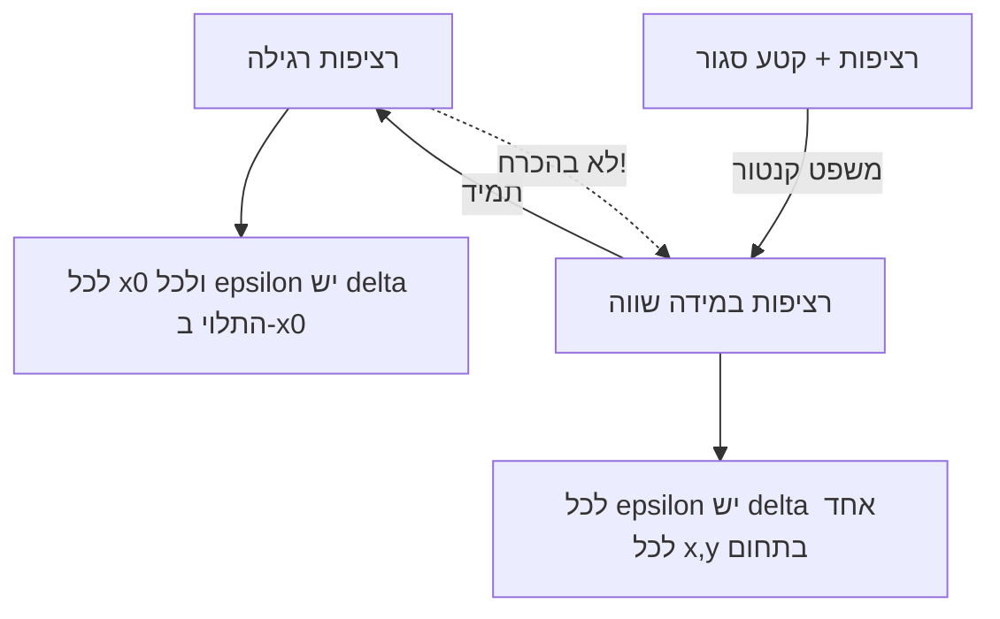

# רציפות במידה שווה ומשפט קנטור

> מקור: כרך ב, פרק 5.3 (הגדרה 5.46, טענה 5.47, משפטים 5.48–5.49)

**מה חשוב כאן**: ההבדל מרציפות רגילה: כאן צריך $\delta$ **אחד** שמתאים לכל הנקודות בתחום. משפט קנטור (ברשימת המשפטים לבחינה) אומר שבקטע סגור רציפות מספיקה. בתרגילים צריך שני כלים: איך מוכיחים רציפות במידה שווה (קנטור, או חסם על ההפרש), ואיך שוללים אותה (שתי סדרות שמתקרבות זו לזו בזמן שערכי הפונקציה נשארים רחוקים).

## ההגדרה (5.46)

$f$ **רציפה במידה שווה (במ"ש)** בקטע $I$ אם:
$$\forall\varepsilon>0\ \exists\delta>0:\ \forall x_1,x_2\in I,\quad |x_1-x_2|<\delta \implies |f(x_1)-f(x_2)|<\varepsilon$$

> [!simple]- במילים פשוטות: אותו כלל מרחק בכל התחום
> **בשורה אחת**: בוחרים מרחק קלט אחד שמבטיח את הדיוק המבוקש, בלי לדעת מראש איפה נמצאות שתי הנקודות.
>
> **תמונה בראש**: כלל צילום אחד שעובד בכל המפה, בלי לכוון מחדש את הזום בכל אזור.
>
> **עם מספרים**: עבור $f(x)=3x$, כדי שהפער בערכים יהיה קטן מ-$0.03$, מספיק שהנקודות יהיו במרחק קטן מ-$0.01$, בכל מקום בישר.
>
> **מה לא מספיק**: ברציפות רגילה מותר למרחק המותר להשתנות מנקודה לנקודה. ב-$x^2$ על הישר יש צורך במרחקים קטנים יותר כשמתרחקים מהאפס.

> [!simple]- נבנה את הרעיון צעד אחר צעד
> **אותו סרגל בכל המפה**: בוחרים כמה מותר לפלטים להתרחק זה מזה. ברציפות במידה שווה אפשר למצוא מרחק אחד בין הקלטים שעובד לכל זוג נקודות בתחום, אפילו אם בוחרים את הזוג רק אחר כך.
>
> **דוגמה טובה**: ל-$f(x)=3x$, אם רוצים פער פלטים קטן מ-$0.03$, מספיק לבקש פער קלטים קטן מ-$0.01$, בכל מקום על הישר.
>
> **למה התחום משנה?** $x^2$ רציפה על כל הישר, אך לא במידה שווה שם: בחרו $x_n=n$ ו-$y_n=n+1/n$. מרחק הקלטים שואף לאפס, אבל $y_n^2-x_n^2=2+1/n^2$ אינו שואף לאפס. על קטע סגור וחסום, לעומת זאת, משפט קנטור מבטיח רציפות במידה שווה.

## לפני הסימנים: שני כפתורי מרחק

לפונקציה מכניסים שני מספרים, והיא מחזירה שני ערכים. יש כאן **שני מרחקים שונים**:

1. מרחק בין הקלטים: $|x-y|$. הוא נמדד על הציר האופקי.
2. מרחק בין הפלטים: $|f(x)-f(y)|$. הוא נמדד על הציר האנכי.

נבחר כמה קרובים הפלטים צריכים להיות: למרחק המבוקש הזה קוראים $\varepsilon$ (אפסילון). עכשיו אנחנו מחפשים מרחק מותר בין הקלטים: לו קוראים $\delta$ (דלתא). השאלה היא האם ניתן למצוא **דלתא אחת** שתתאים לכל זוג נקודות בתחום.

> [!simple]- ננסה מספרים לפני ההגדרה
> ניקח $f(x)=3x$ ונבקש שהפלטים יהיו במרחק קטן מ-$0.3$.
>
> אם נדרוש מהקלטים להיות במרחק קטן מ-$0.1$, אז $|f(x)-f(y)|=3|x-y|<0.3$.
>
> למשל, $2$ ו-$2.05$ רחוקים זה מזה $0.05$; הפלטים שלהם $6$ ו-$6.15$ רחוקים זה מזה $0.15$. גם עבור $100$ ו-$100.05$ מתקבל אותו מרחק בין הפלטים.
>
> הבדיקה בשני זוגות רק ממחישה את הרעיון. השוויון $|f(x)-f(y)|=3|x-y|$ הוא שמראה שהבחירה עובדת **לכל** הזוגות.

### מי בוחר מה, ובאיזה סדר?

1. בוחרים דיוק חיובי כלשהו לפלטים: $\varepsilon>0$. צריך להצליח גם אם הוא קטן מאוד.
2. בוחרים $\delta>0$. מותר להתאים את הבחירה לדיוק שנבחר.
3. רק עכשיו בוחרים **זוג כלשהו** של נקודות $x,y$ בתחום, שמרחקן קטן מדלתא.
4. בודקים שמרחק הפלטים קטן מאפסילון. אותה דלתא צריכה לעבוד לכל הזוגות שבשלב 3.

לדוגמה, לפונקציה $3x$ הבחירה $\delta=\varepsilon/3$ עובדת. אם משנים את אפסילון מותר לשנות גם את דלתא; **לא** בוחרים דלתא חדשה בהתאם למיקום הזוג.

### רציפות רגילה לעומת רציפות במידה שווה

ברציפות רגילה מתחילים מנקודה מסוימת $x_0$. מותר למצוא מרחק שמתאים לאותה נקודה, ובנקודה אחרת לבחור מרחק אחר. ברציפות במידה שווה צריך להכין מרחק אחד לפני שיודעים איפה זוג הנקודות נמצא.

| השאלה | רציפות בנקודה | רציפות במידה שווה בתחום |
|---|---|---|
| את מי משווים? | קלט קרוב ל-$x_0$ מול $x_0$ | שני קלטים כלשהם בתחום |
| מתי יודעים איפה בודקים? | הנקודה $x_0$ כבר ידועה | הזוג נבחר אחרי דלתא |
| במה דלתא יכולה להיות תלויה? | בדיוק ובנקודה | בדיוק, אבל לא בזוג הנקודות |

אם יש דלתא שעובדת לכל זוגות התחום, היא עובדת גם כשאחד מהם הוא הנקודה $x_0$. לכן במידה שווה גוררת רציפות בכל נקודה בתחום, עם הבדיקה החד־צדדית המתאימה בקצה. בכיוון ההפוך צריך לבדוק בנפרד.

## ההבדל מרציפות רגילה — מיקום הכמתים

- **רציפות ב-$I$**: $\forall x_0\,\forall\varepsilon\,\exists\delta$ — ה-$\delta$ רשאי להיות תלוי ב-$x_0$ ("דלתא מקומי", נתפר לכל נקודה).
- **במ"ש**: $\forall\varepsilon\,\exists\delta\,\forall x_1,x_2$ — $\delta$ **אחד שעובד לכל זוג נקודות בקטע** ("דלתא אוניברסלי").

זו בדיוק החלפת סדר כמתים (במקום $\forall x\,\exists\delta$ דורשים $\exists\delta\,\forall x$) — הדוגמה החשובה בקורס לכך ש[[קבוצות, יחסים ופעולות|סדר כמתים משנה משמעות]]. **רציפות במידה שווה גוררת רציפות** (טענה 5.47 — הדלתא האוניברסלי עובד בפרט בכל נקודה); ההפך לא נכון:

- $f(x)=x^2$ על $\mathbb{R}$: רציפה אך **לא במ"ש** — ככל שמתרחקים, השיפוע גדל: $|x_1^2-x_2^2|=|x_1+x_2||x_1-x_2|$, והגורם $|x_1+x_2|$ אינו חסום, אז שום $\delta$ קבוע לא שורד רחוק. (על קטע חסום $[0,10]$ — כן במ"ש: $|x_1+x_2|\le20$ ולכן $\delta=\frac{\varepsilon}{20}$.)
- $f(x)=\frac1x$ על $(0,1)$: רציפה אך לא במ"ש — ליד $0$ הפונקציה "מתפוצצת": נקודות קרובות כרצוננו עם ערכים רחוקים.

**דוגמה חיובית ישירה**: $f(x)=\sqrt x$ במ"ש על $[0,\infty)$ — מ-$|\sqrt{x_1}-\sqrt{x_2}|\le\sqrt{|x_1-x_2|}$ אפשר לקחת $\delta=\varepsilon^2$. וכל פונקציה **ליפשיצית** ($|f(x_1)-f(x_2)|\le K|x_1-x_2|$, למשל בעלת נגזרת חסומה על קטע) במ"ש עם $\delta=\frac\varepsilon K$ כאשר $K>0$; אם $K=0$, היא קבועה ובמ״ש.

> [!simple]- במילים פשוטות: במידה שווה חזקה מרציפות
> **בשורה אחת**: מרחק שעובד עבור כל הזוגות עובד בפרט ליד כל נקודה; הכיוון ההפוך אינו מובטח.
>
> **עם מספרים**: ב-$x^2$, המרחק בין $10$ ל-$10.01$ הוא $0.01$, אבל פער הריבועים הוא $0.2001$. בין $100$ ל-$100.01$ אותו מרחק נותן פער $2.0001$.
>
> **תמונה בראש**: ככל שהגרף תלול יותר, נדרש צעד אופקי קטן יותר כדי לשמור על אותו פער בגובה.
>
> **ליפשיץ**: זהו חסם קבוע על שינוי הערכים ביחס למרחק. אם $|f(x)-f(y)|\le K|x-y|$ עם $K>0$, הבחירה $\delta=\varepsilon/K$ עובדת בכל התחום. אם $K=0$, הפונקציה קבועה וכל דלתא חיובית מתאימה.

## גרף אינטראקטיבי: אותו מרחק, גבהים שונים

הזיזו את $a$. הנקודה הירוקה מייצגת את הקלט הראשון והאדומה את השני; המרחק ביניהם קבוע: $0.2$. עקבו אחר המרחק בין הגבהים שלהן על הפרבולה.

```desmos-live
{
  "version": 10,
  "graph": {
    "viewport": {
      "xmin": -0.5,
      "xmax": 5,
      "ymin": -1,
      "ymax": 23
    }
  },
  "expressions": {
    "list": [
      {
        "id": "a",
        "type": "expression",
        "latex": "a=0.5",
        "sliderBounds": {
          "min": 0,
          "max": 4,
          "step": 0.1
        }
      },
      {
        "id": "f",
        "type": "expression",
        "latex": "f(x)=x^2",
        "color": "#2d70b3"
      },
      {
        "id": "p",
        "type": "expression",
        "latex": "(a,f(a))",
        "color": "#388c46",
        "showLabel": false,
        "label": "קלט ראשון"
      },
      {
        "id": "q",
        "type": "expression",
        "latex": "(a+0.2,f(a+0.2))",
        "color": "#c74440",
        "showLabel": false,
        "label": "קלט שני"
      }
    ]
  }
}
```

לדוגמה, ב-$a=1$ פער הפלטים הוא $1.44-1=0.44$; ב-$a=3$ הוא $10.24-9=1.24$. אותו מרחק קלט יוצר כאן פער גדול יותר ככל שמתרחקים. הגרף מציג תחום סופי, ולכן אינו מוכיח לבדו שאין רציפות במידה שווה על כל הישר.

## הוכחה מההגדרה: לא מדלגים על הצעדים

נוכיח ש-$f(x)=x^2$ רציפה במידה שווה ב-$[0,10]$.

**מה מחפשים?** דרך לחסום את פער הפלטים בעזרת פער הקלטים. נפרק הפרש ריבועים:

$$|f(x)-f(y)|=|x^2-y^2|=|x-y|\,|x+y|.$$

**איפה משתמשים בתחום?** שתי הנקודות ב-$[0,10]$, ולכן $0\le x+y\le20$. מכאן:

$$|f(x)-f(y)|\le20|x-y|.$$

כדי להבטיח שפער הפלטים קטן מ-$\varepsilon$, מספיק שפער הקלטים יהיה קטן מ-$\varepsilon/20$. זו הסיבה לבחירה הבאה.

**כתיבה שאפשר להגיש**: יהי $\varepsilon>0$. נבחר $\delta=\varepsilon/20>0$. יהיו $x,y\in[0,10]$ ויניחו ש-$|x-y|<\delta$. אז

$$|f(x)-f(y)|\le20|x-y|<20\delta=\varepsilon.$$

הבחירה תלויה באפסילון ולא בנקודות, ולכן הפונקציה רציפה במידה שווה בקטע. שימו לב: $20$ הוא חסם נוח; אין צורך למצוא את דלתא הגדולה ביותר.

## איך מוכיחים שלא קיימת דלתא אחידה?

כדי להפריך במידה שווה לא מספיק לומר ״הגרף תלול״. מציגים **דיוק אחד קבוע** שבו כל דלתא נכשלת. הסדר בשלילה הוא:

1. בוחרים $\varepsilon_0>0$ אחד.
2. מקבלים דלתא חיובית כלשהי, קטנה ככל שתהיה.
3. מוצאים שתי נקודות בתחום שמרחקן קטן מדלתא, אך מרחק הפלטים שלהן **לפחות** $\varepsilon_0$.

שימו לב להיפוך הסימן: ההגדרה דרשה פער פלטים קטן ממש; בשלילה מספיק פער גדול או שווה. הנקודות שנבחרות יכולות להיות תלויות בדלתא.

### דוגמה מלאה: אותה פונקציה, תחום אחר

נוכיח ש-$f(x)=x^2$ **אינה** רציפה במידה שווה על $[0,\infty)$.

נבחר $\varepsilon_0=1$. תהי $\delta>0$ כלשהי. לפי תכונת ארכימדס אפשר לבחור $n$ טבעי כך ש-$1/n<\delta$. נבחר

$$x=n,\qquad y=n+\frac1n.$$

שתי הנקודות בתחום, והמרחק ביניהן קטן מדלתא. אבל פער הפלטים הוא

$$|f(y)-f(x)|=\left(n+\frac1n\right)^2-n^2=2+\frac1{n^2}\ge1=\varepsilon_0.$$

לכן גם הדלתא הזאת נכשלת. מכיוון שהייתה שרירותית, **אין** דלתא מתאימה לדיוק $1$, והפונקציה אינה במידה שווה בתחום הזה. ככל שהדלתא שנקבל קטנה יותר, נוכל לבחור את הזוג רחוק יותר על הציר.

## איך בוחרים שיטה בשאלה?

1. **בודקים תחום ורציפות.** אם הפונקציה אינה רציפה בנקודה בתחום, היא אינה במידה שווה בו.
2. **קטע סגור וחסום?** אם הפונקציה רציפה עליו, משפט קנטור נותן תשובה חיובית. מציינים את שתי ההנחות.
3. **קטע פתוח וחסום?** לפונקציה רציפה בודקים אם יש גבולות חד־צדדיים סופיים בשני הקצוות; לפי האפיון בהמשך, זה שקול לבמ״ש.
4. **תחום לא חסום?** אפשר לחפש חסם אחיד על פער הפלטים, או לנסות לבנות זוגות קרובים שמפריכים אחידות. למשל $x$ במידה שווה על כל הישר, ואילו $x^2$ אינה במידה שווה שם.

> [!simple]- טיפ: תחום וקצוות הם חלק מהפתרון
> בשימוש בהגדרה או בשלילתה כותבים ששתי הנקודות שייכות לתחום. משפט ההשלמה לקצוות עוסק בקטע **פתוח וחסום**; אין להפעיל אותו אוטומטית על חצי ישר.
>
> קיום גבול סופי באינסוף אינו תנאי הכרחי לבמ״ש על חצי ישר: $f(x)=x$ רציפה במידה שווה על $[0,\infty)$, כי $|f(x)-f(y)|=|x-y|$, למרות שהיא שואפת לאינסוף.

## תרגול קצר עם פתרונות מדורגים

נסו לענות לפני פתיחת הפתרונות.

1. האם $f(x)=5x+2$ רציפה במידה שווה על כל הישר? מצאו דלתא בעזרת אפסילון.
2. האם $f(x)=1/x$ רציפה במידה שווה על $(0,1)$? נסו לבחור שתי סדרות נקודות הקרובות זו לזו.
3. מה משתנה בשאלה הקודמת אם התחום הוא $[1,2]$?

> [!hint]- שאלה 1 — רמז ראשון
> השוו בין הפלטים של שתי נקודות כלליות בתחום. כתבו את המרחק ביניהם.

> [!hint]- שאלה 1 — רמז שני
> החסירו את שני הפלטים. האיברים הקבועים מצטמצמים. איזה מספר נשאר כפול המרחק בין הקלטים?

> [!solution]- פתרון שאלה 1
> לכל $x,y\in\mathbb R$ מתקיים $|f(x)-f(y)|=|5x+2-(5y+2)|=5|x-y|$. יהי $\varepsilon>0$; נבחר $\delta=\varepsilon/5$. אם $|x-y|<\delta$, נקבל $|f(x)-f(y)|<5\delta=\varepsilon$. הבחירה עובדת לכל זוג, ולכן הפונקציה במ״ש.

> [!hint]- שאלה 2 — רמז ראשון
> חפשו זוגות קלטים קרובים ליד קצה התחום שבו ערכי הפונקציה גדלים מאוד.

> [!hint]- שאלה 2 — רמז שני
> התקרבו לקצה $0$ בשתי מהירויות: נסו $1/n$ ו-$1/(2n)$. ודאו ששתיהן בתוך הקטע.

> [!solution]- פתרון שאלה 2
> לכל $n\ge2$ נבחר $x_n=1/n$ ו-$y_n=1/(2n)$; שתיהן ב-$(0,1)$. מרחק הקלטים הוא $1/(2n)\to0$, אבל פער הפלטים הוא $|n-2n|=n\ge1$. לדיוק הקבוע $\varepsilon_0=1$, לכל דלתא נבחר $n$ גדול מספיק שמרחק הקלטים יהיה קטן ממנה. לכן אין במ״ש.

> [!hint]- שאלה 3 — רמז ראשון
> בדקו אם הפונקציה רציפה על התחום החדש ומה סוג הקטע.

> [!hint]- שאלה 3 — רמז שני
> אפשר להפעיל את משפט קנטור; לחלופין השתמשו בזהות $|1/x-1/y|=|x-y|/(xy)$.

> [!solution]- פתרון שאלה 3
> על $[1,2]$ הפונקציה רציפה, והקטע סגור וחסום. לפי משפט קנטור היא במידה שווה. אפשר גם להוכיח ישירות: לכל $x,y\in[1,2]$, מתקיים $|1/x-1/y|=|x-y|/(xy)\le|x-y|$, ולכן $\delta=\varepsilon$ מתאימה.

### קריטריון השלילה (דרך סדרות) — הכלי המעשי

$f$ **אינה** במ"ש ב-$I$ $\iff$ קיימות סדרות $x_n, y_n \in I$ עם $|x_n - y_n| \to 0$ אבל $|f(x_n)-f(y_n)| \not\to 0$.

הקריטריון **אינו ממוספר בחוברת**. במבחן מספיק הכיוון שבו משתמשים: אם קיימות סדרות כאלה, אז יש $\varepsilon_0>0$ ותת-סדרה עם $|f(x_{n_k})-f(y_{n_k})|\ge\varepsilon_0$, ולכל $\delta>0$ יש $k$ עם $|x_{n_k}-y_{n_k}|<\delta$. זו בדיוק השלילה של הגדרה 5.46.

- ל-$x^2$ על $\mathbb{R}$: $x_n = n+\frac1n,\ y_n = n$: הפרש $\frac1n\to0$, אבל $|f(x_n)-f(y_n)|=2+\frac1{n^2}\to2\ne0$. ✗
- ל-$\frac1x$ על $(0,1)$: $x_n=\frac1n,\ y_n=\frac1{2n}$ עבור $n\ge2$ (כדי ששתיהן יהיו בתוך $(0,1)$): הפרש $\to0$, ערכים נבדלים ב-$n\to\infty$. ✗

<!-- infi-demo: uniform -->

## משפט קנטור (משפט 5.48, ברשימת המשפטים לבחינה)

**פונקציה רציפה בקטע סגור רציפה בו במידה שווה.**

> [!simple]- במילים פשוטות: קטע סגור וחסום מאפשר כלל אחיד
> **בשורה אחת**: פונקציה רציפה על קטע סגור וחסום אינה יכולה לדרוש מרחקי קלט קטנים בלי סוף בלי שהדבר יפגע ברציפות בנקודה כלשהי.
>
> **תמונה בראש**: שני מטיילים הולכים ומתקרבים על שביל סגור. אם פער הגבהים נשאר גדול, מוצאים נקודת מפגש שבה הרציפות נשברת.
>
> **עם מספרים**: ב-$x^2$ על $[0,10]$, מתקיים $|x^2-y^2|\le20|x-y|$. עבור $\varepsilon=0.1$ אפשר לבחור $\delta=0.005$.
>
> **מה נשבר כשמורידים תנאי**: בלי סגירות, $1/x$ על $(0,1)$ אינה במ״ש. בלי חסימות התחום, $x^2$ על $\mathbb R$ אינה במ״ש. בלי רציפות, פונקציית מדרגה על $[0,1]$ אינה במ״ש.

> [!exam] במבחן
> משפט קנטור, 5.48, התבקש להוכחה ב־**6 שאלות** במאגר: [2019ב·85, שאלה 1](#/exams/2/q1), [2022ב·84, שאלה 1](#/exams/20/q1), [2026א·83, שאלה 1](#/exams/40/q1). שימו לב: בולצאנו־ויירשטראס מחלץ תת־סדרה של זוגות עם אותם אינדקסים, והרציפות מופעלת בגבול המשותף שלהם.

> [!plan]
> מניחים שאין מרחק אחיד, ובונים זוגות נקודות שהולכים ומתקרבים אך ערכיהן נשארים רחוקים. מחלצים מהסדרה הראשונה תת־סדרה מתכנסת, והשנייה עם אותם אינדקסים מתכנסת לאותה נקודה. הסגירות שומרת את הנקודה בתחום, והרציפות סותרת את הפער הקבוע בערכים.

### הוכחה מלאה (בשלילה + בולצאנו-ויירשטראס)

<!-- infi-proof: 5.48 -->

נניח ש-$f$ רציפה ב-$[a,b]$ אך לא במ"ש. אז יש $\varepsilon_0>0$ כך שלכל $\delta=\frac1n$ קיימות נקודות $x_n,y_n\in[a,b]$ עם
$$|x_n-y_n|<\frac1n \quad\text{אבל}\quad |f(x_n)-f(y_n)|\ge\varepsilon_0.$$
הסדרה $\{x_n\}$ חסומה ולכן [[משפט בולצאנו-ויירשטראס]] נותן תת-סדרה $x_{n_k}\to c$, ומ**סגירות** $c\in[a,b]$. מכיוון ש-$|x_{n_k}-y_{n_k}|<\frac{1}{n_k}\to0$, גם $y_{n_k}\to c$ (סנדוויץ' על $|y_{n_k}-c|\le|y_{n_k}-x_{n_k}|+|x_{n_k}-c|$). מ[[רציפות בנקודה|רציפות ב-$c$ (היינה)]]:
$$f(x_{n_k})\to f(c), \qquad f(y_{n_k})\to f(c),$$
ולכן $|f(x_{n_k})-f(y_{n_k})|\to0$ — סתירה ל-$\ge\varepsilon_0$. ∎

<!-- /infi-proof -->

(אותו שלד משולש כמו ב[[משפטי ויירשטראס]]: סדרה מהשלילה, אחריה ב״ו, ולבסוף סגירות ורציפות.)

## אפיון בקטע פתוח (משפט 5.49)

$f$ רציפה ב-$(a,b)$ (חסום) היא במ"ש שם $\iff$ הגבולות החד-צדדיים $\lim_{x\to a^+}f$, $\lim_{x\to b^-}f$ **קיימים וסופיים**.

אינטואיציה: אם הגבולות קיימים, "משלימים" את $f$ לפונקציה רציפה על $[a,b]$ ומפעילים קנטור; אם לא — הכישלון בקצה מפר במ"ש. שימושים מיידיים:
- $\sin\frac1x$ על $(0,1)$: **לא** במ"ש (אין גבול ב-$0^+$).
- $x\sin\frac1x$ על $(0,1)$: **כן** במ"ש (הגבול ב-$0^+$ הוא 0, ב-$1^-$ קיים).
- $\frac1x$ על $(0,1)$: לא במ"ש (גבול אינסופי ב-$0^+$).

זהו כלי ההכרעה המהיר ביותר לשאלות במ"ש על קטע פתוח חסום. (על קרן אינסופית הוא לא חל — שם בודקים ידנית או דרך ליפשיץ/נגזרת חסומה.)

> [!simple]- במילים פשוטות: אפשר לסגור את הקצוות
> **בשורה אחת**: על קטע פתוח וחסום, פונקציה רציפה היא במידה שווה בדיוק כשאפשר להשלים אותה ברציפות בשני הקצוות.
>
> **תמונה בראש**: מוסיפים לשביל את שתי תחנות הקצה. אם יש לכל אחת גובה סופי מוסכם, מתקבל שביל רציף סגור.
>
> **עם מספרים**: עבור $f(x)=x\sin(1/x)$, מתקיים $|f(x)|\le x$. ליד $0$ הערכים קטנים מ-$0.01$ כש-$0<x<0.01$, ולכן אפשר להגדיר $f(0)=0$.
>
> **מה נשבר**: ב-$\sin(1/x)$ אין גבול בקצה $0$; ב-$1/x$ הגבול שם אינסופי. בשני המקרים אין במ״ש על $(0,1)$. על תחום לא חסום אין להפעיל את האפיון הזה: $f(x)=x$ במ״ש ב-$\mathbb R$ בלי גבול סופי באינסוף.

## למה המושג חשוב

במ"ש היא סוג האחידות שנחוץ למשפטים **גלובליים** — בקורסי המשך היא המפתח לאינטגרביליות של פונקציה רציפה (חלוקת הקטע לרצועות בעובי $\delta$ אחיד). בקורס הזה: הדוגמה המובהקת לכוחו של קטע סגור, והזירה שבה לומדים לקרוא כמתים ברצינות.

## כרטיס דיוק

- **רעיון-על**: במ"ש מחליפה $\delta$ נקודתי ב-$\delta$ אחד לכל התחום; קנטור אומר שעל קטע סגור ההבחנה נעלמת.
- **מתי מפעילים**: שאלות "האם במ"ש?" — קטע סגור: כן אוטומטית (קנטור); פתוח חסום: בדיקת גבולות בקצוות (5.49); תחום אינסופי: ליפשיץ/נגזרת חסומה או קריטריון השלילה.
- **בדיקה עצמית**: (א) הוכיחו ש-$x^2$ לא במ"ש על $\mathbb{R}$ ו-כן על $[0,10]$. (ב) שחזרו את הוכחת קנטור. (ג) הכריעו: $\sqrt x$ על $[0,\infty)$? $\ \tan x$ על $(-\frac\pi2,\frac\pi2)$?
- **מלכודת**: רציפות בכל נקודה אינה מבטיחה במ"ש על תחום לא קומפקטי; וסדר הכמתים הוא כל ההבדל.
- **קישור רוחב**: ראו גם [[מפת תלות משפטים - אינפי 1]], [[תבניות הוכחה באינפי 1]], [[אינדקס דוגמאות נגד - אינפי 1]].

> [!solution]- פתרון (א)
> על $\mathbb R$ נבחר $x_n=n+1/n$, $y_n=n$. המרחק $|x_n-y_n|=1/n\to0$, אך $|x_n^2-y_n^2|=2+1/n^2\ge2$. לכן עבור $\varepsilon_0=1$, לכל $\delta>0$ בוחרים $n$ גדול עם $1/n<\delta$ ומפרים את הדרישה: אין במ״ש. על $[0,10]$ מתקיים $|x^2-y^2|=|x-y||x+y|\le20|x-y|$. לכל $\varepsilon>0$ נבחר $\delta=\varepsilon/20$; אם $|x-y|<\delta$, אז פער הריבועים קטן מ-$\varepsilon$, כנדרש.

> [!solution]- פתרון (ב)
> נניח ש-$f$ רציפה ב-$[a,b]$ ואינה במ״ש. קיימת $\varepsilon_0>0$ ולכל $n$ נקודות $x_n,y_n$ בתחום עם $|x_n-y_n|<1/n$ ו-$|f(x_n)-f(y_n)|\ge\varepsilon_0$. מחסימות $x_n$ יש תת־סדרה $x_{n_k}\to c$, והסגירות נותנת $c\in[a,b]$. מאי־שוויון המשולש $|y_{n_k}-c|\le1/n_k+|x_{n_k}-c|\to0$. הרציפות ב-$c$ נותנת לשתי סדרות התמונות אותו גבול $f(c)$, ולכן הפרשן שואף לאפס, בסתירה לחסם התחתון $\varepsilon_0$.

> [!solution]- פתרון (ג)
> השורש במ״ש ב-$[0,\infty)$. אם $x\ge y\ge0$, אז $(\sqrt x-\sqrt y)^2\le(\sqrt x-\sqrt y)(\sqrt x+\sqrt y)=x-y$, ובסימטריה $|\sqrt x-\sqrt y|\le\sqrt{|x-y|}$. הבחירה $\delta=\varepsilon^2$ מספיקה. לעומת זאת $\tan x$ אינה במ״ש על $(-\pi/2,\pi/2)$: היא רציפה בקטע פתוח חסום אך גבולותיה בקצוות אינסופיים. לפי משפט 5.49 תנאי הגבולות הסופיים נכשל.

## תרשים כמתים



## קשרים

- [[רציפות בקטע]] — ההשוואה המרכזית; אותם כמתים בסדר אחר
- [[קבוצות, יחסים ופעולות]] — קריאת כמתים
- [[משפט בולצאנו-ויירשטראס]] — מנוע ההוכחה
- [[משפטי ויירשטראס]], [[משפט ערך הביניים]] — שאר משפטי הקטע הסגור
- [[גבולות חד-צדדיים]] — האפיון בקטע פתוח
