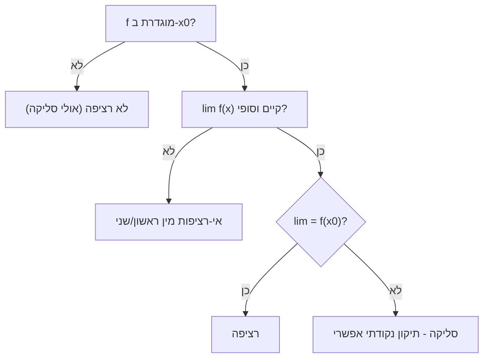

# רציפות בנקודה

> מקור: כרך ב, פרק 5.1 (הגדרות 5.1–5.2, 5.16; טענות 5.3–5.7, 5.17–5.20; משפטים 5.11, 5.14–5.15)

## ההגדרה (5.1–5.2)

$f$ **רציפה ב-$x_0$** אם:
$$\lim_{x\to x_0} f(x) = f(x_0)$$

שלושה תנאים בחבילה אחת (הגדרה 5.2), וכל אחד יכול להיכשל בנפרד:
1. $f$ **מוגדרת** ב-$x_0$ — נכשל: $\frac{\sin x}{x}$ ב-0.
2. **הגבול קיים** (וסופי) — נכשל: $\operatorname{sgn}(x)$ ב-0 (חד-צדדיים שונים), $\sin\frac1x$ עם ערך $0$ בנקודה $0$ (אין גבול).
3. **הגבול שווה לערך** — נכשל: $f(x)=\begin{cases}x^2 & x\ne0\\ 5 & x=0\end{cases}$ — הגבול 0, הערך 5.

ההבדל מ[[גבול של פונקציה בנקודה|גבול]]: הגבול מתעלם בכוונה מ-$f(x_0)$; הרציפות דורשת שהערך "יתאים לסביבה". אינטואיציה: אין קפיצה, אין חור — אפשר לצייר בלי להרים עיפרון (ליד הנקודה). אבל זהירות: האינטואיציה הגרפית נשברת בדוגמאות כמו [[פונקציית דיריכלה]] — רק ההגדרה שורדת תמיד.

> [!simple]- במילים פשוטות: הסביבה והערך מסכימים
> **בשורה אחת**: כשמתקרבים לנקודה, ערכי הפונקציה מתקרבים לערך שכתוב בה.
>
> **תמונה בראש**: שתי חתיכות של מסילה נפגשות בדיוק באותו גובה, בלי חור או קפיצה בחיבור.
>
> **עם מספרים**: עבור $f(x)=x^2$ ליד $2$, הערכים ב-$1.99$ וב-$2.01$ הם $3.9601$ ו-$4.0401$, והערך בנקודה הוא $4$.
>
> **מה נשבר**: אם משנים רק את $f(2)$ ל-$7$, ההתקרבות עדיין מובילה ל-$4$, ולכן הפונקציה החדשה אינה רציפה ב-$2$.

> [!simple]- נבנה את הרעיון צעד אחר צעד
> **בודקים את החיבור בשלושה צעדים**: האם לפונקציה יש ערך בנקודה? האם הערכים מסביב מתקרבים למספר אחד? האם המספר הזה שווה לערך שבנקודה? רציפות דורשת שכל שלוש התשובות יהיו כן.
>
> **תיקון של חור**: נגדיר $f(x)=x+2$ לכל $x\ne1$. סביב $1$ הפלטים מתקרבים ל-$3$. אם נגדיר $f(1)=3$ החיבור רציף; אם נגדיר $f(1)=9$, הגבול נשאר $3$ אבל יש אי־רציפות.
>
> **טיפ**: כאשר מחשבים גבולות מימין ומשמאל, לא מספיק ששניהם קיימים. צריך שיהיו שווים זה לזה וגם לערך הפונקציה בנקודה.

## מהגבול ביחידה 4 אל הרציפות ביחידה 5

גבול שואל מה קורה **ליד** הנקודה. רציפות מוסיפה בדיקה: האם מה שמתרחש ליד הנקודה מתאים גם למה שמוגדר בה?

נתבונן בשלושה מצבים באותו מקום, $x=1$, כאשר מחוץ לנקודה $f(x)=x+2$:

| מה מוגדר ב-$1$? | מה הגבול כשמתקרבים ל-$1$? | האם רציפה ב-$1$? |
|---|---|---|
| לא מוגדר ערך | $3$ | לא: חסר ערך בנקודה |
| $f(1)=9$ | $3$ | לא: הערך והגבול שונים |
| $f(1)=3$ | $3$ | כן: הגבול קיים ושווה לערך |

> [!simple]- בואו נבדוק את המקרה השלישי
> נניח שכלל הפונקציה הוא $f(x)=x+2$, כולל בנקודה $1$. אז $f(1)=3$. לכל $\varepsilon>0$ נבחר $\delta=\varepsilon$.
>
> אם $|x-1|<\delta$, גם כאשר $x=1$, נקבל $|f(x)-f(1)|=|x-1|<\varepsilon$. לכן הפונקציה רציפה ב-$1$.
>
> **טיפ**: בניסוח הישיר של רציפות מרשים גם $x=1$. כשמוכיחים את הגבול בנפרד משתמשים בסביבה מנוקבת, כלומר בודקים קלטים שונים מהנקודה, ואז משווים את הגבול לערכה.

רציפות בנקודה היא שאלה מקומית. השאלה האם אפשר להשתמש **באותה דלתא לכל זוג נקודות בתחום** היא [[רציפות במידה שווה ומשפט קנטור|רציפות במידה שווה]].

## גרף אינטראקטיבי: גבול וערך בנקודה

הישר הכחול מתאר את $x+2$ מחוץ ל-$1$. העיגול הריק מסמן את הגבול, והנקודה הירוקה את הערך שנקבע ב-$1$. הזיזו את $b$ כדי לשנות את הערך.

```desmos-live
{
  "version": 10,
  "graph": {
    "viewport": {
      "xmin": -1,
      "xmax": 4,
      "ymin": -1,
      "ymax": 7
    }
  },
  "expressions": {
    "list": [
      {
        "id": "b",
        "type": "expression",
        "latex": "b=5",
        "sliderBounds": {
          "min": 0,
          "max": 6,
          "step": 0.1
        }
      },
      {
        "id": "f",
        "type": "expression",
        "latex": "y=x+2",
        "color": "#2d70b3"
      },
      {
        "id": "hole",
        "type": "expression",
        "latex": "(1,3)",
        "color": "#2d70b3",
        "showLabel": false,
        "label": "הגבול",
        "pointStyle": "OPEN"
      },
      {
        "id": "actual",
        "type": "expression",
        "latex": "(1,b)",
        "color": "#388c46",
        "showLabel": false,
        "label": "ערך בנקודה"
      }
    ]
  }
}
```

הנקודה הירוקה מגדירה את ערך הפונקציה ב-$1$; העיגול הריק מוציא מן הישר את הערך שבמקום הזה. הפונקציה רציפה בנקודה בדיוק כאשר $b=3$. המחוון משנה רק את הערך בנקודה, ולכן הגבול נשאר $3$.

### ניסוחים שקולים

- **$\varepsilon$–$\delta$** (טענה 5.3): $\forall\varepsilon>0\ \exists\delta>0:\ |x-x_0|<\delta \Rightarrow |f(x)-f(x_0)|<\varepsilon$. שימו לב — **בלי נקיבה**! ב-$x=x_0$ התנאי מתקיים ממילא ($|f(x_0)-f(x_0)|=0$), אז אין צורך להחריג.
- **היינה** (טענה 5.4): לכל סדרה $x_n \to x_0$ (מותר $x_n = x_0$!): $f(x_n) \to f(x_0)$. הניסוח החשוב ביותר למעשה: **רציפות = מותר להחליף גבול ופונקציה**:
$$\lim_{n\to\infty} f(x_n) = f\left(\lim_{n\to\infty} x_n\right)$$
זה מה שמכשיר את "הצבת הגבול" בסדרות רקורסיביות ([[סדרות מונוטוניות]]) ואת משוואות הגבול בכלל.
- **רציפות חד-צדדית** (הגדרה 5.16, טענה 5.18): רציפה מימין אם $\lim_{x\to x_0^+}f(x)=f(x_0)$; רציפה $\iff$ רציפה מימין וגם משמאל. דוגמה: $\lfloor x\rfloor$ רציפה **מימין** בכל שלם (הגבול מימין שווה לערך) אך לא משמאל.

> [!simple]- במילים פשוטות: דיוק, סדרות ושני צדדים
> **בשורה אחת**: אפשר לבדוק רציפות דרך מרחקים קטנים או דרך כל סדרה שמתקרבת לנקודה; שתי הדרכים אומרות אותו דבר.
>
> **עם מספרים**: עבור $f(x)=3x$ ודרישה $\varepsilon=0.06$, הבחירה $\delta=0.02$ מספיקה בכל נקודה, כי $|3x-3x_0|=3|x-x_0|$.
>
> **תמונה בראש**: היינה בודק כל מסלול של צעדים שמתקרב ליעד. מסלול אחד מוצלח אינו מספיק; מסלול אחד נכשל כבר מפריך רציפות.
>
> **חד־צדדיות**: ב-$\lfloor x\rfloor$ ליד $2$ הערך מימין הוא $2$ ומשמאל $1$. התאמה מצד אחד בלבד אינה רציפות דו־צדדית.

## אילו פונקציות רציפות?

- **אריתמטיקה** (משפט 5.11): $f,g$ רציפות ב-$x_0$ ולכן גם $f\pm g$, $fg$, ו-$\frac fg$ (אם $g(x_0)\ne0$) רציפות שם. (נובע ישירות מ[[אריתמטיקה וכללים לגבולות פונקציות|אריתמטיקת הגבולות]].)
- **משפט 5.15** — הרכבה (ברשימת המשפטים לבחינה): אם $g$ רציפה ב-$t_0$ ו-$f$ רציפה ב-$x_0=g(t_0)$, אז $f\circ g$ רציפה ב-$t_0$. ההוכחה המלאה מופיעה מיד אחרי הרשימה.
- **הכנסת גבול פנימה** (משפט 5.14): אם $\lim_{t\to t_0}g(t)=x_0$ ו-$f$ רציפה ב-$x_0$, אז
  $$\lim_{t\to t_0} f(g(t)) = f\left(\lim_{t\to t_0} g(t)\right) = f(x_0)$$
  — **בלי** התנאי העדין של משפט 4.39 (הרציפות של $f$ ב-$x_0$ בדיוק סותמת את החור שהתנאי נועד לעקוף). זו העבודה השחורה של כל חישובי הגבולות בהמשך: $\lim\sqrt{g(t)}=\sqrt{\lim g(t)}$, $\lim\sin(g(t))=\sin(\lim g(t))$ וכו'.

> [!simple]- במילים פשוטות: מחברים פונקציות רציפות
> **בשורה אחת**: חיבור, כפל והרכבה שומרים על התאמה בין הערכים לגבולות, כשכל הפעולות מוגדרות.
>
> **תמונה בראש**: בהרכבה יש שתי תחנות: הפנימית מביאה אותנו קרוב לקלט של החיצונית, והחיצונית מביאה אותנו קרוב לתוצאה.
>
> **עם מספרים**: אם $g(t)=t^2$ ו-$f(x)=\sqrt{x+1}$, אז כש-$t\to2$ מתקבל $f(g(t))\to\sqrt5$.
>
> **מה נשבר כשמורידים תנאי**: למנה $1/x$ אין רציפות ב-$0$, כי המכנה מתאפס. בהרכבה צריך רציפות של החיצונית דווקא ב-$g(t_0)$: עם $g(t)=t$ ו-$f=\operatorname{sgn}$ ההרכבה אינה רציפה ב-$0$.

> [!exam] במבחן
> רציפות הרכבה, משפט 5.15, התבקשה להוכחה ב־**3 שאלות** במאגר: [2020א·85, שאלה 2](#/exams/5/q2), [2025ב·96, שאלה 2](#/exams/38/q2), [2026ב·88, שאלה 7](#/exams/43/q7). מתחילים מדרישת הדיוק של החיצונית, ומעבירים אותה כדרישה לפנימית.

> [!plan]
> החיצונית אומרת כמה קרוב צריך להיות אל הקלט שלה כדי לקבל דיוק נתון. את המרחק הזה מבקשים מהפנימית. שרשור שתי ההבטחות נותן את הרציפות של ההרכבה.

### הוכחת משפט 5.15 (רציפות של הרכבה)

<!-- infi-proof: 5.15 -->

נשתמש באפיון $\varepsilon$–$\delta$ של רציפות (טענה 5.3). יהי $\varepsilon>0$.

1. **הפונקציה החיצונית.** $f$ רציפה ב-$x_0$, ולכן קיים $\eta>0$ כך שלכל $x$ המקיים $|x-x_0|<\eta$ מתקיים $|f(x)-f(x_0)|<\varepsilon$. (אפשר לבחור את $\eta$ קטן מספיק כך ש-$f$ מוגדרת בכל הסביבה $N_\eta(x_0)$.)
2. **הפונקציה הפנימית.** $g$ רציפה ב-$t_0$. נפעיל את ההגדרה עם המספר החיובי $\eta$ במקום $\varepsilon$: קיים $\delta>0$ כך שלכל $t$ המקיים $|t-t_0|<\delta$ מתקיים $|g(t)-g(t_0)|<\eta$, כלומר $|g(t)-x_0|<\eta$.
3. **שרשור.** יהי $t$ עם $|t-t_0|<\delta$. לפי שלב 2, הנקודה $x=g(t)$ מקיימת $|x-x_0|<\eta$, ולכן $f(g(t))$ מוגדר, ולפי שלב 1
$$|f(g(t))-f(g(t_0))| = |f(x)-f(x_0)|<\varepsilon.$$

לכן $f\circ g$ רציפה ב-$t_0$. ∎

<!-- /infi-proof -->

**דרך שנייה (היינה, טענה 5.4)**: תהי $t_n\to t_0$. מרציפות $g$ מקבלים $g(t_n)\to g(t_0)=x_0$, ומרציפות $f$ מקבלים $f(g(t_n))\to f(x_0)$. **שימו לב**: בהגדרת היינה לרציפות מותר $x_n=x_0$, ולכן אין כאן את הבעיה של משפט 4.39, שבו $g(t)$ עלולה להיות שווה ל-$x_0$.

### מלאי הרציפות של הקורס

| משפחה | מקור |
|---|---|
| פולינומים ורציונליות (בתחומן) | מסקנה 5.12 |
| $\sin,\cos$ (בכל $\mathbb{R}$); $\tan$ בתחומה | טענה 5.7, משפט 5.13 |
| $\sqrt x$ ב-$[0,\infty)$ (ב-0 מימין) | טענות 5.5, 5.17 |
| $\|x\|$ | ישירות מ-$\big\|\|x\|-\|x_0\|\big\|\le\|x-x_0\|$ |
| $a^x,\ \log_a x$ בתחומן | [[פונקציות מעריכיות ולוגריתמיות|משפטים 6.9–6.14]] |

**אסטרטגיית העבודה**: פונקציה שבנויה מאלמנטריות בפעולות מותרות — רציפה בכל תחומה אוטומטית; ציטוט המשפטים מספיק. בדיקה ידנית (מהגדרה/חד-צדדית) נדרשת רק ב**נקודות תפר** של הגדרה-למקרים וב**נקודות מיוחדות** (קצה תחום, ערך מוגדר בנפרד).

### דוגמה עבודה — נקודת תפר

$f(x)=\begin{cases}\frac{\sin x}{x} & x\ne0\\ 1 & x=0\end{cases}$: בכל $x\ne0$ — מנת רציפות עם מכנה שונה מאפס ולכן רציפה. ב-0: $\lim_{x\to0}\frac{\sin x}{x}=1=f(0)$ ([[הגבול של sin x חלקי x]]) ולכן רציפה גם שם. זו "השלמה ברציפות" של אי-רציפות סליקה — ראו [[מיון נקודות אי-רציפות]].

## שתי תוצאות קטנות שחוזרות בהוכחות

- **שימור סימן** (לא ממוספר בחוברת; מוכיחים בשורה): $f$ רציפה ב-$x_0$ ו-$f(x_0)>0$ ולכן קיימת סביבה שבה $f>0$ (קחו $\varepsilon=\frac{f(x_0)}2$). משמשת בהוכחת [[משפט ערך הביניים|ערך הביניים]] ובהמשך ב[[נקודות קיצון ומשפט פרמה|פרמה]].
- **חסימות מקומית**: רציפה ב-$x_0$ ולכן חסומה בסביבה של $x_0$.

## תרגול מודרך: האם התפר רציף?

נגדיר $f(x)=x^2+1$ כאשר $x\ne2$, ו-$f(2)=a$. **נסו בעצמכם**: מצאו את ערך $a$ שעבורו הפונקציה רציפה ב-$2$, והסבירו מדוע הוא מתאים.

> [!hint]- רמז ראשון
> רציפות בנקודה דורשת שגבול הפונקציה כאשר מתקרבים לנקודה יהיה שווה לערך שלה בנקודה. בדקו תחילה את הגבול.

> [!hint]- רמז שני
> מחוץ לנקודה הפונקציה היא $x^2+1$. מה ערכו של הביטוי הזה כאשר מציבים $x=2$? השוו את התוצאה ל-$a$.

> [!solution]- פתרון מלא
> לפי רציפות הפולינום, $\lim_{x\to2}(x^2+1)=5$. ערך הפונקציה בנקודה הוא $f(2)=a$. שלושת תנאי הרציפות מתקיימים בדיוק כאשר $a=5$: הפונקציה מוגדרת בנקודה, הגבול קיים ושווה ל-$5$, והוא שווה לערך הפונקציה.

**לזכור להבא**: קודם מחשבים גבול לפי הביטוי שמחוץ לנקודה, אחר כך בודקים את הערך המוגדר בנקודה ומשווים.

## כרטיס דיוק

- **רעיון-על**: רציפות = הגבול שווה לערך; ובניסוח היינה — מותר להחליף סדר בין גבול לפונקציה.
- **מתי מפעילים**: הרכבות והצבות גבול; בדיקת תפרים; והכשרת משוואות גבול בסדרות רקורסיביות.
- **בדיקה עצמית**: (א) אילו משלושת התנאים נכשל בכל אחת: $\frac{x^2-1}{x-1}$ ב-1, $\operatorname{sgn}$ ב-0, דיריכלה בכל נקודה? (ב) הוכיחו מהיינה שרציפות מאפשרת $\lim f(x_n)=f(\lim x_n)$. (ג) מדוע ב-$\varepsilon$–$\delta$ של רציפות אין נקיבה?
- **מלכודת**: פונקציה יכולה להיות מוגדרת בנקודה ולא רציפה שם; והגדרת ערך "לא מתאים" הורסת רציפות גם כשהגבול קיים.
- **קישור רוחב**: ראו גם [[מפת תלות משפטים - אינפי 1]], [[תבניות הוכחה באינפי 1]], [[אינדקס דוגמאות נגד - אינפי 1]].

> [!solution]- פתרון (א)
> ב-$1$ הביטוי $\frac{x^2-1}{x-1}$ אינו מוגדר, אך עבור $x\ne1$ הוא שווה ל-$x+1$ ולכן גבולו $2$: חסר ערך בנקודה. פונקציית הסימן מוגדרת ב-$0$, אך גבולותיה משמאל ומימין הם $-1$ ו-$1$, ולכן אין גבול. דיריכלה מוגדרת בכל נקודה, אך על סדרת רציונליים ערכיה $1$ ועל סדרת אי־רציונליים ערכיה $0$; בכל נקודה נכשל קיום הגבול.

> [!solution]- פתרון (ב)
> נניח $x_n\to x_0$ וכל האיברים בתחום $f$, ו-$f$ רציפה ב-$x_0$. לפי אפיון היינה לרציפות מתקיים $f(x_n)\to f(x_0)$. מכיוון ש-$x_0=\lim x_n$, נקבל $\lim f(x_n)=f(\lim x_n)$. צריך את הרציפות בנקודת הגבול: עבור $f=\operatorname{sgn}$ ו-$x_n=1/n$ מתקבל $f(x_n)=1$, אף ש-$f(0)=0$.

> [!solution]- פתרון (ג)
> ב-$x=x_0$ המרחק בין ערכי הפונקציה הוא $|f(x_0)-f(x_0)|=0<\varepsilon$. לכן הוספת הנקודה עצמה לדרישה אינה משנה דבר. בכיוון אחד מסירים אותה ומקבלים את תנאי הגבול; בכיוון השני תנאי הגבול מטפל בכל $x\ne x_0$, והמקרה $x=x_0$ מתקיים אוטומטית.

## תרשים רציפות



## קשרים

- [[גבול של פונקציה בנקודה]] — המושג שעליו רציפות בנויה
- [[מיון נקודות אי-רציפות]] — מה קורה כשזה נכשל
- [[פונקציית דיריכלה]] — הקיצון: רציפה בשום מקום
- [[רציפות בקטע]] — מרציפות נקודתית לגלובלית
- [[אריתמטיקה וכללים לגבולות פונקציות]] — המשפטים שמאחורי הכללים
- [[הגדרת הנגזרת]] — גזירות גוררת רציפות (משפט 7.9), לא להפך
