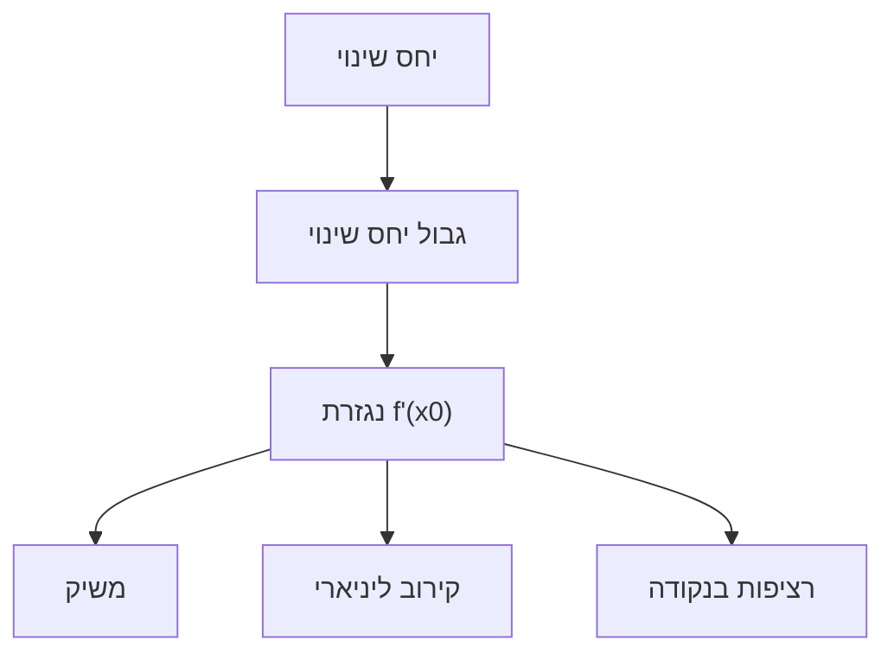

# הגדרת הנגזרת

> מקור: כרך ג, פרקים 7.1–7.2 (הגדרות 7.1–7.7, טענות 7.8, 7.10, משפט 7.9)

## שתי הבעיות שהולידו את הנגזרת (פרק 7.1)

1. **מהירות רגעית** (הגדרות 7.1–7.5): גוף במקום $f(t)$; המהירות הממוצעת בקטע זמן היא $\frac{f(t_2)-f(t_1)}{t_2-t_1}$; המהירות **הרגעית** — הגבול כשהקטע מתכווץ.
2. **משיק לעקומה** (הגדרה 7.6): שיפוע המיתר בין $(x,f(x))$ ל-$(x+h, f(x+h))$ הוא $\frac{f(x+h)-f(x)}{h}$; המשיק — הישר ששיפועו גבול שיפועי המיתרים.

שתי הבעיות — אותו גבול.

## ההגדרה (7.7)

$f$ מוגדרת בסביבת $x_0$. אם הגבול (הסופי!) קיים:
$$f'(x_0) = \lim_{h\to0}\frac{f(x_0+h)-f(x_0)}{h}$$
אומרים ש-$f$ **גזירה** ב-$x_0$, והגבול נקרא **הנגזרת**.

> [!simple]- במילים פשוטות: שיפוע שמתייצב
> **בשורה אחת**: הנגזרת מודדת את קצב השינוי ברגע מסוים, באמצעות השוואה לנקודות קרובות יותר ויותר.
>
> **תמונה בראש**: מחשבים מהירות ממוצעת בחלונות זמן שהולכים ומתקצרים; אם הערכים מתייצבים לאותו מספר משני הצדדים, זו המהירות הרגעית.
>
> **עם מספרים**: ניקח $f(x)=x^2$ ונתקרב לנקודה $x_0=2$. השינוי בערך הפונקציה הוא $(2+h)^2-4=4h+h^2$, ולכן מנת ההפרשים היא $4+h$. נסתכל על שני הצדדים:
>
> | הצעד $h$ | מנת ההפרשים $4+h$ | מאיזה צד הגענו |
> |---|---|---|
> | $0.1$ | $4.1$ | מימין |
> | $0.01$ | $4.01$ | מימין, קרוב יותר |
> | $-0.1$ | $3.9$ | משמאל |
> | $-0.01$ | $3.99$ | משמאל, קרוב יותר |
>
> כשמקטינים את גודל הצעד, המנות משני הצדדים מתקרבות לאותו מספר, $4$. זהו שיפוע המשיק בנקודה. לא מציבים $h=0$ במנה המקורית — היא כוללת חילוק ב-$h$; מחשבים את הגבול כשמתקרבים לאפס.
>
> **מה יכול להשתבש**: עבור $f(x)=|x|$ ב-$0$ המנה היא $1$ מימין ו-$-1$ משמאל, ולכן אין נגזרת.
>
> **מה בדיוק מחלקים?** בוחרים נקודה קרובה. מחשבים בכמה השתנה הפלט, ומחלקים בכמה השתנה הקלט. זהו השיפוע הממוצע בין שתי הנקודות. הנגזרת היא הגבול של השיפוע הזה כשהמרחק בין הקלטים שואף לאפס.
>
> **עבודה קטנה עד הסוף**: ל-$f(x)=x^2$ בנקודה $2$, שינוי הפלט הוא $(2+h)^2-4=4h+h^2$. עבור $h\ne0$ מחלקים ב-$h$ ומקבלים $4+h$. רק עכשיו נותנים ל-$h$ לשאוף לאפס ומקבלים נגזרת $4$; לא מציבים אפס לפני הצמצום.
>
> **טיפ**: גזירות בנקודה אומרת משהו על אותה נקודה; היא אינה מבטיחה שהפונקציה גזירה בכל סביבתה. בהוכחה מציינים היכן בדיוק משתמשים בגזירות.

צורה שקולה (טענה 7.8):
$$f'(x_0) = \lim_{x\to x_0}\frac{f(x)-f(x_0)}{x-x_0}$$

<!-- infi-demo: secant -->

## נגזרות מההגדרה: ארבע דוגמאות

> [!solution]- ריבוע בנקודה כללית
> עבור $f(x)=x^2$ ו-$h\ne0$ מתקיים
> $$\frac{f(x+h)-f(x)}h=\frac{(x+h)^2-x^2}{h}=2x+h.$$
> כש-$h\to0$ הגבול הוא $2x$, ולכן $f'(x)=2x$ לכל ממשי.

> [!solution]- פונקציה הופכית
> עבור $f(x)=1/x$ נבחר $x\ne0$ ו-$h$ קטן מספיק כך שגם $x+h\ne0$. אז
> $$\frac{f(x+h)-f(x)}h=\frac{1/(x+h)-1/x}{h}=\frac{-h}{h\,x(x+h)}=-\frac1{x(x+h)}.$$
> לכן $f'(x)=-1/x^2$ לכל $x\ne0$.

> [!solution]- שורש חיובי
> עבור $f(x)=\sqrt x$ ו-$x>0$, ניקח $h\ne0$ קטן מספיק ש-$x+h>0$. נכפול בצמוד:
> $$\frac{\sqrt{x+h}-\sqrt x}{h}=\frac{(x+h)-x}{h(\sqrt{x+h}+\sqrt x)}=\frac1{\sqrt{x+h}+\sqrt x}.$$
> מרציפות השורש מתקבל $f'(x)=1/(2\sqrt x)$. ב-$0$ בתחום $[0,\infty)$ מנת ההפרשים מימין היא $1/\sqrt h\to\infty$, ולכן אין נגזרת סופית.

> [!solution]- פונקציה עם ערך מוחלט
> עבור $f(x)=x|x|$, כאשר $x>0$ הפונקציה שווה ל-$x^2$, ולכן נגזרתה $2x$. כאשר $x<0$ היא שווה ל-$-x^2$, ולכן נגזרתה $-2x$. ב-$0$ נבדוק בנפרד:
> $$\frac{f(h)-f(0)}h=\frac{h|h|}{h}=|h|\longrightarrow0.$$
> לכן $f'(0)=0$, ובכל הנקודות אפשר לכתוב $f'(x)=2|x|$.

> [!solution]- פונקציית דיריכלה כפול ריבוע
> נגדיר $f(x)=x^2D(x)$, כאשר $D(x)=1$ לרציונלי ו-$D(x)=0$ לאי־רציונלי. מאחר ש-$f(0)=0$, לכל $h\ne0$ מתקיים
> $$\left|\frac{f(h)-f(0)}h\right|=|hD(h)|\le|h|\longrightarrow0.$$
> לפי משפט הסנדוויץ׳ $f'(0)=0$. אם $x_0\ne0$, נבחר סדרת רציונליים וסדרת אי־רציונליים המתכנסות ל-$x_0$. ערכי $f$ לאורך הראשונה שואפים ל-$x_0^2>0$, ולאורך השנייה שווים ל-$0$. לכן אין גבול לפונקציה ב-$x_0$, היא אינה רציפה שם, וממשפט 7.9 גם אינה גזירה שם.

## מציאת פרמטרים בנקודת תפר

> [!simple]- במילים פשוטות: קודם מחברים, אחר כך משווים שיפועים
> **בשורה אחת**: גזירות בתפר דורשת גם ששני חלקי הפונקציה ייפגשו וגם שמנות ההפרשים משני הצדדים יגיעו לאותו שיפוע.
>
> **תמונה בראש**: מחברים שתי חתיכות של כביש. חיבור באותו גובה מונע קפיצה; התאמת השיפועים מונעת פינה.
>
> **עם מספרים**: שני קווים שנפגשים בגובה $3$ עם שיפועים $1$ ו-$2$ יוצרים פינה. שוויון ערכי הפונקציה לבדו אינו מספיק לגזירות.
>
> בסדר העבודה: רציפות תחילה, אחריה חישוב נגזרות חד־צדדיות, ולבסוף בדיקה שהערכים שנמצאו אכן מקיימים את שני התנאים.

> [!solution]- דוגמה מלאה: שני פרמטרים בתפר
> נגדיר $f(x)=x^2+ax+b$ עבור $x\le1$, ו-$f(x)=2x+1$ עבור $x>1$. נחפש $a,b$ כך ש-$f$ תהיה גזירה ב-$1$.
>
> **רציפות**: ערך הפונקציה והגבול משמאל הם $1+a+b$, ואילו הגבול מימין הוא $3$. לכן $a+b=2$.
>
> **שיפועים**: לאחר שהרציפות הובטחה, הנגזרת משמאל היא $2+a$, והנגזרת מימין היא $2$. שוויונן מחייב $a=0$, ואז ממשוואת הרציפות $b=2$.
>
> **בדיקה**: עבור $a=0,b=2$ שני הצדדים מתקרבים ל-$3=f(1)$, ושתי הנגזרות החד־צדדיות שוות ל-$2$. לכן $f$ אכן גזירה בתפר.

## גזירות גוררת רציפות (משפט 7.9, ברשימת המשפטים לבחינה)

**הניסוח**: אם $f$ גזירה ב-$x_0$, אז $f$ רציפה ב-$x_0$.

> [!simple]- במילים פשוטות: קו משיק דורש שהגרף לא יקפוץ
> **בשורה אחת**: אם יש לפונקציה נגזרת בנקודה, היא חייבת להיות רציפה בה.
>
> **עם מספרים**: עבור $f(x)=x^2$ ב-$2$, הנגזרת היא $4$ והערכים מתקרבים ל-$f(2)=4$ כש-$x$ מתקרב ל-$2$.
>
> **הכיוון ההפוך נכשל**: $|x|$ רציפה ב-$0$, אבל יש לה פינה והנגזרות החד־צדדיות שונות.
>
> אפשר לחשוב על הנגזרת כעל שיפוע מקומי סופי; קפיצה בנקודה מונעת קיום שיפוע כזה.

> [!exam] במבחן
> משפט 7.9 התבקש להוכחה ב־5 שאלות במאגר: [2021ב·56, שאלה 2](#/exams/11/q2), [2024א·88, שאלה 2](#/exams/30/q2), [2026ב·84, שאלה 7](#/exams/42/q7). מציגים את מנת ההפרשים כגורם ששואף לנגזרת סופית ומכפילים בהפרש ששואף לאפס.
>
> [שאלה 9 · 2021ג · מועד 93 — סריקה ללא פתרון](#/exams/15/q9). כתבו את מנת ההפרשים עבור המכפלה בנקודה שבה שתי הפונקציות מתאפסות. [עוד שאלות ביחידה](#/exams?unit=7).

> [!plan]
> כותבים את הפרש ערכי הפונקציה כמכפלת מנת ההפרשים בהפרש המשתנים. הגורם הראשון שואף לנגזרת סופית, והשני לאפס. לכן הפרש ערכי הפונקציה שואף לאפס, וזו רציפות.

<!-- infi-proof: 7.9 -->

**הוכחה.**
1. לפי הגדרה 7.7, $f$ מוגדרת בסביבה של $x_0$. לכל $x\ne x_0$ בסביבה זו מתקיים
$$f(x)=f(x_0)+\frac{f(x)-f(x_0)}{x-x_0}\cdot(x-x_0).$$
2. לפי טענה 7.8, $\lim_{x\to x_0}\frac{f(x)-f(x_0)}{x-x_0}=f'(x_0)$, וזה גבול סופי כי $f$ גזירה ב-$x_0$. בנוסף $\lim_{x\to x_0}(x-x_0)=0$ (טענה 4.33, גבול של פונקציה ליניארית).
3. לפי אריתמטיקה של גבולות (משפט 4.38):
$$\lim_{x\to x_0}f(x)=f(x_0)+f'(x_0)\cdot0=f(x_0).$$
4. לכן לפי הגדרה 5.1, $f$ רציפה ב-$x_0$. ∎

<!-- /infi-proof -->

**נקודה לבודק**: חשוב לכתוב שהגבול של מנת ההפרשים **סופי**. אריתמטיקה של גבולות מותרת רק לגבולות סופיים.

**ההפך לא נכון** (טענה 7.10): $f(x)=|x|$ רציפה ב-$0$ ואינה גזירה שם — [[נגזרות חד-צדדיות|הנגזרות החד-צדדיות]] הן $\pm1$ ושונות (גרף עם "פינה"). דוגמאות אי-גזירות נוספות (סעיף 7.2.4): משיק אנכי ($\sqrt[3]{x}$ ב-0), התנדנדות ($x\sin\frac1x$ ב-0).

## שלוש דרכים לקרוא את $f'(x_0)$

1. **גאומטרית**: שיפוע המשיק לגרף ב-$(x_0, f(x_0))$ — [[קירוב ליניארי והדיפרנציאל|משוואת המשיק]].
2. **פיזיקלית**: קצב שינוי רגעי (מהירות, צפיפות קווית — סעיף 7.1.3).
3. **קירובית**: המספר שעבורו $f(x_0+h) \approx f(x_0) + f'(x_0)h$ עם שגיאה זניחה — הניסוח המדויק ב[[קירוב ליניארי והדיפרנציאל|משפט 7.35]].

## נגזרת כפונקציה, נגזרות גבוהות

$f'$ היא פונקציה בפני עצמה (בכל נקודה שבה הגבול קיים); $f''=(f')'$ (הגדרה 8.22 — גזירה פעמיים), וכן הלאה $f^{(n)}$.

## גרף אינטראקטיבי: ממיתר למשיק

הנקודה הירוקה קבועה ב-$(2,4)$ והנקודה האדומה נמצאת ב-$(2+h,(2+h)^2)$. הקטינו את $h$ בעזרת המחוון ועקבו אחר הישר העובר בשתי הנקודות.

```desmos-live
{
  "version": 10,
  "graph": {
    "viewport": {
      "xmin": 0,
      "xmax": 4.5,
      "ymin": -1,
      "ymax": 16
    }
  },
  "expressions": {
    "list": [
      {
        "id": "h",
        "type": "expression",
        "latex": "h=1",
        "sliderBounds": {
          "min": 0.1,
          "max": 2,
          "step": 0.1
        }
      },
      {
        "id": "f",
        "type": "expression",
        "latex": "f(x)=x^2",
        "color": "#2d70b3"
      },
      {
        "id": "sec",
        "type": "expression",
        "latex": "y=(4+h)(x-2)+4",
        "color": "#c74440"
      },
      {
        "id": "p",
        "type": "expression",
        "latex": "(2,4)",
        "color": "#388c46",
        "showLabel": false,
        "label": "נקודה קבועה"
      },
      {
        "id": "q",
        "type": "expression",
        "latex": "(2+h,f(2+h))",
        "color": "#c74440",
        "showLabel": false,
        "label": "נקודה שנייה"
      }
    ]
  }
}
```

שיפוע המיתר הוא $4+h$: עבור $h=1$ הוא $5$, ועבור $h=0.1$ הוא $4.1$. כש-$h$ שואף לאפס מימין השיפוע מתקרב ל-$4$. כדי להצדיק נגזרת דו־צדדית בודקים את הגבול גם משמאל, כפי שנעשה בהסבר שלעיל.

## תרגול מודרך: נסו לפני הפתרון

חשבו מההגדרה את נגזרת $f(x)=x^2$ בנקודה $x=1$.

> [!hint]- רמז ראשון
> כתבו את מנת ההפרשים: השינוי בפלט חלקי השינוי בקלט $h$.

> [!hint]- רמז שני
> פתחו את הריבוע $(1+h)^2$ וצמצמו את $h$ כאשר $h\ne0$.

> [!solution]- פתרון מלא
> עבור $h\ne0$, מנת ההפרשים היא $((1+h)^2-1)/h=(2h+h^2)/h=2+h$. כש-$h\to0$ הגבול הוא $2$, ולכן $f'(1)=2$.

## כרטיס דיוק

- **הרעיון המרכזי**: נגזרת היא גבול של יחס שינוי; קיומה אומר שקיים קירוב ליניארי מקומי יחיד.
- **מתי מפעילים**: כשצריך לבדוק גזירות בנקודה, למצוא משיק, או להוכיח אי-גזירות.
- **בדיקה עצמית**: בדקו מההגדרה את גזירות $|x|$ ב-$0$ ואת גזירות $x^2$ בכל נקודה.
- **מלכודת**: גזירות גוררת רציפות, אבל רציפות אינה גוררת גזירות.

> [!solution]- פתרון הבדיקה העצמית
> עבור $f(x)=|x|$ ב-$0$, מנת ההפרשים היא $|h|/h$: מימין היא $1$ ומשמאל $-1$. הגבולות שונים ולכן הפונקציה אינה גזירה ב-$0$.
>
> עבור $g(x)=x^2$ בכל $x$ ממשי, מנת ההפרשים היא $2x+h$, כפי שחישבנו לעיל. גבולה כאשר $h\to0$ הוא $2x$, ולכן הנגזרת קיימת ושווה לערך הזה בכל נקודה.

## תרשים הנגזרת



## קשרים

- [[גבול של פונקציה בנקודה]] — הנגזרת היא גבול
- [[כללי הגזירה]], [[כלל השרשרת]], [[נגזרות הפונקציות האלמנטריות]] — מכונת החישוב
- [[נקודות קיצון ומשפט פרמה]] — תחילת התורה ביחידה 8
