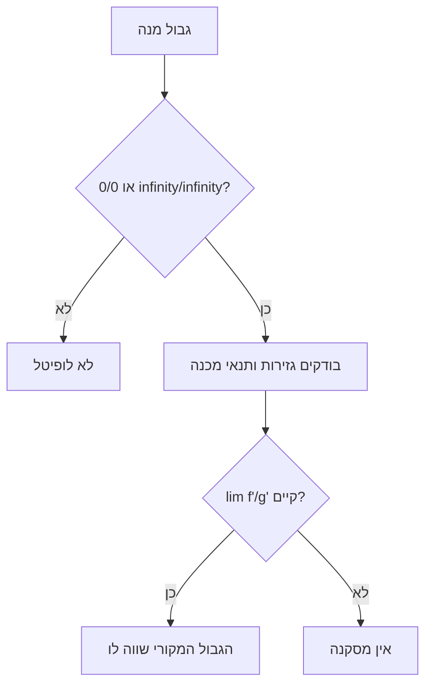

# כלל לופיטל

> מקור: כרך ג, פרק 8.3 (משפטים 8.13–8.16)

## הכלל — צורת "$\frac00$" בנקודה (משפט 8.13)

$f,g$ גזירות בסביבה מנוקבת של $x_0$, ושתיהן שואפות שם ל-$0$:
$$\lim_{x\to x_0} f(x) = \lim_{x\to x_0} g(x) = 0$$
אם הגבול $\lim_{x\to x_0}\dfrac{f'(x)}{g'(x)}$ **קיים** (או אינסופי), אז:
$$\lim_{x\to x_0}\frac{f(x)}{g(x)} = \lim_{x\to x_0}\frac{f'(x)}{g'(x)}$$

> [!simple]- במילים פשוטות: במקום המנה בודקים את קצב השינוי
> **בשורה אחת**: בצורות מסוימות של מנה אפשר לחשב את הגבול דרך מנה של נגזרות, לאחר שבודקים את תנאי המשפט.
>
> **תמונה בראש**: שני גדלים מצטמצמים יחד; שואלים מה היחס בין קצבי השינוי שלהם כשהם מתקרבים לנקודה.
>
> **עם מספרים**: כאשר $x\to0$, המנה $(e^x-1)/x$ היא מצורת $0/0$. מנת הנגזרות היא $e^x/1\to1$, ולכן גם הגבול המקורי $1$.
>
> **מה נשבר בלי צורת אי־הכרעה**: $\sin x/(1+x)$ שואפת ל-$0$ כש-$x\to0$, ואילו מנת הנגזרות שואפת ל-$1$. אסור להפעיל עליה את הכלל.

**שימו לב לתנאי סמוי**: כדי שלמנה $\frac{f'(x)}{g'(x)}$ יהיה בכלל גבול, היא צריכה להיות מוגדרת בסביבה מנוקבת של $x_0$, כלומר $g'(x)\ne0$ שם. במבחן כותבים את זה במפורש כשבודקים את התנאים.

*רעיון ההוכחה*: מגדירים (או מגדירים מחדש) $f(x_0)=g(x_0)=0$, כך ש-$f,g$ רציפות ב-$x_0$. אז לפי [[משפט קושי]] $\frac{f(x)}{g(x)}=\frac{f(x)-f(x_0)}{g(x)-g(x_0)} = \frac{f'(c_x)}{g'(c_x)}$ עבור $c_x$ בין $x_0$ ל-$x$, ו-$c_x\to x_0$ כש-$x\to x_0$.

## הגרסאות (משפטים 8.14–8.16)

הכלל תקף באותה צורה עבור:
- גבולות חד-צדדיים ($x\to x_0^\pm$) — 8.14
- גבולות באינסוף ($x\to\pm\infty$) — 8.15
- צורת "$\frac{\infty}{\infty}$" — 8.16 (בכל סוגי הגבולות)

> [!simple]- במילים פשוטות: אותו רעיון בנקודות ובאינסוף
> **בשורה אחת**: יש גרסאות לופיטל להתקרבות חד־צדדית, לאינסוף ולצורת אינסוף חלקי אינסוף.
>
> **עם מספרים**: כאשר $x\to\infty$, גם $\ln x$ וגם $x$ שואפים לאינסוף, ומנת הנגזרות היא $1/x\to0$. לכן $\ln x/x\to0$.
>
> **מה עדיין בודקים**: תנאי הגזירות, אי־התאפסות נגזרת המכנה וקיום גבול מנת הנגזרות רלוונטיים לכל גרסה; צורה אחרת דורשת המרה לפני ההפעלה.

## חמש אזהרות קריטיות

1. **בדקו שזו באמת צורה בלתי-מוגדרת** — לופיטל על $\lim_{x\to0}\frac{\sin x}{x^3+1}$ (שאינו $\frac00$) נותן שטויות.
2. **אם $\lim\frac{f'}{g'}$ לא קיים — אין מסקנה!** הכלל חד-כיווני. דוגמה: $\lim_{x\to0}\frac{x^2\sin\frac1x}{\sin x}$ — מנת הנגזרות מתנדנדת בלי גבול, אבל הגבול המקורי קיים ($=0$, דרך [[סדרות חסומות וסדרות אפסות|חסומה×אפסה]]).
3. **גוזרים מונה ומכנה בנפרד** — לא כמנה ([[כללי הגזירה|כלל המנה]])!
4. **מעגליות**: אסור להוכיח את [[הגבול של sin x חלקי x]] בלופיטל — נגזרת סינוס נשענת על הגבול הזה.
5. אפשר להפעיל שוב ושוב — אבל כל פעם לוודא מחדש שהצורה בלתי-מוגדרת; ולפעמים לופיטל "מסתובב במעגל" ($\frac{x}{\sqrt{x^2+1}}$ באינסוף — עדיף אלגברה).

## המרת צורות אחרות

| צורה | המרה |
|---|---|
| $0\cdot\infty$ | $fg = \dfrac{f}{1/g}$ → לרוב $\frac00$ או $\frac\infty\infty$ |
| $\infty - \infty$ | מכנה משותף / כפל בצמוד / הוצאת גורם |
| $1^\infty,\ 0^0,\ \infty^0$ | $f^g = e^{g\ln f}$ ([[פונקציות מעריכיות ולוגריתמיות]]) ולופיטל על המעריך |

דוגמאות פתורות: $\lim_{x\to0^+}x\ln x = 0$; $\lim_{x\to0^+}x^x = e^0 = 1$; $\lim_{x\to\infty}\frac{x^n}{e^x}=0$ ($n$ הפעלות); $\lim_{x\to\infty}\frac{\ln x}{x^n}=0$ — [[סדרי גודל ומבחן המנה|סולם סדרי הגודל]].

## לפני שמפעילים: רשימת בדיקה

1. מוודאים מהו הגבול המבוקש ומאיזה צד ניגשים. מציבים גבולות במונה ובמכנה ובודקים שמתקבלת צורת $0/0$ או $\infty/\infty$.
2. בודקים שהפונקציות גזירות בסביבה המנוקבת הרלוונטית, שהמנה המקורית מוגדרת שם, ושנגזרת המכנה אינה מתאפסת בה.
3. גוזרים את המונה ואת המכנה **בנפרד**, ובודקים שמנת הנגזרות שואפת לגבול סופי או אינסופי. רק אז מסיקים את הגבול המבוקש.
4. אם משתמשים בכלל פעם נוספת, בודקים מחדש את הצורה ואת התנאים. אם אין גבול למנת הנגזרות, בוחרים כלי אחר; אין מכאן מסקנה על הגבול המקורי.

## דוגמאות פתורות לכל הצורות

> [!solution]- צורת אפס חלקי אפס
> עבור $x\to0$, המנה $(e^x-1)/x$ היא מצורת $0/0$. הפונקציות גזירות ודרישת המכנה מתקיימת כי נגזרתו $1$. לפי לופיטל הגבול הוא $\lim e^x=1$.

> [!solution]- צורת אינסוף חלקי אינסוף
> עבור $x\to\infty$, מתקבלת צורת $\infty/\infty$ במנה $\ln x/x$. שתי הפונקציות גזירות ב-$x>0$, ונגזרת המכנה $1$. מנת הנגזרות היא $1/x\to0$, ולכן גם הגבול המקורי $0$.

> [!solution]- צורת אפס כפול אינסוף
> כאשר $x\to0^+$, מתקבל $x\to0$ ו-$\ln x\to-\infty$. נכתוב $x\ln x=\ln x/(1/x)$, צורת $-\infty/\infty$. נגזרת המכנה היא $-1/x^2\ne0$, ומנת הנגזרות $-x\to0$. לכן הגבול $0$.

> [!solution]- צורת אינסוף פחות אינסוף
> כאשר $x\to\infty$, שני הביטויים ב-$\sqrt{x^2+x}-x$ שואפים לאינסוף. כופלים בצמוד ומקבלים
> $$\sqrt{x^2+x}-x=\frac{x}{\sqrt{x^2+x}+x}=\frac1{\sqrt{1+1/x}+1}\longrightarrow\frac12.$$
> בחילוק ב-$x$ השתמשנו בכך ש-$x>0$ בסביבה הרלוונטית. כאן האלגברה פותרת את הצורה בלי לופיטל.

> [!solution]- צורת אחת בחזקת אינסוף
> עבור $x\to\infty$, נכתוב $(1+1/x)^x=e^{x\ln(1+1/x)}$. נסמן $t=1/x\to0^+$; המעריך הוא $\ln(1+t)/t\to1$, לפי גבול הלוגריתם היסודי. מרציפות המעריכית הגבול הוא $e$.

> [!solution]- צורת אפס בחזקת אפס
> עבור $x\to0^+$ נכתוב $x^x=e^{x\ln x}$. כבר ראינו ש-$x\ln x\to0$, ולכן מרציפות המעריכית $x^x\to1$.

> [!solution]- צורת אינסוף בחזקת אפס
> עבור $x\to\infty$ הבסיס של $x^{1/x}$ חיובי. נכתוב $x^{1/x}=e^{(\ln x)/x}$. לפי דוגמת אינסוף חלקי אינסוף המעריך שואף לאפס, ולכן הגבול הוא $1$.

## כרטיס דיוק

- **רעיון-על**: לופיטל מעביר גבול מנה בלתי מוגדרת לגבול מנת נגזרות, תחת תנאים מדויקים.
- **מתי מפעילים**: רק אחרי זיהוי $0/0$ או $\infty/\infty$ ובדיקת תנאי גזירות ואי-התאפסות מכנה.
- **בדיקה עצמית**: חשבו $\lim_{x\to0}\frac{e^x-1-x}{x^2}$ (שתי הפעלות של לופיטל; התשובה $\frac12$).
- **מלכודת**: אם מנת הנגזרות לא מתכנסת, אין מסקנה על המנה המקורית.
- **קישור רוחב**: ראו גם [[מפת תלות משפטים - אינפי 1]], [[תבניות הוכחה באינפי 1]], [[אינדקס דוגמאות נגד - אינפי 1]].

> [!solution]- פתרון הבדיקה העצמית
> נחשב $\lim_{x\to0}(e^x-1-x)/x^2$. תחילה זו צורת $0/0$, ושתי הפונקציות גזירות; נגזרת המכנה היא $2x\ne0$ בסביבה מנוקבת. לאחר הפעלה אחת מתקבל $(e^x-1)/(2x)$, ושוב צורת $0/0$ עם נגזרת מכנה $2\ne0$. בהפעלה שנייה מקבלים $e^x/2\to1/2$. לכן גם הגבול המקורי הוא $1/2$.

## תרשים החלטה

## קשרים

- [[משפט קושי]] — הבסיס התאורטי
- [[גבולות אינסופיים וגבולות באינסוף]] — הצורות הבלתי-מוגדרות
