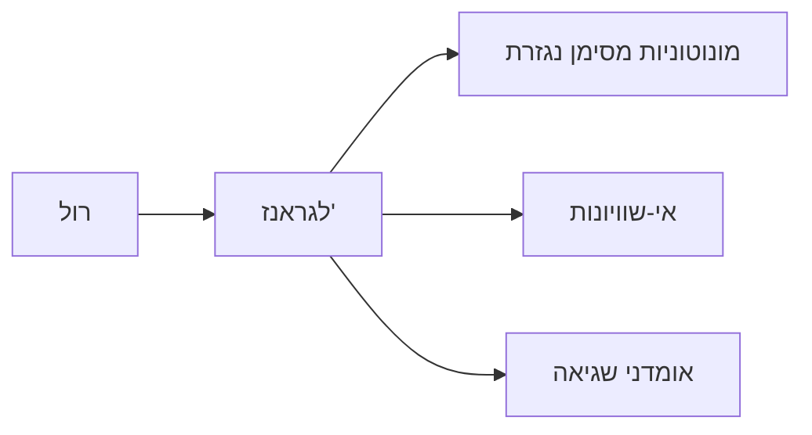

# משפט לגראנז' — משפט הערך הממוצע

> מקור: כרך ג, סעיף 8.2.2 (משפט 8.6, משפטים 8.7–8.8)

## המשפט (8.6)

אם $f$ רציפה ב-$[a,b]$ וגזירה ב-$(a,b)$, קיימת $c\in(a,b)$ שבה:
$$f'(c) = \frac{f(b)-f(a)}{b-a}$$

**איפשהו — המהירות הרגעית שווה למהירות הממוצעת.** גאומטרית: יש נקודה שבה המשיק מקביל למיתר המחבר את קצות הגרף.

<!-- infi-demo: mvt -->

> [!simple]- במילים פשוטות: המהירות הממוצעת מופיעה גם ברגע מסוים
> **בשורה אחת**: בדרך רציפה וחלקה יש נקודה פנימית שבה השיפוע הרגעי שווה לשיפוע בין הקצוות.
>
> **עם מספרים**: עבור $f(x)=x^2$ ב-$[1,3]$, שיפוע המיתר הוא $(9-1)/(3-1)=4$. הנגזרת היא $2x$, ולכן ב-$c=2$ היא שווה $4$.
>
> **בלי רציפות**: נגדיר $f(0)=0$ ו-$f(x)=1+x$ עבור $0<x\le1$. שיפוע המיתר הוא $2$, אבל הנגזרת בפנים היא $1$. **בלי גזירות**: ל-$|x|$ על $[-1,1]$ שיפוע מיתר אפס, אך הנגזרת הפנימית אינה אפס במקום שבו היא קיימת.

> [!simple]- נבנה את הרעיון צעד אחר צעד
> **המהירות הממוצעת פוגשת את הרגעית**: אם פונקציה רציפה בכל המסלול וגזירה בפנים, יש נקודה שבה הנגזרת שווה לשינוי הכולל בגובה חלקי השינוי הכולל בקלט.
>
> **דוגמה**: עבור $f(x)=x^2$ ב-$[1,3]$, השיפוע הממוצע הוא $(9-1)/(3-1)=4$. הנגזרת היא $2x$, והיא שווה ל-$4$ בנקודה הפנימית $x=2$.
>
> **טיפ**: מציינים את הקטע שעליו מפעילים את המשפט ובודקים רציפות בקצוות וגזירות בפנים. אם משווים שני ערכים, שתי נקודות הקלט צריכות להשתייך לקטע הנבחר.

> [!plan]
> מחסרים מהפונקציה את הישר המחבר את שני קצות הגרף. הפונקציה החדשה מקבלת ערכים שווים בקצוות ומקיימת את שאר תנאי רול. הנגזרת מתאפסת באיזו נקודה פנימית, ומשם מחזירים את שיפוע הישר.

## ההוכחה — הטיה + רול (ברשימת המשפטים לבחינה)

<!-- infi-proof: 8.6 -->

**שלב 1: פונקציית העזר.** נסמן $\lambda=\frac{f(b)-f(a)}{b-a}$, ונחסר מ-$f$ את הישר שעובר דרך שתי נקודות הקצה של הגרף:
$$g(x) = f(x) - \big[f(a) + \lambda(x-a)\big].$$

**שלב 2: תנאי משפט רול עבור $g$.**
- $g$ רציפה ב-$[a,b]$, כהפרש של $f$ ושל פונקציה ליניארית, ששתיהן רציפות שם.
- $g$ גזירה ב-$(a,b)$ מאותה סיבה, ו-$g'(x)=f'(x)-\lambda$.
- $g(a)=f(a)-f(a)=0$, וגם $g(b)=f(b)-f(a)-\lambda(b-a)=0$ לפי הגדרת $\lambda$.

**שלב 3: רול.** לפי [[משפט רול]] (8.5) קיימת $c\in(a,b)$ עם $g'(c)=0$, כלומר $f'(c)=\lambda=\frac{f(b)-f(a)}{b-a}$. ∎

<!-- /infi-proof -->

## המסקנות המבניות (משפטים 8.7–8.8)

- **נגזרת אפס גוררת קבועה**: אם $f'\equiv0$ בקטע, אז $f$ קבועה שם. (לגראנז' על כל תת-קטע: כל שני ערכים שווים.)
- **נגזרות שוות גוררות הפרש קבוע**: אם $f'=g'$ בקטע, אז $f=g+C$. זה הבסיס לכך שהפונקציה הקדומה יחידה עד כדי קבוע (אינפי 2).
- **סימן הנגזרת קובע מונוטוניות** (משפטים 8.17–8.18): אם $f'>0$ הפונקציה עולה, ואם $f'<0$ היא יורדת — ראו [[מונוטוניות ומיון נקודות קיצון]].

**שימו לב:** "קטע" חיוני: $f(x)=\frac{|x|}{x}$ על $(-1,0)\cup(0,1)$ — נגזרת אפס, לא קבועה (התחום לא קטע!).

> [!simple]- במילים פשוטות: נגזרת אפס מחזיקה את הגובה קבוע
> **בשורה אחת**: אם הנגזרת אפס בכל קטע, הפונקציה קבועה בו; אם לשתי פונקציות אותה נגזרת, ההפרש ביניהן קבוע.
>
> **עם מספרים**: $x^2+3$ ו-$x^2-5$ בעלות אותה נגזרת $2x$, וההפרש שלהן תמיד $8$.
>
> **למה התחום חייב להיות קטע**: $f(x)=|x|/x$ על $(-1,0)\cup(0,1)$ בעלת נגזרת אפס בכל תחומה, אבל ערכה $-1$ בענף אחד ו-$1$ בשני. אי־אפשר להפעיל את לגראנז׳ על פני החור ב-$0$.
>
> הרעיון: אם שני ערכים היו שונים, שיפוע המיתר ביניהם היה שונה מאפס, ולגראנז׳ היה מוצא נגזרת לא־אפסית ביניהם.

## שימוש: הוכחת אי-שוויונות

לגראנז' חוסם את השינוי של פונקציה דרך חסם על הנגזרת: אם $m \le f' \le M$ בקטע אז
$$m(b-a) \le f(b)-f(a) \le M(b-a)$$
דוגמאות: $|\sin b - \sin a| \le |b-a|$ (כי $|\cos|\le1$); $\frac{x}{1+x} < \ln(1+x) < x$ עבור $x>0$.
פונקציה המקיימת $|f(x)-f(y)|\le K|x-y|$ לכל $x,y$ נקראת ליפשיצית. לפי לגראנז', כל פונקציה גזירה בקטע עם $|f'|\le K$ היא כזו, והיא בפרט [[רציפות במידה שווה ומשפט קנטור|רציפה במידה שווה]].

## סדנת אי-שוויונות: שתי שיטות שחוזרות במבחן

אי-שוויונות הם סוג השאלה הנפוץ ביותר ביחידות 7–8: בכ-40 שאלות במבחנים מבקשים להוכיח אי-שוויון, או להכריע אם הוא נכון. כמעט תמיד מספיקה אחת משתי שיטות.

> [!exam] במבחן
> שאלות לדוגמה: [2019ב·91, שאלה 8](#/exams/3/q8) (בדיוק אי-השוויון הראשון כאן), [2020א·85, שאלה 4](#/exams/5/q4), [2021ב·86, שאלה 8](#/exams/13/q8), [2021א·83, שאלה 7](#/exams/9/q7), [2019ב·82, שאלה 4](#/exams/1/q4).

### שיטה 1: לגראנז' על קטע

**מתי**: באי-השוויון מופיע הפרש $f(b)-f(a)$, או ביטוי שאפשר לכתוב כהפרש כזה (למשל $\ln(1+x)=\ln(1+x)-\ln 1$).

**שלושה צעדים**: (1) לזהות את $f$ ואת הקטע. (2) לכתוב $f(b)-f(a)=f'(c)(b-a)$ עבור $c$ בין $a$ ל-$b$. (3) לחסום את $f'(c)$ מלמעלה ומלמטה בעזרת $a<c<b$.

**דוגמה א**: $\dfrac{x}{1+x}<\ln(1+x)<x$ לכל $x>0$.

> [!plan]
> מפעילים לגראנז' על $\ln(1+t)$ בקטע $[0,x]$. הנגזרת $\frac1{1+c}$ נמצאת בין $\frac1{1+x}$ ל-$1$, ומכפילים ב-$x$.

הפונקציה $f(t)=\ln(1+t)$ רציפה ב-$[0,x]$ וגזירה ב-$(0,x)$, ולכן קיים $c\in(0,x)$ עם
$$\ln(1+x)-\ln1=\frac{1}{1+c}\cdot x.$$
מ-$0<c<x$ נובע $1<1+c<1+x$, ולכן $\frac1{1+x}<\frac1{1+c}<1$. כופלים ב-$x>0$ ומקבלים $\frac{x}{1+x}<\ln(1+x)<x$. ∎

**דוגמה ב**: $|\arctan b-\arctan a|\le|b-a|$ לכל $a,b$. לפי לגראנז' $\arctan b-\arctan a=\frac{1}{1+c^2}(b-a)$, ו-$0<\frac1{1+c^2}\le1$. באותו אופן $|\tan b-\tan a|\ge|b-a|$ בקטע $(-\frac\pi2,\frac\pi2)$, כי שם $(\tan)'=\frac{1}{\cos^2c}\ge1$.

**דוגמה ג**: לכל $0<a<b$ ו-$n\ge2$ טבעי: $na^{n-1}(b-a)<b^n-a^n<nb^{n-1}(b-a)$. לפי לגראנז' על $t^n$: $b^n-a^n=nc^{n-1}(b-a)$, ומ-$a<c<b$ נובע $a^{n-1}<c^{n-1}<b^{n-1}$.

**דוגמה ד (הכרעה)**: האם $\ln(1+x^2)<x^2+x$ לכל $x>0$? כן: לפי דוגמה א עם $t=x^2>0$ מתקיים $\ln(1+x^2)<x^2$, ו-$x^2<x^2+x$.

### שיטה 2: מונוטוניות של פונקציית הפרש

**מתי**: רוצים $f(x)>g(x)$ בקטע, ויש נקודה שבה ידוע שוויון (בדרך כלל בקצה).

**שלושה צעדים**: (1) $h=f-g$. (2) מחשבים את $h$ בנקודת ההתחלה. (3) מראים ש-$h'>0$ (או $<0$) ומסיקים מ[[מונוטוניות ומיון נקודות קיצון|משפט 8.18]].

**דוגמה ה**: $\arcsin x>x+\frac{x^3}{6}$ לכל $0<x<1$ (נשאל לפחות שלוש פעמים).

> [!plan]
> פונקציית ההפרש מתאפסת ב-$0$. מראים שהנגזרת שלה חיובית, כך שהיא עולה וחיובית אחרי $0$. החלק היחיד שדורש עבודה הוא אי-שוויון אלגברי על הנגזרת.

נגדיר $h(x)=\arcsin x-x-\frac{x^3}{6}$ ב-$[0,1)$. אז $h(0)=0$ ו-$h'(x)=\frac{1}{\sqrt{1-x^2}}-1-\frac{x^2}{2}$. נסמן $u=x^2\in(0,1)$. צריך להראות $\frac1{\sqrt{1-u}}>1+\frac u2$, כלומר (שני האגפים חיוביים, מעלים בריבוע והופכים) $(1+\frac u2)^2(1-u)<1$. נפתח:
$$\left(1+u+\tfrac{u^2}{4}\right)(1-u)=1-\tfrac34u^2-\tfrac14u^3<1.$$
לכן $h'>0$ ב-$(0,1)$, $h$ רציפה ב-$[0,x]$, ולפי 8.18 היא עולה ממש. מכאן $h(x)>h(0)=0$. ∎

**דוגמה ו**: $\cos x>1-\frac{2x}{\pi}$ לכל $0<x<\frac\pi2$.

נגדיר $h(x)=\cos x-1+\frac{2x}{\pi}$. אז $h(0)=h(\frac\pi2)=0$, ו-$h'(x)=\frac2\pi-\sin x$. הנגזרת יורדת ממש ב-$[0,\frac\pi2]$, חיובית ב-$0$ ושלילית ב-$\frac\pi2$, ולכן מתאפסת בנקודה אחת $x_1$. לכן $h$ עולה ב-$[0,x_1]$ ויורדת ב-$[x_1,\frac\pi2]$. בקטע הראשון $h(x)>h(0)=0$, ובשני $h(x)>h(\frac\pi2)=0$. ∎

> [!simple]- במילים פשוטות: איך בוחרים שיטה
> **יש הפרש של ערכי פונקציה, או שני משתנים $a,b$?** לגראנז'.
>
> **יש משתנה אחד ונקודה שבה שני האגפים שווים?** פונקציית הפרש ומונוטוניות.
>
> בשתי השיטות העבודה האמיתית היא רק חסימה של נגזרת. מי שיודע לגזור ולהשוות שברים, יודע לפתור את רוב השאלות האלה.

## כרטיס דיוק

- **רעיון-על**: שיפוע מיתר על קטע מופיע כשיפוע משיק בנקודה פנימית.
- **מתי מפעילים**: באומדנים, הוכחת מונוטוניות, אי-שוויונות, ושליטה בהפרשי ערכים.
- **בדיקה עצמית**: הוכיחו $|\sin b-\sin a|\le |b-a|$ בעזרת לגראנז'.
- **מלכודת**: הנקודה $c$ מובטחת קיימת אבל בדרך כלל לא יודעים לחשב אותה במפורש.
- **קישור רוחב**: ראו גם [[מפת תלות משפטים - אינפי 1]], [[תבניות הוכחה באינפי 1]], [[אינדקס דוגמאות נגד - אינפי 1]].

> [!solution]- פתרון הבדיקה העצמית
> אם $a=b$ יש שוויון. אחרת נפעיל את לגראנז׳ על הקטע הסגור שקצותיו $a,b$: הסינוס רציפה וגזירה, ולכן קיים $c$ בין הקצוות עם $\sin b-\sin a=\cos c(b-a)$. מכיוון ש-$|\cos c|\le1$ נקבל $|\sin b-\sin a|\le|b-a|$.

## תרשים תלות

## קשרים

- [[משפט רול]] — המקרה הפרטי וגם מנוע ההוכחה
- [[משפט קושי]] — ההכללה לשתי פונקציות
- [[מונוטוניות ומיון נקודות קיצון]] — המסקנה החשובה ביותר
- [[קמירות ונקודות פיתול]] — למת המיתרים מוכחת בלגראנז'
