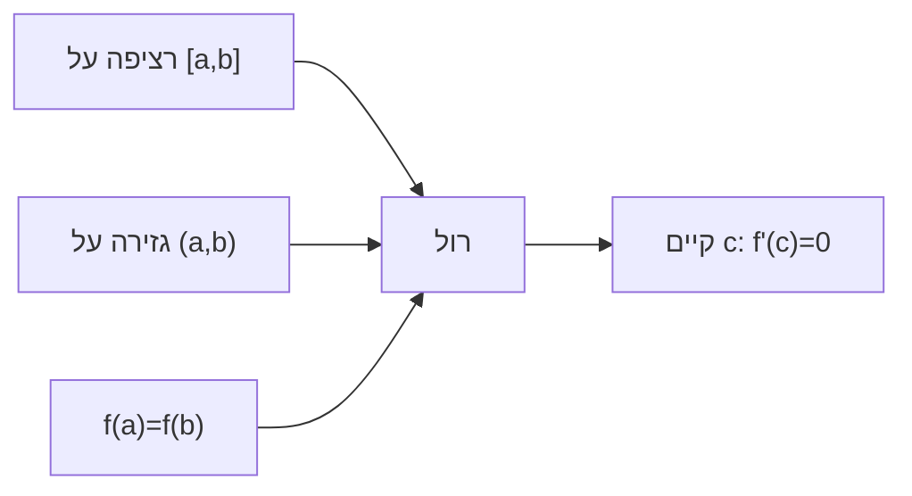

# משפט רול (Rolle)

> מקור: כרך ג, סעיף 8.2.1 (משפט 8.5)

**מה חשוב כאן**: שלושת התנאים של המשפט ומה קורה כשאחד מהם חסר, ההוכחה (ברשימת המשפטים לבחינה), והשימוש לספירת שורשים, שחוזר הרבה במבחנים. את הדוגמאות המתקדמות ($e^x=3x$, $\tan x=x$) אפשר להשאיר לקריאה שנייה.

## המשפט (8.5)

תהי $f$:
1. **רציפה** בקטע הסגור $[a,b]$
2. **גזירה** בקטע הפתוח $(a,b)$
3. $f(a) = f(b)$

אז קיימת נקודה $c \in (a,b)$ שבה:
$$f'(c) = 0$$

**בציור**: גרף שמתחיל ומסתיים באותו גובה, בלי קפיצות ובלי פינות, עובר בנקודה שבה המשיק אופקי. **דוגמה מהחיים**: כדור שנזרק כלפי מעלה וחוזר לאותו גובה. ברגע השיא המהירות האנכית שלו היא אפס.

> [!simple]- במילים פשוטות: חוזרים לאותו גובה
> **בשורה אחת**: בדרך חלקה שמתחילה ומסתיימת באותו גובה יש לפחות נקודה פנימית עם שיפוע אפס.
>
> **תמונה בראש**: מטייל יוצא וחוזר לאותו גובה; אם עלה או ירד בדרך, הוא מגיע לנקודת מפנה פנימית.
>
> **עם מספרים**: ל-$f(x)=x(1-x)$ על $[0,1]$ שני ערכי הקצה אפס, ו-$f'(1/2)=1-2\cdot(1/2)=0$.
>
> **בלי רציפות**: $f(0)=f(1)=0$ ו-$f(x)=x$ בפנים אינה רציפה ב-$1$, ואין נגזרת אפס בפנים. **בלי גזירות**: $f(x)=|x|$ על $[-1,1]$ יוצרת פינה ב-$0$. **בלי שוויון קצוות**: $f(x)=x$ על $[0,1]$ בעלת נגזרת $1$ בכל נקודה פנימית.

> [!simple]- נבנה את הרעיון צעד אחר צעד
> **מסלול שחוזר לאותו גובה**: אם מסלול רציף יוצא מנקודה ומגיע לאותו גובה, וחלק בכל פנים הדרך, יש בדרך נקודה פנימית שבה השיפוע אפס. גם מסלול שטוח לגמרי מתאים: אז השיפוע אפס בכל נקודה פנימית.
>
> **דוגמה**: $f(x)=x(2-x)$ על $[0,2]$ מקיימת $f(0)=f(2)=0$. הנגזרת היא $2-2x$, והיא מתאפסת ב-$x=1$.
>
> **טיפ**: ביישום בבחינה מפרטים רציפות בכל הקטע הסגור, גזירות בפנים ושוויון ערכי הקצוות. הנקודה שמתקבלת נמצאת בפנים; המשפט אינו מזהה אותה מראש.

> [!exam] במבחן
> משפט רול התבקש להוכחה ב־2 שאלות במאגר: [2024ב·85, שאלה 1](#/exams/32/q1), [2026ג·83, שאלה 6](#/exams/45/q6). מתחילים בויירשטראס ולאחריו מפעילים פרמה בנקודה פנימית.

> [!plan]
> ויירשטראס נותן מקסימום ומינימום בקטע. אם הם שווים הפונקציה קבועה; אחרת לפחות אחד הקיצונים מושג בפנים, כי בשני הקצוות אותו ערך. פרמה נותן שם נגזרת אפס.

## ההוכחה — שרשרת של שלושה משפטים (ברשימת המשפטים לבחינה)

<!-- infi-proof: 8.5 -->

1. **ויירשטראס.** $f$ רציפה בקטע הסגור $[a,b]$, ולכן לפי [[משפטי ויירשטראס|המשפט השני של ויירשטראס]] (5.37) היא מקבלת בו מקסימום ומינימום. נסמן $M=\max f([a,b])$ ו-$m=\min f([a,b])$.
2. **המקרה $M=m$.** לכל $x\in[a,b]$ מתקיים $m\le f(x)\le M=m$, ולכן $f$ קבועה בקטע ו-$f'(x)=0$ לכל $x\in(a,b)$. בפרט אפשר לקחת $c=\frac{a+b}{2}$.
3. **המקרה $M>m$.** לא ייתכן שגם $M$ וגם $m$ שווים ל-$f(a)=f(b)$, כי אז $M=m$. נניח בלי הגבלת הכלליות ש-$M\ne f(a)$ (המקרה $m\ne f(a)$ דומה). תהי $c\in[a,b]$ נקודה עם $f(c)=M$. מכיוון ש-$f(a)=f(b)\ne M$, מתקיים $c\ne a$ ו-$c\ne b$, כלומר $c\in(a,b)$.
4. **פרמה.** $c$ נקודת מקסימום של $f$ בקטע והיא פנימית, ולכן לפי טענה 8.3 היא נקודת קיצון (מקומי) של $f$. $f$ גזירה ב-$c$ כי $c\in(a,b)$. לפי [[נקודות קיצון ומשפט פרמה|משפט פרמה]] (8.4) מתקיים $f'(c)=0$. ∎

<!-- /infi-proof -->

## דיוק התנאים

- הגזירות נדרשת רק **בקטע הפתוח**. לפונקציה $f(x)=\sqrt{1-x^2}$ על $[-1,1]$ אין נגזרת בקצוות, ובכל זאת המשפט חל עליה: $f(-1)=f(1)=0$, ואכן $f'(0)=0$.
- אי אפשר לוותר על אף אחד משלושת התנאים:
  - **בלי גזירות בפנים**: $|x|$ על $[-1,1]$ רציפה, והערכים בקצוות שווים. אבל הנגזרת היא $-1$ משמאל לאפס ו-$1$ מימין לו, ובאפס אינה קיימת. אין נקודה שבה היא מתאפסת.
  - **בלי רציפות בקצה**: $f(x)=x$ עבור $0\le x<1$, ו-$f(1)=0$. כאן $f(0)=f(1)$ ו-$f$ גזירה ב-$(0,1)$, אבל $f'(x)=1$ בכל הקטע הפתוח.
  - **בלי שוויון בקצוות**: $f(x)=x$ על $[0,1]$. הנגזרת היא $1$ בכל נקודה.

## שימוש אופייני: ספירת שורשים

**בין כל שני שורשים של $f$ יש שורש של $f'$.** הסיבה: בשני השורשים ערך הפונקציה הוא $0$, כלומר אותו גובה, ולכן אפשר להפעיל את רול על הקטע שביניהם (בתנאי ש-$f$ רציפה בו וגזירה בפנימו).

מכאן נובע: אם ל-$f'$ אין שורשים בקטע, אז ל-$f$ יש שם לכל היותר שורש אחד. יחד עם [[משפט ערך הביניים]], שנותן קיום, מקבלים הוכחות מהסוג "קיים ויחיד". למשל עבור $x^3+3x-1=0$: משפט ערך הביניים נותן שורש, והעובדה ש-$f'(x)=3x^2+3>0$ שוללת שורש שני.

### דוגמה לספירת שורשים

למשוואה $x^3+3x-1=0$ יש שורש אחד בדיוק. הפולינום רציף וערכיו ב-$0$ וב-$1$ הם $-1$ ו-$3$, ולכן יש שורש ביניהם לפי ערך הביניים. אילו היו שני שורשים שונים, רול היה נותן נקודה ביניהם שבה $f'(x)=0$. אבל $f'(x)=3x^2+3>0$ לכל $x$, סתירה. לכן השורש יחיד בכל הישר.

### ספירת שורשים: שלושה כלים שעובדים יחד

1. **קיום** (כמה שורשים לפחות): [[משפט ערך הביניים]]. מוצאים נקודות שבהן הסימן מתחלף, או משתמשים בגבולות ב-$\pm\infty$.
2. **חסם עליון** (כמה לכל היותר): רול. בין כל שני שורשים של $f$ יש שורש של $f'$. לכן אם ל-$f'$ יש לכל היותר $k$ שורשים, ל-$f$ יש לכל היותר $k+1$. ובאופן כללי: **אם $f^{(k)}$ לא מתאפסת בקטע, ל-$f$ יש שם לכל היותר $k$ שורשים.**
3. **בכל קטע בדיוק אחד**: מונוטוניות ממש בכל קטע.

> [!exam] במבחן
> שאלה אמריקאית שחוזרת כמעט מילה במילה: "ל-$f$ יש $n$ אפסים; כמה אפסים יש בהכרח ל-$f'$ ול-$f''$?" ([2020א·85, שאלה 9](#/exams/5/q9), [2021א·83, שאלה 8](#/exams/9/q8), [2022א·97, שאלה 9](#/exams/18/q9)). התשובה לפי רול: לפחות $n-1$ ל-$f'$, ולפחות $n-2$ ל-$f''$ (בהנחה שהפונקציה גזירה מספיק פעמים בקטע). ושאלות "אינסוף פתרונות": [2020ג·89, שאלה 2](#/exams/6/q2), [2023א·94, שאלה 2](#/exams/26/q2).

**דוגמה: בדיוק שני פתרונות.** למשוואה $e^x=3x$ יש בדיוק שני פתרונות.

> [!plan]
> הנגזרת השנייה חיובית תמיד, ולכן (רול פעמיים) יש לכל היותר שני פתרונות. שלושה ערכים עם החלפות סימן נותנים שניים לפחות.

נגדיר $f(x)=e^x-3x$. אז $f''(x)=e^x>0$ לכל $x$, ולכן ל-$f''$ אין שורשים. לפי רול, ל-$f'$ יש לכל היותר שורש אחד, ול-$f$ יש לכל היותר שניים. מצד שני $f(0)=1>0$, $f(1)=e-3<0$ ו-$f(2)=e^2-6>0$, ולפי ערך הביניים יש שורש ב-$(0,1)$ ושורש ב-$(1,2)$. לכן יש בדיוק שניים. ∎

**דוגמה: אינסוף פתרונות.** למשוואה $\tan x=x$ יש אינסוף פתרונות חיוביים, אחד בדיוק בכל קטע $I_k=(k\pi-\frac\pi2,\,k\pi+\frac\pi2)$, $k\ge1$.

נגדיר $h(x)=\tan x-x$ ב-$I_k$. היא רציפה שם, $h(x)\to-\infty$ כש-$x$ שואף לקצה השמאלי ו-$h(x)\to+\infty$ כש-$x$ שואף לקצה הימני. לכן יש נקודות $s<t$ ב-$I_k$ עם $h(s)<0<h(t)$, ולפי ערך הביניים יש שורש ביניהן. בנוסף $h'(x)=\frac1{\cos^2x}-1=\tan^2x\ge0$, והיא מתאפסת רק בנקודה בודדת ($x=k\pi$), ולכן $h$ עולה ממש ב-$I_k$ ([[מסקנות משאלות הספר - אינפי 1|שאלה 29 ביחידה 8]]) והשורש יחיד. הקטעים זרים, ולכן יש אינסוף פתרונות. ∎

## תפקיד מבני

רול הוא המקרה שבו המיתר בין קצות הגרף אופקי, וממנו נובעים שני המשפטים הבאים. כשמחסרים מהפונקציה ישר מתאים מקבלים את [[משפט לגראנז]]. כשמחסרים כפולה מתאימה של פונקציה שנייה מקבלים את [[משפט קושי]].

## נסו בעצמכם: השלימו את החסר

**טענה**: למשוואה $x^5+x-1=0$ יש פתרון ממשי אחד בדיוק.

נסמן $f(x)=x^5+x-1$.

**קיום**: $f$ רציפה, $f(0)=\underline{\quad?\quad}$ ו-$f(1)=\underline{\quad?\quad}$. הסימנים הפוכים, ולכן לפי $\underline{\quad?\quad}$ יש שורש ב-$(0,1)$.

**יחידות**: נניח בשלילה שיש שני שורשים $x_1<x_2$. אז $f(x_1)=f(x_2)=0$, ולפי $\underline{\quad?\quad}$ קיימת $c\in(x_1,x_2)$ עם $f'(c)=0$. אבל $f'(x)=\underline{\quad?\quad}$, וזה סותר כי $\underline{\quad?\quad}$.

> [!hint]- רמז
> חזקה זוגית של מספר ממשי אינה שלילית. מה זה אומר על $5x^4+1$?

> [!solution]- פתרון
> **קיום**: $f(0)=-1<0$ ו-$f(1)=1>0$. לפי [[משפט ערך הביניים]] יש שורש ב-$(0,1)$.
>
> **יחידות**: אילו היו שני שורשים $x_1<x_2$, משפט רול על $[x_1,x_2]$ היה נותן $c$ עם $f'(c)=0$ (פולינום רציף וגזיר בכל מקום, והערכים בקצוות שווים). אבל $f'(x)=5x^4+1\ge1>0$ לכל $x$, ולכן הנגזרת אינה מתאפסת באף נקודה. סתירה. ∎
>
> שימו לב לחלוקת התפקידים: משפט ערך הביניים אומר "לפחות אחד", ורול אומר "לכל היותר אחד".

## כרטיס דיוק

- **רעיון-על**: אם פונקציה חוזרת לאותו גובה בקצוות, חייבת להיות נקודה עם שיפוע אפס.
- **מתי מפעילים**: בהוכחת לגראנז', ספירת שורשים, והוכחת קיום נקודת נגזרת אפס.
- **בדיקה עצמית**: הראו שאם לפולינום יש שני שורשים שונים אז לנגזרת יש שורש ביניהם.
- **מלכודת**: כל תנאי חשוב: רציפות על סגור, גזירות בפנים, ושוויון ערכים בקצוות.
- **קישור רוחב**: ראו גם [[מפת תלות משפטים - אינפי 1]], [[תבניות הוכחה באינפי 1]], [[אינדקס דוגמאות נגד - אינפי 1]].

> [!solution]- פתרון הבדיקה העצמית
> יהי פולינום $p$ עם שורשים שונים $a<b$. פולינום רציף על $[a,b]$ וגזיר ב-$(a,b)$, ומתקיים $p(a)=p(b)=0$. לפי רול קיים $c\in(a,b)$ עם $p'(c)=0$. לכן לנגזרת יש שורש בין השורשים הנתונים.

## תרשים תנאים

## קשרים

- [[משפטי ויירשטראס]] + [[נקודות קיצון ומשפט פרמה]] — לבני ההוכחה
- [[משפט לגראנז]] — ההכללה המיידית
- [[משפט קושי]] — הכללה נוספת
