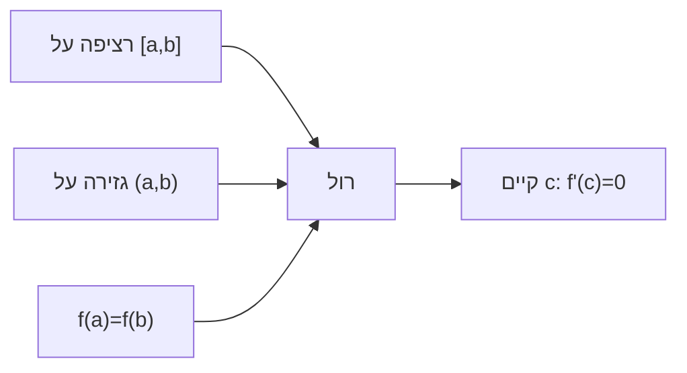

# משפט רול (Rolle)

> מקור: כרך ג, סעיף 8.2.1 (משפט 8.5)

## המשפט (8.5)

תהי $f$:
1. **רציפה** בקטע הסגור $[a,b]$
2. **גזירה** בקטע הפתוח $(a,b)$
3. $f(a) = f(b)$

אז קיימת נקודה $c \in (a,b)$ שבה:
$$f'(c) = 0$$

גאומטרית: גרף שמתחיל ומסיים באותו גובה — חייב איפשהו משיק אופקי. פיזיקלית: כדור שנזרק וחוזר לאותו גובה — היה רגע שמהירותו האנכית אפס.

> [!simple]- במילים פשוטות: חוזרים לאותו גובה
> **בשורה אחת**: בדרך חלקה שמתחילה ומסתיימת באותו גובה יש לפחות נקודה פנימית עם שיפוע אפס.
>
> **תמונה בראש**: מטייל יוצא וחוזר לאותו גובה; אם עלה או ירד בדרך, הוא מגיע לנקודת מפנה פנימית.
>
> **עם מספרים**: ל-$f(x)=x(1-x)$ על $[0,1]$ שני ערכי הקצה אפס, ו-$f'(1/2)=1-2\cdot(1/2)=0$.
>
> **בלי רציפות**: $f(0)=f(1)=0$ ו-$f(x)=x$ בפנים אינה רציפה ב-$1$, ואין נגזרת אפס בפנים. **בלי גזירות**: $f(x)=|x|$ על $[-1,1]$ יוצרת פינה ב-$0$. **בלי שוויון קצוות**: $f(x)=x$ על $[0,1]$ בעלת נגזרת $1$ בכל נקודה פנימית.

> [!exam] במבחן
> משפט רול התבקש להוכחה ב־2 שאלות במאגר: [2024ב·85, שאלה 1](#/exams/32/q1), [2026ג·83, שאלה 6](#/exams/45/q6). מתחילים בויירשטראס ולאחריו מפעילים פרמה בנקודה פנימית.

> [!plan]
> ויירשטראס נותן מקסימום ומינימום בקטע. אם הם שווים הפונקציה קבועה; אחרת לפחות אחד הקיצונים מושג בפנים, כי בשני הקצוות אותו ערך. פרמה נותן שם נגזרת אפס.

## ההוכחה — שרשרת של שלושה משפטים (ברשימת המשפטים לבחינה)

<!-- infi-proof: 8.5 -->

1. **ויירשטראס.** $f$ רציפה בקטע הסגור $[a,b]$, ולכן לפי [[משפטי ויירשטראס|המשפט השני של ויירשטראס]] (5.37) היא מקבלת בו מקסימום ומינימום. נסמן $M=\max f([a,b])$ ו-$m=\min f([a,b])$.
2. **המקרה $M=m$.** לכל $x\in[a,b]$ מתקיים $m\le f(x)\le M=m$, ולכן $f$ קבועה בקטע ו-$f'(x)=0$ לכל $x\in(a,b)$. בפרט אפשר לקחת $c=\frac{a+b}{2}$.
3. **המקרה $M>m$.** לא ייתכן שגם $M$ וגם $m$ שווים ל-$f(a)=f(b)$, כי אז $M=m$. נניח בלי הגבלת הכלליות ש-$M\ne f(a)$ (המקרה $m\ne f(a)$ דומה). תהי $c\in[a,b]$ נקודה עם $f(c)=M$. מכיוון ש-$f(a)=f(b)\ne M$, מתקיים $c\ne a$ ו-$c\ne b$, כלומר $c\in(a,b)$.
4. **פרמה.** $c$ נקודת מקסימום של $f$ בקטע והיא פנימית, ולכן לפי טענה 8.3 היא נקודת קיצון (מקומי) של $f$. $f$ גזירה ב-$c$ כי $c\in(a,b)$. לפי [[נקודות קיצון ומשפט פרמה|משפט פרמה]] (8.4) מתקיים $f'(c)=0$. ∎

<!-- /infi-proof -->

## דיוק התנאים

- גזירות נדרשת רק **בפתוח**: $f(x)=\sqrt{1-x^2}$ על $[-1,1]$ — אין נגזרת בקצוות, רול עדיין עובד.
- כל תנאי הכרחי: $|x|$ על $[-1,1]$ (נכשלת גזירות בפנים — אין $c$); $f(x)=x-\lfloor x\rfloor$ עם אי-רציפות בקצה — אין $c$.

## שימוש אופייני: ספירת שורשים

**בין כל שני שורשים של $f$ יש שורש של $f'$.** מכאן: אם ל-$f'$ אין שורשים בקטע — ל-$f$ יש שם לכל היותר שורש אחד. משולב עם [[משפט ערך הביניים]] (שנותן קיום), מקבלים הוכחות "קיים ויחיד": למשל $x^3+3x-1=0$ — ערך ביניים נותן שורש, $f'=3x^2+3>0$ שולל שניים.

### דוגמה לספירת שורשים

למשוואה $x^3+3x-1=0$ יש שורש אחד בדיוק. הפולינום רציף וערכיו ב-$0$ וב-$1$ הם $-1$ ו-$3$, ולכן יש שורש ביניהם לפי ערך הביניים. אילו היו שני שורשים שונים, רול היה נותן נקודה ביניהם שבה $f'(x)=0$. אבל $f'(x)=3x^2+3>0$ לכל $x$, סתירה. לכן השורש יחיד בכל הישר.

## תפקיד מבני

רול הוא "המקרה השטוח" שממנו נובע הכול: הטיית הגרף (חיסור ישר) הופכת אותו ל[[משפט לגראנז]]; הטיה מתוחכמת יותר — ל[[משפט קושי]].

## כרטיס דיוק

- **רעיון-על**: אם פונקציה חוזרת לאותו גובה בקצוות, חייבת להיות נקודה עם שיפוע אפס.
- **מתי מפעילים**: בהוכחת לגראנז', ספירת שורשים, והוכחת קיום נקודת נגזרת אפס.
- **בדיקה עצמית**: הראו שאם לפולינום יש שני שורשים שונים אז לנגזרת יש שורש ביניהם.
- **מלכודת**: כל תנאי חשוב: רציפות על סגור, גזירות בפנים, ושוויון ערכים בקצוות.
- **קישור רוחב**: ראו גם [[מפת תלות משפטים - אינפי 1]], [[תבניות הוכחה באינפי 1]], [[אינדקס דוגמאות נגד - אינפי 1]].

> [!solution]- פתרון הבדיקה העצמית
> יהי פולינום $p$ עם שורשים שונים $a<b$. פולינום רציף על $[a,b]$ וגזיר ב-$(a,b)$, ומתקיים $p(a)=p(b)=0$. לפי רול קיים $c\in(a,b)$ עם $p'(c)=0$. לכן לנגזרת יש שורש בין השורשים הנתונים.

## תרשים תנאים

## קשרים

- [[משפטי ויירשטראס]] + [[נקודות קיצון ומשפט פרמה]] — לבני ההוכחה
- [[משפט לגראנז]] — ההכללה המיידית
- [[משפט קושי]] — הכללה נוספת
